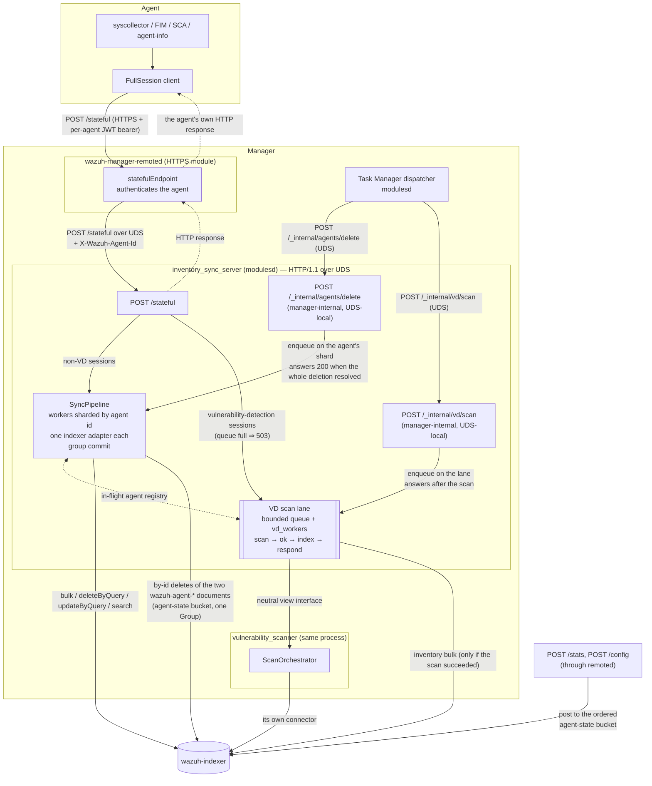
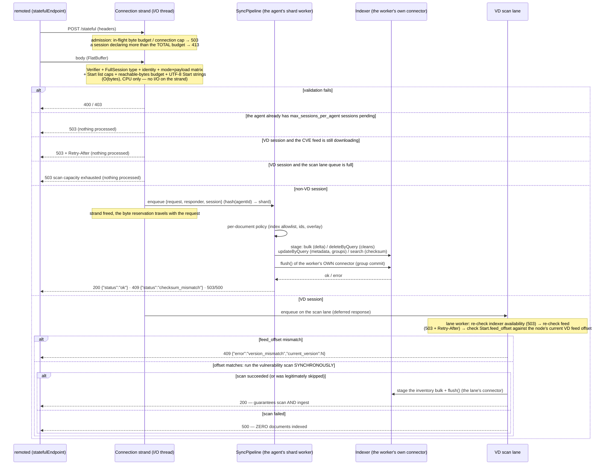
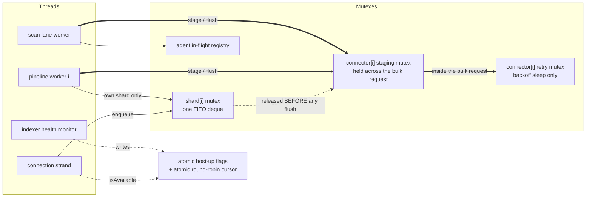
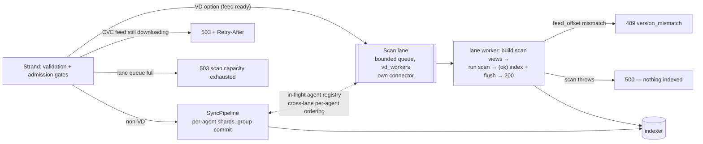

# Inventory Sync Server Architecture

## Overview

The module is a C++ shared library (`libinventory_sync_server.so`) loaded by
`wazuh-manager-modulesd` through a small C shim. It is the manager-side half of agent state
synchronization: a whole synchronization session travels as ONE FlatBuffers
`Message{FullSession}` request, and the HTTP response IS the session result — there are no acks,
no retransmission protocol, and no persistent session state.

Every hop is HTTP/1.1. Remoted relays only the agent-facing routes (`POST /stateful`, `POST /stats`,
`POST /config`); the two `_internal` routes are manager-internal and UDS-local — remoted has no
downstream route to them, by design. `/stats` and `/config` index one document per agent: the handler
`post`s it to the `agent-state` bucket of the module's `indexer_client` `Client`, an **ordered** bucket
(operations on the same document id are never in flight together, and the per-agent order is the order
of arrival). Neither this module nor the vulnerability scanner links the previous v1 connector library
(see the [Indexer Client](../indexer_client/README.md)); it holds one `Client` with two buckets, `inventory` for the
ingestion pipeline and the VD lane and `agent-state` for `/stats`, `/config` and the by-id deletes.

`/stats` and `/config` answer `200` when the bucket **accepted** the report (it is then buffered and
retried until it resolves; the bucket's quota bounds it) and `503` when it did not: no usable indexer
host, the `agent-state` quota full, or the module stopping. Before 5.x a report the queue could not
take was acknowledged with `200` and silently lost; the agent now sees the `503` and re-sends its next
report.

## The request pipeline

The handler runs only the CPU-bound part on the connection's I/O strand — FlatBuffers
verification, identity, shape — and defers everything that touches the indexer to a worker,
answering later through the retained responder. That is what keeps the transport responsive
while sessions of arbitrary size are being applied.

What runs where, and what it can block:

| Stage | Thread | I/O | Bound |
|---|---|---|---|
| Admission + HTTP parse | connection strand | no | O(headers) |
| FlatBuffers verify + identity + shape | strand | no | O(body bytes), CPU only |
| Enqueue to a shard / the lane | strand | no | O(1); a full queue answers `503` immediately (explicit backpressure). The cap is `sync_queue_bytes` (64 MiB default), one GLOBAL byte counter across every shard — not per shard |
| Per-document policy + staging | shard worker | no | O(documents) |
| bulk/deleteByQuery/updateByQuery/search + flush | shard worker | yes | dominated by the indexer; only delays the agents of THAT shard |
| Scan + index + respond (VD sessions) | scan lane worker | yes | dominated by the scanner; only delays the lane, never the pipeline or the transport |

## The sync pipeline

`SyncPipeline` (`src/wazuh_modules/inventory_sync_server/src/sync/`) owns N workers, each with its own private indexer adapter over the `Client`. A
session lands on `hash(agentId) % N`, which makes **per-agent ordering a property of the
topology** instead of a lock: two requests of the same agent — a cleans and the delta that
re-populates it, a delta and its checksum — are applied in arrival order because they traverse
the same FIFO. The private connector removes any cross-worker synchronization from the hot path.

Sessions divide into two scheduling kinds:

- **Bulk sessions** (delta data) only STAGE documents into the worker's connector; their
  durability — and their response — arrives with the batch flush. Workers **group-commit**: the
  flush happens when the staged bytes reach the flush threshold or the shard's queue drains, and
  only then is the whole batch answered `200`. Under low load the queue is empty after every
  session (flush-per-request latency); under a burst of small sessions the bulks grow on their
  own and the indexer sees a few large requests instead of a thousand tiny ones.
- **Immediate sessions** (cleans, checksum verification, metadata and group reconciliation, and
  whole-agent deletions) execute their own I/O and respond by themselves. Before running one, the
  worker **cuts the open batch** — flushes and answers it — because an immediate session's
  effects (deletes, a checksum read) must not overtake bulk writes of an EARLIER session of the
  same agent.

The `200` contract is strict on purpose: it is only sent after the sessions' operations were
confirmed by the indexer, so "the agent saw 200" always means "the indexer accepted the data".
Each session of a group commit is answered for **its own** operations: a failure in one session
does not fail the healthy sessions batched with it. The status of a failed session is decided by
the cause of the failure alone (the indexer's availability is not queried again afterwards), see
[Failure causes and HTTP answers](#failure-causes-and-http-answers). Re-applying a session is
idempotent (deterministic document ids, versioned upserts), which is what makes "just re-POST it"
the whole recovery story.

### Failure causes and HTTP answers

| Cause (`indexer_client`) | Answer to the agent | Failure metric |
|---|---|---|
| `Unavailable`, `Throttled`, `QueueFull`, `SubmitTimeout`, `RetryExhausted`, `Transport*`, `Server5xx`, `Shutdown`, `ClientClosed`, `Cancelled`, `WaitTimeout` | `503` | `unavailable`; `exhausted` for `RetryExhausted` |
| `VersionConflict` of a by-query (allowance exhausted) | `503` + `{"reason":"version_conflicts"}` + `Retry-After`; also counts `sync.indexer.conflict.exhausted` | `documents` |
| `ItemPermanent`, `Client4xx`, `PayloadTooLarge`, `GroupTooLarge`, `Ambiguous` and any other cause | `500` | `documents` for the first four, `other` for the rest |

A session whose operations failed with several classes is answered with the transient one (`503`).
The metric suffix is the `sync.bulk.flush.failures.<suffix>` counter ([catalog](metrics.md#group-commit--syncbulk)),
now counted per failed session.

Because each worker owns its connector outright, all cross-thread contention in the ingestion
path funnels into one mutex per connector with a single legitimate owner. Two ordering rules keep
it acyclic, and both are enforced by scoping rather than by convention: the shard lock is always
released before any flush (it lives in its own block inside the worker loop), and the connector's
retry mutex — which exists only so the backoff can sleep without self-deadlocking on the staging
mutex — is only ever taken from inside the staging one.

The availability verdict behind the `503` admission gate is read lock-free, so a worker blocked on
the indexer never delays the strand that is deciding whether to admit the next session.

## The vulnerability-detection scan lane

Sessions whose `Start.option` is `VDFirst` or `VDSync` carry data the vulnerability scanner must
evaluate. They run through a dedicated lane so that the scan can GATE the response: a `200` for a
VD session guarantees the scan ran (unless this node runs no scanner — see the table below) AND the
inventory was flushed; a failed scan answers `500` with **nothing indexed**.

The gates, in order:

| Situation | Answer | Why |
|---|---|---|
| CVE feed still downloading, or the scanner is enabled here but still starting up | `503` + `Retry-After` | Rejected WITHOUT processing, so the re-POST applies scan and ingest together and nothing ever blocks waiting for the feed or the scanner. The delay is `inventory_sync_server_vd_feed_retry_after_seconds`. |
| Lane queue full | `503` `{"error":"scan capacity exhausted","code":503}` | The queue is deliberately short (`vd_scan_queue_slots`): scans are slow, and an early 503 beats a late timeout — a timed-out agent re-POSTs and re-does scan+ingest in full. |
| No healthy indexer host when a lane worker picks the session up | `503` (generic body) | Checked before the scan: a scan whose inventory could never land would waste minutes to answer the same `503`. The feed gate above is also re-checked here, answering `503` + `Retry-After` again if the feed became unready while the session waited. |
| `Start.feed_offset` differs from this node's current feed offset (only while this node runs a scanner) | `409` `{"error":"version_mismatch","current_version":N}` | Counted as `vd.offset_mismatch.total`; the agent rebuilds the session against `current_version`. |
| Scan succeeded | index + flush → `200` | The strong contract: 200 = scanned AND ingested. |
| Scan threw | `500` `{"error":"vulnerability scan failed","code":500}` | Zero documents indexed; the agent retries next cycle and the re-POST redoes both halves. |
| Scan succeeded, indexing failed (staging or flush) | by cause: `503` or `500` ([failure table](#failure-causes-and-http-answers)) | What was staged is dropped and the re-POST redoes the session. The agent is answered at once but stays held until a `_bulk` the failure cancelled while it was already on the wire has resolved — at most the runtime's request timeout + 5 s, less if the module closes; a WARN says when it gives up. Released earlier, a delete-by-query of the same agent on the pipeline could reach the indexer first and the late write bring the deleted documents back. |
| Scan legitimately skipped (scanner disabled, or enabled but failed to start) | index + `200` | Inventory must keep flowing even with the scanner off or broken. |
| VD session on a node running no scanner | admitted with no version check, then index + `200` | With no scanner there is no feed version to disagree about, and an agent still carrying an offset from before the module was disabled would otherwise be rejected on every cycle, forever. A scanner that is enabled here but still starting is answered `503` above instead, so packages and vulnerabilities keep going together whenever the module is up. |
| Shutdown | `503` to everything queued | The lane joins its workers; a scan in flight finishes (there is no cancellation point inside the scanner). |

Two pieces coordinate the lane with the rest of the system:

- **The in-flight agent registry** (`src/wazuh_modules/inventory_sync_server/src/vd/agentInFlightRegistry.hpp`) is a per-agent,
  lane-aware exclusion map both dispatchers consult. The sync pipeline **parks** items of an
  agent whose scan is in flight (they stay queued, in order, without head-of-line blocking the
  shard's other agents), and the lane will not start a second scan for an agent that already has
  one running. Pipeline holds are reentrant (group commit holds several staged sessions of one
  agent at once); lane holds are not. Releases are lane-checked, so one lane can never free the
  other's hold. When a pipeline batch fails with a `_bulk` still on the wire, the pipeline answers
  at once but keeps the agent held (at most the runtime's request timeout + 5 s, a WARN if it gives
  up): its shard keeps serving every agent, and the scan lane parks that agent's VD sessions instead
  of writing its documents under the late write.
- **The scan coordinator** (`src/wazuh_modules/inventory_sync_server/src/vd/serverScanCoordinator.hpp`)
  registers with the scanner's coordination registry so a feed-update rescan (per-agent, on-demand
  via `/scan/vd`, or the master-only sweep over disconnected agents — see
  [vulnerability-scanner's architecture.md](../vulnerability-scanner/architecture.md#feed-update-rescan-scanvd--rescandisconnectedagents))
  and a session scan for the SAME agent never race: the scanner can pause new dispatches for an
  agent and wait (up to 30 s) for what is already running to drain before it rescans that agent.
  Only the disconnected-agent sweep can actually wait here, for a session of that agent the
  pipeline is applying. An on-demand rescan runs on the scan lane, which already holds the agent;
  that hold is the caller's own and is not waited for, so the scan starts at once. There is no
  fleet-wide coordination — each feed-update rescan fences only the one agent it is about to scan.

The scanner itself stays behind a **neutral view interface** — flat `string_view`/span structs —
so the boundary between the two modules carries no FlatBuffers types in either direction. The
production adapter is confined to a single translation unit
(`src/wazuh_modules/inventory_sync_server/src/vd/vdScannerAdapter.cpp`).

The same lane also runs **on-demand rescans** (`POST /_internal/vd/scan`): one agent, no session and
no inventory — the scanner reads the agent's stored packages and writes its findings itself, so the
answer is the scan's own outcome. Running it here is what puts it under the same per-agent exclusion
as the agent's sessions. A request for an agent that already has a scan in flight is refused at once
with `409 scan_in_progress` instead of waiting behind it. Once admitted, it waits only for a free
lane worker (and, rarely, for a session of the same agent that started in between); the scanner's
per-agent fence does not wait for the lane's own hold. Statuses are in the
[API reference](api-reference.md#on-demand-vulnerability-scans).

## Agent deletion

`POST /_internal/agents/delete` deletes every document of one agent across the whole deletion
scope — `wazuh-states-*`, `wazuh-agent-config` and `wazuh-agent-stats`. Its only caller is the Task
Manager's dispatcher, executing a durable `agent_delete_indexer` task that `wazuh-manager-authd`
created right after removing the agent from `client.keys` and Wazuh DB. The agent id travels in the
body (`{"agent_id":"7"}`), because the dispatcher forwards a task row's payload verbatim and sets no
headers of its own.

**It answers at COMPLETION**: the `200` means the whole deletion resolved — the by-query half ran and
flushed, **and the two by-id deletes were confirmed by the indexer** — which is what lets the task row
read `completed` and have that mean purged rather than "accepted". (Before 5.x the by-id half was only
queued, fire-and-forget, and the `200` promised nothing about it.)

**Two halves, one per bucket** (`AGENT_DELETION_SCOPE_BY_QUERY` / `AGENT_DELETION_SCOPE_BY_ID`), both run
**in the worker of the agent's shard**. The route only validates the body, checks that an indexer host is
usable and enqueues the deletion on the agent's shard; the worker then executes, in order, behind the
agent's in-flight sessions (a delete-then-reenroll can never resurrect state, and two overlapping
deletions of one agent run one after the other, never interleaved):

1. **`cancel(agent)`** on the `agent-state` bucket: drops the agent's `/stats` and `/config` writes that
   were still queued (they would be pointless and could land after the delete).
2. **One `Group` with the two by-id deletes**, `wazuh-agent-config` and `wazuh-agent-stats`, tagged with the
   agent and committed at once. Both are named exactly (not a `wazuh-agent-*` wildcard) so a future index
   sharing that prefix is not wiped by accident. A by-id delete resolves against the live version map, so
   the index refresh interval does not hide the document from it.
3. **The by-query** over `wazuh-states-*` (cluster-scoped `deleteByQuery`), on the `inventory` bucket's
   query path, with its own deadline.
4. **Wait for the Group's result**, in slices of at most 250 ms that watch the module's closing flag, until
   the one absolute deadline fixed when the deletion was dispatched (`min(3 * d + 25 s, 540 s)`, `d` =
   [`…indexer_sync_max_retry_duration_seconds`](configuration.md#wazuh_modulesinventory_sync_server_indexer_sync_max_retry_duration_seconds)).
   By-id and by-query share that one deadline.

An index that does not exist counts as success on **both** halves (a by-id delete answered `404
index_not_found_exception` is a success, like a missing index on the by-query), so repeating a deletion
is harmless. A refusal, a failure, the deadline or a stop answers `503` (the dispatcher retries it,
against a task type with no attempt budget, so it retries until it succeeds), after a `cancel(agent)`
that does not wait; the failure class decides the answer as in
[Failure causes](#failure-causes-and-http-answers). A per-shard failure or a skipped document of the
by-query (a version conflict, which `conflicts: "proceed"` counts separately) fails the deletion instead
of passing as success, because with the agent gone nothing would ever overwrite what was missed; a
version conflict is first retried inside an allowance bounded by the same clock.

Answering at completion is safe because nothing waits on `client.keys` any more: the caller is a
dispatcher lane built to wait, not authd's key-writing thread (why the earlier admission-answered
routes were removed is recorded in the developer README's *What replaced what*).

**Windows this does NOT cover on its own**, both leaving a document behind while still reporting success:

- The **index refresh interval**, for `wazuh-states-*`: a delete-by-query is a search, so documents
  the agent's last session wrote before the index refreshed are invisible to it. Refreshing each index
  first closed this, but `_refresh` needs the `indices:admin/refresh` privilege that the manager's
  least-privilege indexer role does not grant — every deletion failed with `403` — so it was removed
  pending that privilege. **This is why the deletion is delayed**: authd sets the task's first
  attempt `authd.purge_delay` seconds out, so the refresh (and, in a cluster, the worker nodes'
  `client.keys` reload) has already happened by the time the query runs. See
  [authd's architecture](../authd/architecture.md). The by-id half is not exposed to this window.
- **A late `/stats` or `/config` write.** `cancel(agent)` also lifts the bucket's *pin* (see below), so a
  report that timed out on one indexer node may still be applied by that node after the delete reached
  another one. The strict order is therefore not claimed for the by-id half; the sweep below covers that
  residue.

### The post-deletion sweep

Once a deletion's by-id deletes succeeded, the worker notes the agent in a small sweeper with its own
thread. The sweeper runs on a fixed tick, at most one pass per **window**, and takes the agents whose note
is at least one window old (so each agent waits between one and two windows). The window is
`indexer_client_request_timeout_ms + 5 s`, enough for a default `refresh_interval` of the indexer
(1 to 5 s) to make a late write visible. A pass runs **one delete-by-query per index**
(`wazuh-agent-config` and `wazuh-agent-stats` separately, so a missing index does not void the other) with
the due agent ids as a `terms` filter on `_id`, in chunks of at most 10 000 ids, **without a refresh**
(for the same privilege reason as above), each with the deletion deadline. The documents a pass deletes
are the **residual** it counts. Each request is sent once, without a retry of its own on a `5xx`, a `429` or a
version conflict; a chunk that failed is retried once on the next pass, without the agents withdrawn by then (below),
and then dropped (counted); nothing is sent when no id is due. Pending ids are dropped (counted) at stop. The sweep is
best effort: it makes a leftover very unlikely, not impossible. Counters:
[`sync.agent_delete.sweep.*`](metrics.md#post-deletion-sweep--syncagent_deletesweep).

The sweep deletes by `_id` without looking at the document. Pass starts are always at least one window
apart (a pass that outlasts the window is followed by the next one as soon as it ends), and a pass cut by the module's stop counts its agents as dropped, not as
failures.

An agent id can be enrolled again (for example `POST /agents/insert` with an explicit `id`) as soon as its deletion
has answered, which is when its sweep is noted. When the module accepts a `/stats` or `/config` write for an id that
is still waiting for its sweep, it withdraws that id: the pending note is removed, and a pass already running leaves the
id out of the requests it has not sent yet and does not retry it. The old agent's key is revoked at that point, so the
write comes from the new agent, and it replaces any late document of the old one (the document id is the agent id).
Withdrawals are counted in `sync.agent_delete.sweep.forgotten`. Two narrow cases remain: a sweep request already in
flight with that id (it is never resent) can still delete the new agent's first document, and a late write of the old agent applied after
the new agent's first report stays until the new agent's next report replaces it.

### Effects to know

The two buckets are ordered/limited resources shared with other traffic, so a deletion has side effects
worth knowing when sizing and triaging:

- **A pin freezes the `agent-state` bucket.** After an ambiguous `5xx` (the request may have been
  applied) the bucket retries on the **same** node and sends only the pinned operations, for at most
  `indexer_client_ambiguous_retry_window_ms` (30 s by default). While pinned, `/stats` and `/config`
  reports and deletions wait behind it.
- **With a full quota, deletes compete with stats.** The two by-id deletes need room in the `agent-state`
  quota like any report: when `/stats` traffic has filled it, the deletion is refused and answers `503`
  (the dispatcher retries). The quota is a quarter of `indexer_client_global_quota_bytes` at most (see
  [`…indexer_async_max_queue_bytes`](configuration.md#wazuh_modulesinventory_sync_server_indexer_async_max_queue_bytes)).
- **An idle bucket waits for the bulk's maximum age.** A bucket sends a `_bulk` when it is full or after
  `bulk.maxAge` (5 s). The Group of the deletion is the exception: committing it makes it eligible at
  once, so a deletion does not pay those 5 s; a lone `/stats` report on an idle bucket does, and is
  buffered up to that long before it reaches the indexer.

## The transport

The transport is the shared [UDS HTTP server](../utils/uds-http-server/README.md) library
(`src/shared_modules/uds_http_server/`), a hand-written HTTP/1.1 server over `asio` and `llhttp`
behind its `IUdsHttpServer` interface; this module only builds its configuration
(`src/wazuh_modules/inventory_sync_server/src/http_server/udsHttpServerConfig.cpp`) and registers the
routes. The library's own internals — per-connection strands, the accept loop, route classes —
are documented on its page; what this module's requests meet is summarized here.

Admission control runs at headers-complete, before any body byte is read:

1. The route is resolved. No route means `404`, or `405` with an `Allow` header when the path
   exists under another verb.
2. The declared `Content-Length` plus a per-request overhead is reserved from the in-flight byte
   budget. Over the available budget means `503`; a request that declares more than the TOTAL
   budget could never be admitted and is answered `413`. This applies to the data-class routes
   (`/stateful`, `/stats`, `/config`); the two `_internal` routes (control class) are exempt from
   the budget and bounded instead by `control_max_body_bytes` (`413`) and `control_max_sessions`
   (`503`), and the liveness routes (`GET /`, `GET /metrics`) by the transport's fixed liveness caps.
3. Only then is the body read.

The per-request overhead is DERIVED from the configured header limits rather than being a
constant, so the budget cannot drift from the memory it is meant to bound. There is no separate
per-request body cap by default: the in-flight budget IS the session size limit, and it bounds
the sum of everything in flight rather than each request in isolation.

Responses are **deferred by contract**: a handler receives an `IHttpResponder` it may answer from
any thread, long after the handler returned. The byte reservation is released when the request is
answered, so backpressure covers the whole life of a session, not just its read phase.

## The startup gate

Before the socket opens, the facade builds, in order: the `indexer_client` `Client` (one consumer, two
buckets: `inventory` and `agent-state`), the post-deletion sweeper, the sync pipeline and the VD scan
lane. Each stage is built at
most once per start and memoised, so a retry never rebuilds what already works: for the indexer
objects, a successful construction is a "configuration is valid" signal that cannot change without a
restart.

The gate is "did construction throw", never "is the indexer reachable". The constructors validate
configuration synchronously and throw on failure, while a host that is merely unreachable does
not — so **the indexer is free to start after modulesd**. A failed attempt is retried on the
worker's heartbeat, with an escalating report: an ERROR naming the failing stage on the first
attempt, debug for the next hour, then one WARN per hour.

Conditions the heartbeat can never fix are the exception, reported as fatal: a socket path that
could never be bound, an exception before the worker thread was launched, and a
`libinventory_sync_server.so` that cannot be loaded or does not export its entry points. Nothing
an operator does at runtime fixes any of them, and running without ingress while looking healthy
is worse than not running.

The processing stages follow the indexer objects in dependency order: the in-flight agent registry
first (it must outlive both consumers), then the sync pipeline with one indexer adapter per worker (all over the
`inventory` bucket), then the scan lane with its own `vd_workers` connectors,
the scanner adapter and the coordinator registration. The HTTP routes are registered with **weak**
references to all of it,
which is what makes shutdown destructive-by-construction: once `stop()` resets a stage, a late
request finds an expired pointer and answers `503` instead of touching freed state.

## Shutdown

`stopAccepting()` establishes that no route handler will run again and no new connection is
accepted, while the I/O runtime stays alive so a response already handed to a handler can still
be delivered. Teardown then walks the stages in reverse dependency order: the scan coordinator
unregisters (feed scans stop consulting a dying module), the scan lane stops (queued sessions are
answered `503`, the in-flight scan finishes and is answered), the pipeline stops (an OPEN batch
is answered `503` WITHOUT flushing — shutdown must not wait on indexer I/O, and the agents simply
re-POST on their next cycle), the registry is dropped, then the post-deletion sweeper and the `indexer_client` `Client`, and
finally the transport is released: it drains what is outstanding for up to `drain_timeout`,
force-closes the remainder and joins the I/O threads.

Every wait in that path is bounded and named — sized to fit inside the 30 s modulesd gives all of
its modules to stop — with one exception: a vulnerability scan already running cannot be aborted, so
the lane waits for it to finish.

## Observability

Every per-request failure condition keeps one throttled log line (90 s window; the first
occurrence always emits, so transitions are visible immediately): handler throws (answered
`500`), limit rejections (`413`/`414`/`431`, and `400` for a chunked request), unknown routes (`404`/`405` — the trace that
catches a route mismatch with remoted), malformed HTTP, budget and connection-cap rejections,
identity mismatches (`403` on an authenticated channel is operator-relevant), feed-not-ready and
scan-capacity rejections, accept and session-bring-up failures, response write failures, and
per-phase timeouts.

The worker's heartbeat additionally reads the `indexer_client` node health (`health().anyUsable()`) and logs availability
*transitions* (WARN when it goes away, INFO when it comes back), and a session whose peer closes
while its response is still deferred is detected and released immediately instead of waiting out
the response timeout.

### Statistics (`GET /metrics`)

The module keeps lock-free runtime statistics (the shared `wazuh_metrics` library,
`src/shared_modules/metrics/` — relaxed-atomic counters and gauges, log-linear histograms for
percentiles) and dumps them on `GET /metrics` over the same local socket — envelope and route
contract in the [API Reference](api-reference.md#get-metrics); the **full catalog, with each
metric linked to the setting it helps size, is in [Metrics](metrics.md)**. What is measured,
by stage:

| Stage | Metrics |
|---|---|
| Responses | `sync.requests.total.<code>` — one counter per handler-sent status of the `/stateful` and `_internal` routes (`200/400/403/409/500/503` + an `other` catch-all), counted exactly once at the send site (endpoint rejection, pipeline, or scan lane). Transport-level answers — the contract's `413`, `504`, malformed-HTTP rejections, and the byte-budget/connection-cap 503s — are sent before any handler runs and are **not** in this family |
| Pipeline | `sync.pipeline.shed.total` (byte-cap refusals), `sync.agent_busy.total` (per-agent cap refusals, pipeline and lane alike), `sync.shard.<i>.depth`/`.bytes` (live gauges per worker shard), `sync.session.duration.bulk`/`.immediate` (enqueue-to-response histograms, µs) |
| Group commit | `sync.bulk.flushes`, `sync.bulk.bytes.total`, `sync.bulk.sessions.total`, `sync.bulk.sessions.failed`, `sync.bulk.flush.failures.{documents,exhausted,other}` |
| Indexer requests | `sync.indexer.bulk.requests`, `sync.indexer.bulk.bytes.total`, `sync.indexer.conflict.retries`, `sync.indexer.conflict.exhausted` |
| Indexer client buckets | `indexer_client.bucket.inventory_sync_server.inventory.*` and `….agent_state.*` — the library's 51 metrics per bucket, by pull |
| Deletion sweep | `sync.agent_delete.sweep.{runs,failures,residual,dropped,forgotten}` — the [post-deletion sweep](#the-post-deletion-sweep) |
| Documents | `sync.docs.indexed`, `sync.docs.skipped`, `sync.bytes.ingested` |
| VD lane | `vd.lane.depth` (gauge), `vd.lane.time` (enqueue-to-response histogram, all outcomes), `vd.capacity.503.total`, `vd.retry_after.total`, `vd.offset_mismatch.total`, `vd.scan.duration` (histogram), `vd.scans.ok`/`.failed`/`.skipped` |
| Transport | `server.budget.{available.bytes, inflight.bytes, inflight.requests}`, `server.sessions.{live, data, control, liveness}` and `server.rejected.{budget, session_cap, shutdown, no_response}` — pull metrics over the shared transport's diagnostics, the only visibility into the transport-side 503 gates |

Counters survive the module's internal restart retries on purpose (the registry is created once
per process and never reset), so totals read across a retry are cumulative.

## Design decisions

The decisions that shape the module, and what each one buys. This is the narrative distillation;
the complete numbered catalog (D1–D31, plus the functional and non-functional requirements it
answers to) lives in the module's in-tree developer README,
`src/wazuh_modules/inventory_sync_server/README.md`:

| # | Decision | Rationale |
|---|---|---|
| 1 | **A whole session is ONE request** (`FullSession`). No chunking, no gap tracking, no retransmission protocol. | The transport (TCP + HTTP) already guarantees ordered, complete delivery; re-implementing it above would only add states that can desynchronize. |
| 2 | **The HTTP response IS the result.** No acknowledgment messages, no out-of-band response channel. | Native request/response correlation: the agent always knows which session an answer belongs to, and a lost answer is just a retriable request. |
| 3 | **Idempotency instead of deduplication.** No session ids; re-applying a session converges to the same state (deterministic `_id`s, versioned upserts). | Retry logic on the agent stays trivially simple, and the server needs no dedup state. |
| 4 | **No local persistence.** Sessions are applied straight from the request body; the scan context for VD sessions is built from the body in RAM. | Nothing to recover, compact, or wipe; restart semantics are "the agent re-POSTs". |
| 5 | **The in-flight byte budget is the size limit** — no per-request body cap by default. A session declaring more than the total budget answers `413`. | One limit that actually bounds memory, instead of two that can contradict each other. |
| 6 | **Per-agent ordering by sharding**, not by locking: `hash(agentId) % workers`, one connector per worker, group commit. | Ordering becomes a topology property; the indexer sees few large bulks; no shared connector state on the hot path. |
| 7 | **A `200` means flushed.** Bulk responses wait for the group commit; immediate sessions flush inside their own execution. | "The agent saw success" and "the indexer has the data" can never diverge. |
| 8 | **Checksum verification is one attempt, no retry loop.** Mismatch answers `409` and the agent full-resyncs (a cleans + a full delta). | Retrying a deterministic comparison only delays the inevitable resync. |
| 9 | **VD sessions scan synchronously, and the scan gates indexing** — scan → ok → index → `200`; failure → `500` with nothing indexed. | A VD `200` certifies both halves; there is no window where inventory exists without its scan. |
| 10 | **Feed not ready ⇒ `503` + `Retry-After`, rejected without processing.** Nobody blocks waiting for the CVE feed. | The re-POST applies ingest and scan together; threads are never parked on a download that can take minutes. |
| 11 | **A short scan-lane queue** with immediate `503` on overflow, and per-agent cross-lane exclusion through a shared registry. | Early rejection beats late timeout; the pipeline and the lane can never interleave one agent's operations. |
| 12 | **The scanner boundary is a neutral view interface** — no FlatBuffers types cross between the modules, in either direction. | The schema can evolve without recompiling the scanner; the adapter is one translation unit. |
| 13 | **Agent deletion is an endpoint with a visible result**, executed whole by the agent's shard worker. | The caller can retry a failed deletion instead of losing it silently, the `200` covers both halves, and deletion orders correctly against the agent's in-flight sessions. |
| 14 | **Ingress via remoted's authenticated `POST /stateful`** (per-agent `wazuh-agent+jwt` bearer), with the authenticated id cross-checked against the session's claimed identity (`403` on mismatch). | Identity is enforced at the edge AND at the application layer; the body stays opaque to remoted. |
| 15 | **The credential keystore socket lives in its own module** (`keystore_server`). | The manager API's indexer credentials do not depend on the ingestion module's lifecycle. |

### The idempotency contract

Decision 3 is not a convenience — it is the load-bearing property the whole failure model stands
on, so it is stated here as a contract: **every operation the pipeline applies must be
idempotent.** The mechanisms that make it hold today: document ids are deterministic
(`<cluster>_<agentId>_<documentId>`), upserts carry the agent's document version
(a version-guarded scripted update with `external_gte` semantics: a replay of the same version is
rewritten by the script and answered `200`, while a `409` on the update means a concurrent writer
— a group or metadata by-query of the same agent applied by another node — refused it; the update
carries `retry_on_conflict` (5), and a `409` that survives it is retried on the `inventory` bucket
and, once that budget is spent, fails the sessions that staged that value with `503` so the agent
sends them again; the batch deadline can answer that same `503` before the budget is spent),
deletes address those same ids, and the by-query
paths (cleans, whole-agent deletion, metadata/group updates) are re-runnable by construction.
That is what makes every recovery in this module safe: a `500`/`503` answered to a whole batch, a
partially auto-flushed session, a group commit that died halfway — in all cases the agent re-POSTs
and the replay converges to the same indexed state
(`test_re_post_is_idempotent` in the module's integration QA pins the replay half). The contract's flip
side binds future work: an operation that is NOT idempotent — an increment, an append, anything
whose replay double-applies — cannot ride this pipeline as it is; adding one requires partial
acknowledgments or session-id deduplication first, i.e. a design change, not just a new handler.
