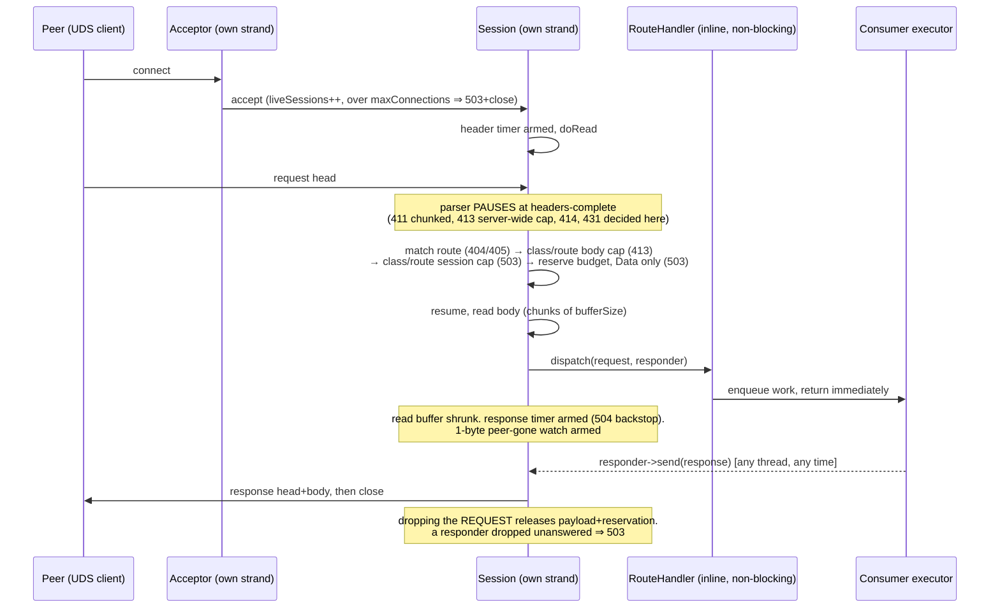
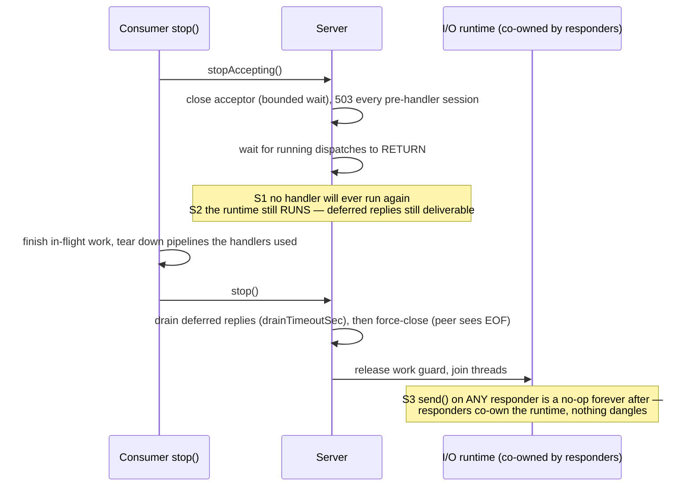
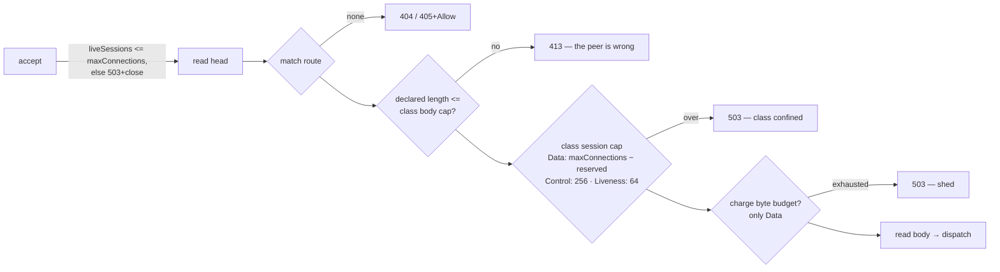

# Architecture

Three mechanisms carry the design: an asynchronous request pipeline with deferred
responses, a two-phase shutdown with named guarantees, and route classes that let one
server host a sheddable data plane without starving control traffic.

*Diagram source of truth: `src/shared_modules/uds_http_server/README.md`.*

## Request pipeline

One connection, from accept to reply — the deferred path included. A handler may return
without answering, keep its responder, and `send()` minutes later from any thread;
`send()` is exactly-once and is a defined no-op after `stop()`.

The order is deliberate: everything that can refuse a request is decided at
headers-complete, before a body byte that would be discarded is read, and a body cap is
checked before any session counter or budget is charged. Routing matches the target's
path before `?`; the handler receives the raw target, query string included, and header
names lower-cased.

While a reply is deferred there is no read pending, so a one-byte read watches the socket:
a peer that gives up (EOF) or violates the one-request-per-connection contract (any byte)
is closed at once, freeing its connection slot instead of holding it until the response
backstop. Its byte reservation stays charged until the handler drops the request.

## Threading and the accept loop

All I/O runs on one shared `asio` context driven by `ioThreads` reactor threads (default:
one per available CPU). A thread that catches an exception logs it (throttled) and
re-enters the loop, so the reactor never silently shrinks.

**Every connection runs on its own strand.** An accepted socket inherits the executor of
the acceptor that produced it, and the acceptor lives on a single shared strand, so the
library explicitly re-binds every socket handler of a connection to that connection's
own strand. Without that binding every connection's I/O would serialize onto the
acceptor's strand and the configured thread count would buy no parallelism; with it,
connections are processed in parallel and one connection's handlers never run
concurrently with each other. A handler that blocks still stalls the I/O thread it runs
on — handlers must hand real work to the consumer's own executor.

**The accept loop** keeps `concurrentAccepts` (default 2) accepts outstanding at once on the
acceptor strand, each re-arming itself after every completion. An `accept()` that fails
for a transient reason — descriptor exhaustion above all, since the limit is shared with
every other module of the daemon — is logged (throttled: `Failed to accept … The listener
is still accepting; peers will retry.`) and the chain is re-armed through the strand
rather than by recursion. A chain that returned without re-arming would leave the socket
bound and the listener permanently deaf; only `stopAccepting()` ends the chains. A
connection accepted over `maxConnections` is answered `503` and closed rather than
dropped, so the peer reads "out of capacity", not a transport failure; the true
descriptor ceiling is therefore `maxConnections + concurrentAccepts`.

## Two-phase shutdown (S1/S2/S3)

Designed to fit a daemon's 30-second stop window: `stopAccepting()` first (S1 — no
handler will ever run again; S2 — the runtime still runs, so deferred replies remain
deliverable), the consumer tears down its own pipelines, then `stop()` (S3 — `send()`
on any responder is a no-op forever after).

Every wait is bounded: closing the acceptor 2 s, running dispatches 10 s, the deferred
replies `drainTimeoutSec` (2 s by default), force-closed sessions 5 s, the I/O threads
2 s — 21 s in the worst case at the defaults. Each phase logs its outcome at INFO
(`… server is no longer accepting on '<socket>'; <n> deferred replies still outstanding,
<n> pre-handler connection(s) answered 503.`, then `… server fully stopped.`) and an
overrun at WARN or ERROR. The socket file is unlinked only if it is still the one this
server bound.

## Route classes (QoS)

The decisive mechanism is `reservedControlConnections`: the Data class's session cap
resolves to `maxConnections − reserved`, so the data plane alone can never drive
occupancy up to the accept-time cap — Control and Liveness always find a slot. The
reservation is clamped at start to a quarter of `maxConnections` (with a WARN). The
honest residual: class membership is unknowable before the request head is read, so
connections racing between accept and classification occupy global slots class-blind;
the hard "control always answers" guarantee holds while the concurrency of new data
connects stays below the reserve. A Control route that does real work still sheds its
own capacity module-side (bounded queue → 503); the class only guarantees the data
plane cannot starve it.

A route can override its class per registration — a body cap, a concurrent-session cap
enforced on its own counter in addition to the class cap, and a response backstop. The
last exists because the backstop assumes the peer gives up first: a route whose peer
legitimately waits longer than the server-wide value raises its own instead of weakening
the backstop for every other route.
