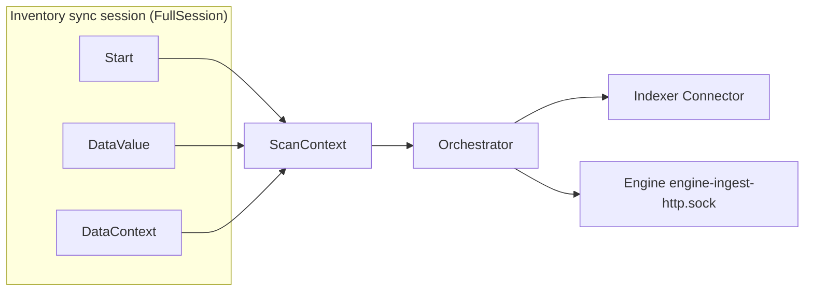
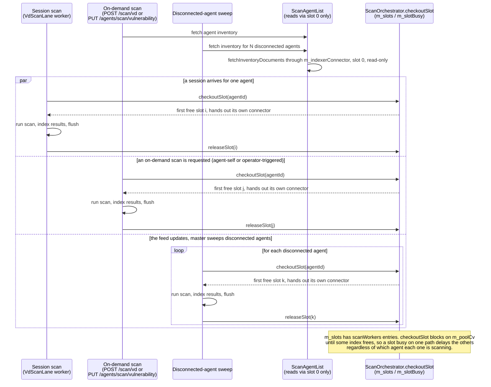
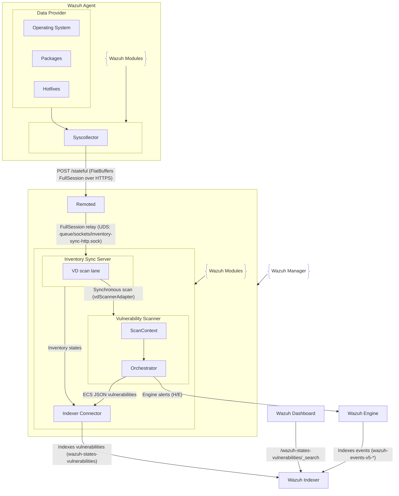

# Architecture

The Vulnerability Scanner module consumes the synchronization sessions the Inventory Sync Server receives and indexes the detection results in the Wazuh Indexer. It integrates several design patterns (Facade, Factory Method, and Chain of Responsibility) to modularize responsibilities and simplify maintenance. Below is an overview of the main components and their roles.

## Processing flow

The detection flow normalizes inventory data into batches that drive detection and reporting:

Inventory Sync Server -> ScanContext -> Orchestrator -> Indexer + Engine

### Pipeline and triggers

The manager-side pipeline is session-driven. A whole session arrives at the Inventory Sync Server as one `Message{FullSession}`, and vulnerability-detection sessions run through the server's VD scan lane, which executes the scan orchestrator synchronously BEFORE the session is indexed — a `200` to the agent guarantees both the scan and the ingest:

Start/DataValue/DataContext -> Inventory Sync Server (VD scan lane) -> ScanOrchestrator -> Indexer + Engine

Orchestration selection is based on `Start.option` and the indices present in the session:

- `VDFirst`: Full inventory in `DataValue` only (OS, packages, hotfixes).
- `VDSync` `FullScanWithDiff`: `DataValue` contains OS + package upserts/deletes, and the session also includes OS/hotfix indices.
- `VDSync` package delta: `DataValue` contains package upserts/deletes only; `DataContext` includes OS.

## Main Components

- **`src/wazuh_modules/vulnerability_scanner/src/vulnerabilityScannerFacade.cpp`**
The entry point for the vulnerability scanner. It builds the content-updater configuration from `<vulnerability-detection>` and `<indexer>`, one Indexer Connector per scan slot, the `DatabaseFeedManager` (which owns the local feed database `queue/vd/feed` and registers the feed topic with the Content Manager) and the scan orchestrator, and it tracks the feed state that `GET /vulnerability-detector/status` reports.

- **`src/shared_modules/content_manager/src/components/IndexerDownloader.hpp`**
  Downloads the CTI feed from the Indexer, as a stage of the [Content Manager](../content_manager/README.md). Before starting a download, it checks the CTI consumer status and waits until it becomes `ready`. If the document is missing or its status is empty, `running`, `failed` or unknown, the downloader postpones the operation and retries every minute.

- **`src/wazuh_modules/vulnerability_scanner/src/scanOrchestrator/`**
  This implementation uses the `Chain of Responsibility` design pattern to represent different stages for detection based on the sync session's batches (Start, DataValue, DataContext). It builds the `ScanContext`, runs package/OS/hotfix detection for full scans and deltas, and emits results to the indexer and (except on a `VDFirst` scan) to the engine.

- **`src/wazuh_modules/inventory_sync_server/`**
  Inventory Sync Server is the upstream module: it receives a whole synchronization session as one `Message{FullSession}` over remoted's `POST /stateful` route, indexes the inventory states, and hands the session's package data to the scanner's VD lane (`src/wazuh_modules/inventory_sync_server/src/vd/vdScannerAdapter.cpp` calls the scanner's neutral entry points) once the session is complete.

- **`src/wazuh_modules/vulnerability_scanner/src/databaseFeedManager/`**
  Submodule in charge of processing the information downloaded from CTI. Key responsibilities include:

  - Parse and store CTI information to build the feed database.
  - Parse CVE5 formatted information.
  - Create CVSS, description, and other related tables to augment the vulnerability indexed information and alert reports.
  - Parse and process mapping details and translation information for OS and packages.
  - Parse and process offset information to keep the CVE database up to date.
  - Validate that the local feed database is complete before marking it as ready for scans.
  - Skip the feed documents that lack required fields. A document that is skipped is not written to the feed database, the rest of the batch is processed as usual, and a warning with the document identifier (`Skipping feed document '<id>' (<type>): required fields are missing.`) is logged once; the identifier is written cut to 128 bytes and with every byte that is not printable ASCII replaced by `?`. The required fields are:
    - CVE documents: a non-empty `cveMetadata.cveId` and, when `cveMetadata.state` is `PUBLISHED`, the `containers` object. `containers.cna` is optional: without it a `PUBLISHED` document is stored and contributes no hotfix or remediation data; an update that leaves it `REJECTED` removes no hotfix data, and its remediation entry is still deleted by its identifier.
    - Translation documents: `source`, `target` and `translation`.

    A translation already stored without those fields is not loaded into the translation cache: it is left in the database and reported once per process (`Skipping stored translation '<id>': required fields are missing.`), and at debug level 2 on later reloads. Up to 256 stored translations are reported this way; when that number is reached a warning says so (`256 stored translations skipped: the next ones are only logged at debug level.`) and, until the module restarts, any other one is only logged at debug level 2. The module remembers a hash of each reported identifier, so two identifiers with the same hash share one warning.

## Feed update readiness

The feed update path separates remote readiness from local readiness:

- The Indexer download starts only when the CTI consumer status is `ready`.
- Once the download completes, the local feed is marked as ready only if the required global maps are present in the local RocksDB feed database.

This prevents VD from starting scans with a partially downloaded or locally incomplete feed. How
each update runs (readiness gate, initial load and incremental updates, retries) is described in
the [Content Manager](../content_manager/README.md#how-an-update-runs).

## Feed-update rescan (`/scan/vd` + `rescanDisconnectedAgents`)

When the CTI feed finishes updating, every agent eventually needs a fresh scan against the new
data — but with stateless HTTPS, any request can land on any node, so no manager node "owns" a
fixed set of agents to push that rescan to. Two independent mechanisms cover it, both without
inter-node coordination — plus a third, operator-initiated path that isn't tied to a feed update
at all, but reuses the same on-demand machinery:

- **Connected agents detect the change themselves.** `VulnerabilityScannerFacade::start()`
  registers a post-update callback on `DatabaseFeedManager` that, once a feed update actually
  changed something, calls `rescanDisconnectedAgents()` (below) — that's the *disconnected*-agent
  path. *Connected* agents never get pushed anything: they learn the feed moved by comparing the
  `vd_feed_offset` remoted includes in every `/control` notify response against their own stored
  value, and — if it's higher — call `POST /scan/vd` on whichever node the load balancer routes
  them to, passing the offset the agent believes is current. `remoted`'s handler
  (`scanVdHandler.cpp`) re-validates that offset itself before admitting anything: it fetches VD's
  actual current offset over a separate UDS client (`VdClient::getOffset()`) and, on a mismatch,
  rejects the request with `VersionMismatch` and returns its own current offset so the agent can
  correct itself and retry — no scan is requested from VD at all in that case. Only once the
  offset matches does `remoted` forward a plain `{"agent_id": ...}` admission request to
  `POST /vulnerability-detector/scan` on `vd-http.sock`, which records a durable `vd_scan` Task
  Manager task and answers at admission (see the
  [route table](api-reference.md#post-vulnerability-detectorscan)). When the Task Manager's
  dispatcher executes the task against `POST /_internal/vd/scan` on `inventory_sync_server`, its VD
  scan lane calls `triggerAgentScan(agentId)`: it looks up the agent's current metadata, builds a `ScanContext` for just that one
  agent, and runs the same `FullScan` orchestration chain (above) any other feed-update-triggered
  rescan uses. The full `/scan/vd` request/response contract is in remoted's developer README
  (`src/remoted/remoted_module/README.md`, section "Scan endpoint (`POST /scan/vd`)") — remoted is
  a synchronous passthrough for the admission verdict once its own offset gate passes.
- **Disconnected agents are swept once, by the master only.**
  `rescanDisconnectedAgents()` fetches every agent whose `connection_status` is `disconnected` from
  global.db (`BuildDisconnectedAgentListContext`; connected agents are already covered by the
  on-demand path above) and
  runs `FullScan` for each. It no-ops on a worker node (`ScanContext::clusterIsWorker()`) — disconnected
  agents aren't tied to any particular node, so only the master (or the single node, without a
  cluster) may sweep them, or every node would redundantly rescan the same agents on every feed
  update.

Besides that feed-driven rescan, an operator can request a scan on demand, for any agent,
independently of feed state — a genuinely separate mechanism, not a variant of the above:

- **Operators can trigger a scan directly, for any agent, connected or not, at any time.**
  `PUT /agents/scan/vulnerability` (`api/api/controllers/agent_controller.py::scan_agents` ->
  `wazuh.vulnerability_scan.scan_agents()`) lets an operator request a scan for one agent, a list,
  or all agents, through `wazuh-manager-apid` and the framework instead of through `remoted`. Unlike
  `/scan/vd`, this request carries no feed-offset value and is subject to no offset-matching
  gate — it is not an "I think the feed moved, am I right?" handshake, it is an unconditional "scan
  this agent now" command, RBAC-authorized (`agent:scan_vulnerability`) rather than agent-key
  authenticated, and issuable for an agent regardless of what the agent itself believes about the
  feed. For each resolved agent, the framework calls `VdHTTPClient.scan_agent()`
  (`framework/wazuh/core/engine_http.py`), which posts the same plain
  `{"agent_id": ...}` request straight to `POST /vulnerability-detector/scan` on `vd-http.sock` —
  bypassing `remoted` and its offset gate entirely. This means the two mechanisms are independent
  end to end except for one shared final step: both ultimately admit through the identical
  `POST /vulnerability-detector/scan` route, the same `vd_scan` task type and the same
  `triggerAgentScan()` — which is exactly why they can collide for the same agent (see below), and why the
  operator path inherits the same silent no-op for an agent with no synced package inventory yet,
  the same connected/disconnected/agent-version indifference (VD reads inventory the indexer
  already holds, not a live agent session), and the same admission-rejection reasons as `/scan/vd`.

  The endpoint always runs on the cluster master: `request_type='local_master'`
  (`framework/wazuh/core/cluster/dapi/dapi.py`) executes locally only when the node that received
  the HTTP call actually is the master, and otherwise forwards to the master
  (`execute_remote_request()`) — so two operator-triggered requests, regardless of which node's
  API received them, always reach the same node's `tasks.db` and coalesce there rather than racing
  each other. `/scan/vd` has no equivalent forwarding — `scanVdHandler.cpp` posts to whichever
  node's local `vd-http.sock` it happens to be running on — so an operator-triggered scan for agent X
  (always on the master) CAN still race that same agent's own self-triggered scan if agent X is
  connected to a non-master node at that moment: the two are recorded in two different nodes'
  `tasks.db` and can run concurrently, hitting the same cross-node exposure already accepted above
  for two agent-self-triggered scans of one agent landing on different nodes. Within one node they
  do not race: the task type coalesces against a pending row, and the execution route
  refuses a second scan of an agent already scanning with `409 scan_in_progress`.

  An admitted (`200`) request is a committed row in `tasks.db`, so a crash or a restart of
  `wazuh-manager-modulesd` resumes it, and the dispatcher retries a failed scan on its own backoff
  ladder — which matters for an operator's one-shot request for a disconnected agent, since no agent
  will re-request it.

  One limit of the shared final step remains, reachable through the operator path too:
  `triggerAgentScan()` checks the target agent's existence in global.db exactly once, at the
  start of execution, and nothing later in the scan chain re-verifies it, so a scan can race the
  deletion of its agent — including an operator-triggered scan for an agent ID that a concurrent
  deletion removes before the scan executes. The task ends `failed` with
  `agent_not_found` rather than retrying, which is the right terminal answer.

Both `/scan/vd` and the operator-triggered endpoint funnel through `triggerAgentScan()`, and
therefore through the same admission gate, before a scan actually runs — the disconnected-agent
sweep does not, since it calls the scan orchestrator directly and is never recorded as a task
(see above). `checkScanReadiness()` (VD's own
`POST /vulnerability-detector/scan` admission calls it, and `triggerAgentScan()` calls it again as
the authoritative check, since readiness can change between enqueue and execution) also
requires a usable indexer host, from the connector's per-host `GET /_cat/health` poll (every 10 s).
Admission is the stricter of the two: it needs a host that is green or yellow and not throttled
(`IndexerConnectorSync::hasAvailableServer()`), because the agent clears its pending rescan on the
`200` and a throttle that outlasts the task's attempts would dead-letter a scan nobody asks for
again. Execution accepts a throttled host too (`isAvailable()`: a host answering HTTP 429 stays in
rotation and its requests back off). Without such a host the check returns
`ScanTriggerResult::IndexerUnavailable` instead of admitting or running the scan. At execution time that
outcome reaches the Task Manager's dispatcher as a retryable `503`, so the task is re-queued on the
backoff ladder rather than dropped, and the wait survives a restart. A thrown inventory read (OS, packages or hotfixes) is classified by the same
health view: `isAvailable() == false` marks the scan `IndexerUnavailable`, which the VD scan lane
answers `503`, and `true` marks it `ScanFailed`, answered `500`. The dispatcher retries both on its
backoff ladder while the task has attempts left; once they are spent the task is dead-lettered, and
an indexer that recovers later does not wake it: the scan then needs a new request or another trigger. One 4xx is exempt: a search answered `404` with `index_not_found_exception` is an EMPTY
inventory, not a failed read — nothing was ever synced to that index (a fleet with no Windows
agent never creates the hotfixes index at all), so it takes the ordinary empty-inventory path
instead of failing every feed-update scan on such fleets. That holds for the first answer of the
read only: the same error after a page has been received means the index went away in the middle,
and the read fails like any other. So does any other status whose body mentions that error. When any agent of the sweep fails,
`rescanDisconnectedAgents()` logs `Disconnected-agent rescan completed with <n> failed agents.` and
its completion line, `Vulnerability scan finished after feed update: disconnected agents (agents=<n>,
status=error).`, reports the failure (`status=ok` otherwise).

Two limits of this gate are known: at execution a throttled host counts as available, so a
sustained 429 is bounded only by the connector's retry budget
(`wazuh_modules.indexer_max_retry_attempts` / `indexer_max_retry_duration_seconds`, see
[Internal Options](configuration.md#internal-options)) and then classifies as `ScanFailed`; and the
health view can be up to ~15 s stale, so a failure inside that window classifies as `ScanFailed`
(`500`, retried by the dispatcher) rather than `IndexerUnavailable` (`503`) — admission starts
answering `indexer_unavailable` once the view catches up.

The syscollector_vd sync path (VDFirst/VDSync sessions, handled by `inventory_sync_server`, not
this module's HTTP surface) carries the same offset-matching contract: each session's `Start.feed_offset`
must equal this node's current feed offset or the session is rejected with `409 version_mismatch`
before it ever reaches the orchestrator — see the
[Inventory Sync Server response contract](../inventory-sync-server/api-reference.md#response-contract)
and, for the implementation, `src/wazuh_modules/inventory_sync_server/README.md` (section "The VD
scan lane").

Both `/scan/vd` and the flatbuffer path validate against the *same* underlying offset
(`DatabaseFeedManager::getLastOffset()`, surfaced to remoted over UDS by `VdClient` — see remoted's
README named above), so a request is only ever accepted by a node whose feed genuinely matches
what the caller expects; a mismatch always returns the node's real current offset so the caller can
retry with the corrected value instead of guessing.

## Baseline after the module is enabled (`runBaselineScan`)

A node that starts with `enabled: no` leaves the marker `queue/vd/baseline_pending`: from then on
it stores the inventory of the agents it serves without scanning it. The next start with the module
enabled finds the marker and, when the feed update cycle completes, runs `runBaselineScan()` in
place of the disconnected-agent sweep:

- **Every agent, on every node.** `BuildDisconnectedAgentListContext` is used in its `AllAgents`
  scope, and the master-only rule of the sweep does not apply: each node closes its own gap without
  waiting for another. A worker's global.db does not know which agents other nodes serve, so the
  connection status cannot narrow the list; an agent with no inventory in the indexer is skipped
  by `ScanAgentList`.
- **No alerts.** Each agent goes through `FullScan` (logged `type=full reason=baseline`) and the
  Report chain is not run after it, as for a first scan. An agent enrolled while the module was off
  would otherwise raise one alert per vulnerability it already had.
- **Every scan that could alert waits.** While the baseline is pending, `checkScanReadiness()`
  answers `ScannerNotReady` (`503 scanner_not_ready`, retryable) to on-demand scans, and
  `isFeedReady()` reads false, so `inventory_sync_server` defers VDFirst/VDSync sessions with the
  same `503` + `Retry-After` it gives while the feed loads. Both matter: an on-demand scan reports
  everything it finds, and a session with an OS or hotfix change runs `FullScan` with its Report
  chain. After the baseline those scans have nothing left to report for what the agent already had.
- **Agents that failed are scanned again, and only those.** The marker is removed once every agent
  has been scanned. An empty marker means every agent; after a pass in which some agents could not
  be scanned (the indexer went away in the middle, for example) it lists them, one
  `<agent id> <attempts>` per line, and the next feed update cycle or the next start scans those
  alone. The node keeps deferring meanwhile: any of them would report everything it had. A pass
  that could not run at all (global.db could not be read, the module was stopping) leaves the
  marker as it was.
- **One failing agent does not hold the node for good.** A failure counts against an agent only
  when what a scan reads can be read at all: after a pass with failures the node queries the system,
  packages and hotfixes inventory indices and `wazuh-states-vulnerabilities` without naming an agent.
  If they answer (a `404` naming `index_not_found_exception` counts as an answer: that index was
  never written), the failures belong to those agents and are counted; after three such passes the
  agent is logged and left out, and its next scan reports what it finds as new. If one does not
  answer (the indexer is out of reach, an index is closed or red, or one of its shards is unavailable
  and the indexer refuses the search), nothing is counted, however long that lasts, and the log
  says so. A start runs a pass as soon as the feed is ready, so a restart can use one of the
  three attempts.
- **A damaged marker means every agent.** A line that is not an agent id, or a file cut in the
  middle of a line, makes the next pass scan the whole fleet again.
- **How long it takes.** One full scan per agent in `global.db`, one agent at a time, starting when
  the feed update cycle completes: at the first start with a feed already on disk that is shortly
  after start, with an empty feed it is after the first download. A pass with failures adds one
  [`feed-update-interval`](configuration.md#feed-update-interval) (60 minutes by default) per
  retry, at most two retries for an agent that fails with the indexer available. The log line
  `Vulnerability scan finished after vulnerability detection was enabled (agents=N, status=ok)`
  marks the end.

Known limits:

- **Only reads are probed.** A failure to write the detections while the probed indices answer
  is counted against the agent.
- **Nodes do not coordinate.** Each node writes detections from the inventory it read when it scanned
  the agent, so two nodes scanning the same agent around a package change can leave the detections
  of the older inventory as the last write: for example, a worker reads the inventory, another
  node indexes a package change and scans it, and the worker then writes what it computed. The
  detections stay stale, with no alert, until that agent's next scan (its next inventory change or
  the next feed update). The window is the duration of a node's baseline.
- **Every node scans every agent**, so the switch costs one silent pass over the fleet per node.
- **Nothing is reported for the time the module was off**, including package changes made then.

A cluster cannot stay with the module enabled on some nodes only: workers apply the master's
`enabled` (see [configuration](configuration.md#enabled)). The baseline is also what covers the
moments when nodes differ while a change reaches them.

## Orchestration chains

The orchestrator builds the following chains (via `FactoryOrchestrator`) and selects them based on `Start.option` and the indices present in the session:

- **PackagesDelta** (VDSync package-only delta):
  `PackageScanner -> EventGetCve -> EventDetailsBuilder -> ResultIndexer`
- **FirstFullScan** (VDFirst):
  `OsScanner -> PackageScanner -> EventDetailsBuilder -> ResultIndexer` — the orchestrator does not run the
  Report chain after it, so a first scan indexes its detections but sends no engine alerts
- **FullScan** (VDSync FullScanWithDiff, triggered when OS or hotfix indices are present):
  `EventGetContext -> OsScanner -> PackageScanner -> EventDetailsBuilder -> ResultIndexer`
- **Report**: `EventSendReport` alone. `ResultIndexer` only stages the detections; the orchestrator runs this chain
  after a PackagesDelta or FullScan scan once the connector's flush has stored them. The FullScan
  scans of the [baseline](#baseline-after-the-module-is-enabled-runbaselinescan) are the exception: like a
  first scan, they store their detections and send no engine alerts. A flush that fails sends no
  engine alerts: the scan is repeated (the agent re-sends a failed session) and reports the same vulnerabilities
  as new again, so alerting before the flush would send them once per attempt.

Two steps read the indexer's `wazuh-states-vulnerabilities` index, with the synchronous search, which asks for
`allow_partial_search_results=false` so that the indexer refuses (`503`/`500`) instead of answering with a partial result:

- `EventGetContext` (FullScan) reconciles the agent's existing detections: it reads them and, for those with no package in the
  scan context, their packages, in requests of at most 1000 ids.
- `EventGetCve` (PackagesDelta) looks up the CVEs of the packages that were deleted.

A failed read in either step fails the scan, whatever the cause (a refusal, no available server, a transport error, an exhausted
`429` retry, a response that is not JSON, or a stop). The step logs the error and rethrows it: no later step runs, nothing is
staged or sent to the indexer, there is no flush, and no alerts are sent. The one exception is an index that does not exist yet:
a `404` naming `index_not_found_exception` as the first response of the read means there is no data, and the scan continues. A
`404` after a page has already been received is a failure.

`EventGetContext` sends the `host.os` update of the agent's existing detections (when the operating system changed) after both
reads, not before. If that update fails it logs a warning and the scan continues; a scan whose read failed does not send it.

What a failed scan means depends on what started it:

- A feed-update rescan (`rescanDisconnectedAgents()`) records the duration and the failure, adds the agent to the list of
  agents with an incomplete scan and goes on with the next agent. The sweep does not retry them: each failed agent has its own
  warning with its id, and the sweep's completion line gives the count. The detections of those agents stay as they were until
  their next scan.
- A VDSync session, full or delta, is answered `500` (`vulnerability scan failed`) and the session's inventory is not indexed;
  the agent sends it again. VDFirst uses another chain and does not go through these reads.
- An on-demand scan reports `ScanFailed`, answered `500`, or `IndexerUnavailable` when no indexer host is available, answered
  `503`. The dispatcher retries either on its backoff ladder while the task has attempts left.

## Concurrency

`VulnerabilityScannerFacade` owns one `std::shared_mutex`, shared by reference with both
`DatabaseFeedManager` and `ScanOrchestrator`. `DatabaseFeedManager` takes it exclusively only
while a feed update is being applied (`reloadGlobalMaps()`) and shares it for read-only feed
queries; `ScanOrchestrator` takes the *shared* side for the whole duration of a scan
(`runScanFromViews()`/`runScanAfterFeedUpdate()`), so any number of scans may run concurrently,
but never at the same time as a feed reload. Every read a scan performs against the feed
database and its global maps (vendor/CPE/CNA mappings, the L2 translation cache) is therefore
safe only because those reads happen while *some* side of this one mutex is held, and because the
L2 translation cache's own read path stays read-only (no LRU-order mutation) on the scan path.

A shared lock alone is not sufficient for real concurrency: `ScanOrchestrator` keeps a small pool
of `Slot`s (one per concurrent scan slot), each bundling its own
`PackageDelta`/`FirstFullScan`/`FullScan` orchestration chains and its own `IndexerConnectorSync`.
This exists because each chain builds its own `PackageScanner` stage, which carries per-instance mutable state (running statistics and its own L1 translation cache), and because `IndexerConnectorSync` serializes bulk writes internally; sharing either across concurrent scans would race. The L1 cache is keyed by platform, vendor and package name. When a `source.version_extended` regex took part in a lookup, whether it matched or not, the result depends on the package version, so it is cached under a key that also includes the version and is only reused for packages with that same version (L1 is not cleared when the feed updates, so this holds for the feed it was filled from). A scan call checks out a free slot for its duration and returns it afterward. The slot count (the [`vulnerability-detection.scan_workers`](configuration.md#scan_workers) internal option, mirroring `inventory_sync_server`'s `wazuh_modules.inventory_sync_server_vd_workers`) is what actually lets
scans of different agents run at once; it defaults to half the host's cores (minimum 1) and an
explicit value always overrides that default. `DatabaseFeedManager` and its global maps remain
the one collaborator every slot shares.

RocksDB read concurrency (the feed database's `get`/`seek` calls, used by every slot) relies on
RocksDB's own documented guarantee that concurrent reads against one `DB*` handle are safe with
no concurrent writer — an external-library assumption this module does not itself enforce.

### Scan concurrency across callers

Three independent paths can trigger a scan at the same time — a session scan from `VdScanLane`
(`inventory_sync_server`), an on-demand request (`triggerAgentScan()`), and the master-only
disconnected-agent sweep (`rescanDisconnectedAgents()`, see
[Feed-update rescan](#feed-update-rescan-scanvd--rescandisconnectedagents) above). The on-demand
path itself has two distinct, independent triggering mechanisms — `remoted`'s offset-gated,
agent-self-triggered `POST /scan/vd` and the operator-triggered, unconditional
`PUT /agents/scan/vulnerability` (see above for how they differ) — but for the purposes of *this*
diagram they behave as a single lane: both record the identical `vd_scan` task type, and the Task
Manager gives that type a lane of depth 1, so at most one on-demand scan is ever executing at a
time regardless of which mechanism triggered it. All three
lanes read inventory through the same fixed slot-0 connector (`m_indexerConnector`, i.e.
`m_scanConnectors.front()`) via `ScanAgentList`, then compete for the slot pool described above:

A separate, per-agent mutual-exclusion fence (`ScanCoordinatorRegistry`, unrelated to this slot
pool) also stops a session scan and a feed-update rescan from targeting the SAME agent at once —
see [inventory-sync-server's architecture.md](../inventory-sync-server/architecture.md#the-vulnerability-detection-scan-lane)
for that mechanism. Its `pause`/`resume` pair is a plain set insert/erase, not reference-counted,
so if two scans fence the same agent concurrently, whichever finishes first un-fences it while the
other is still running. The disconnected-agent sweep is never recorded as a task,
so this gap is the only thing standing between it and a concurrent on-demand scan of the same
agent. A disconnected agent cannot call `POST /scan/vd` on itself, but the operator-triggered path
above can request a scan for a disconnected agent at the same moment the sweep is processing it.

## Data models used by VD

### ScanContext

`ScanContext` is the per-session state container built from the sync session's batches. It stores:

- Current OS metadata (from `Start` + OS `DataValue`/`DataContext`).
- Package and hotfix inventories for detection.
- `osDeleted` data to mark OS CVEs as solved.
- `CVEDetectionResult` entries and their operations (upsert/delete).
- ECS JSON events generated for indexer and engine output.

### CVEDetectionResult

`CVEDetectionResult` is the source of truth for detections. Each entry carries the affected component, CVE id, and the operation (`upsert` or `delete`) that drives both indexing and engine reporting.

### ECS vulnerability documents

VD generates ECS JSON documents (no internal alert struct) that are:

- indexed into `wazuh-states-vulnerabilities` by `ResultIndexer`.
- reused to build engine events in `EventSendReport`.

## Data stores and outputs

- The Inventory Sync Server keeps no local session store — it applies the session straight to the Indexer, into:
  `wazuh-states-inventory-system`, `wazuh-states-inventory-packages`, and `wazuh-states-inventory-hotfixes`.
- VD builds ECS documents and indexes them into `wazuh-states-vulnerabilities`.
- VD sends alert events to the engine through `engine-ingest-http.sock` using the H/E protocol (`Content-Type: application/x-wev1`, queue id `v`).

## Operational notes

- OS scan is supported only for Windows and Darwin. Linux OS scan is not supported (the kernel is treated as a package).
- How the indexed document's fields are built: [API Reference — Field notes](api-reference.md#field-notes).

## High-Level diagram

The engine indexes the vulnerability events it receives as events, into `wazuh-events-v5-*` (its
default indexer output, `src/engine/ruleset/outputs/indexer.yml`); the detections themselves are
read from `wazuh-states-vulnerabilities`, which this module writes directly.
