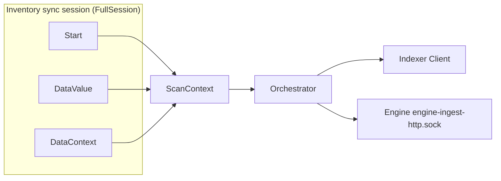
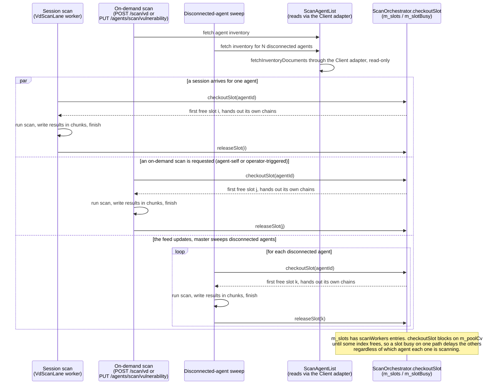
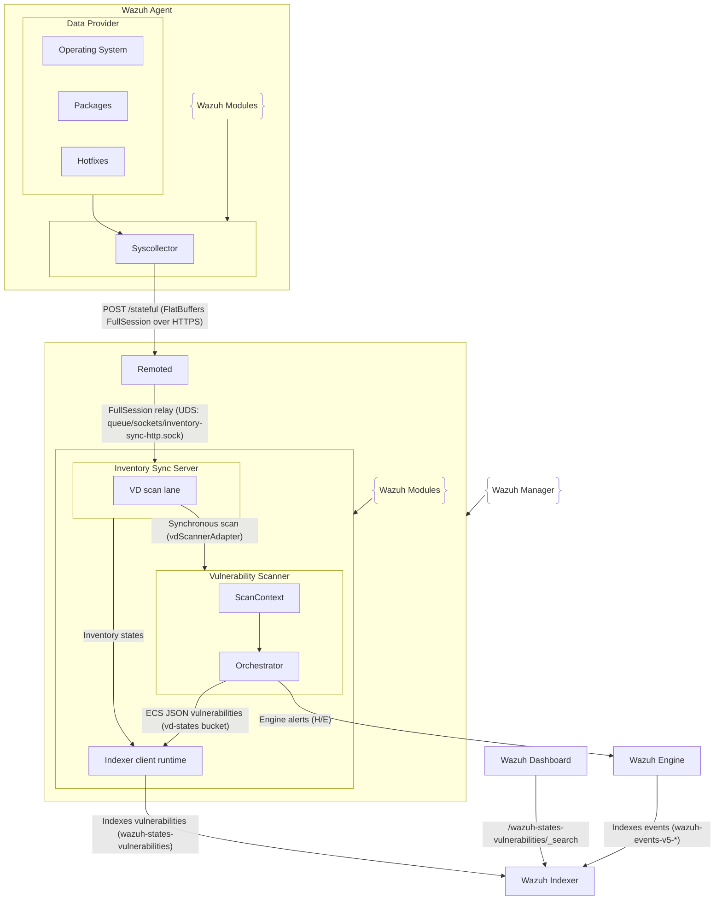

# Architecture

The Vulnerability Scanner module consumes the synchronization sessions the Inventory Sync Server receives and indexes the detection results in the Wazuh Indexer. It integrates several design patterns (Facade, Factory Method, and Chain of Responsibility) to modularize responsibilities and simplify maintenance. Below is an overview of the main components and their roles.

## Processing flow

The renewed detection flow normalizes inventory data into batches that drive detection and reporting:

Inventory Sync Server -> ScanContext -> Orchestrator -> Indexer + Engine



### Pipeline and triggers

The manager-side pipeline is session-driven. A whole session arrives at the Inventory Sync Server as one `Message{FullSession}`, and vulnerability-detection sessions run through the server's VD scan lane, which executes the scan orchestrator synchronously BEFORE the session is indexed — a `200` to the agent guarantees both the scan and the ingest:

Start/DataValue/DataContext -> Inventory Sync Server (VD scan lane) -> ScanOrchestrator -> Indexer + Engine

Orchestration selection is based on `Start.option` and the indices present in the session:

- `VDFirst`: Full inventory in `DataValue` only (OS, packages, hotfixes).
- `VDSync` `FullScanWithDiff`: `DataValue` contains OS + package upserts/deletes, and the session also includes OS/hotfix indices.
- `VDSync` package delta: `DataValue` contains package upserts/deletes only; `DataContext` includes OS.

## Main Components

- **`src/wazuh_modules/vulnerability_scanner/src/vulnerabilityScannerFacade.cpp`**
The entry point for the vulnerability scanner. It builds the content-updater configuration from `<vulnerability-detection>` and `<indexer>`, the scanner's indexer `Client`, the `DatabaseFeedManager` (which owns the local feed database `queue/vd/feed` and registers the feed topic with the Content Manager) and the scan orchestrator, and it tracks the feed state that `GET /vulnerability-detector/status` reports.

- **`src/shared_modules/content_manager/`**
  The shared content library ([Content Manager](../content_manager/README.md)) that downloads the CTI feed from the Indexer, on the feed's interval and on `POST /ondemand`. Before starting a download it checks the CTI consumer status, and it re-checks it from **inside** the Point-in-Time snapshot the feed is read from — so a consumer that begins re-indexing between the two cannot have half-written content read as complete. When the status is not `ready` the cycle is deferred and retried about a minute later, without holding a thread in the meantime. The scanner's feed reads through the scanner's own indexer `Client` (the same consumer its scans read and write with), so the download shares the `Client`'s node health and is cut short when the module stops. The same library serves the Engine's ruleset and IoC synchronization.

- **`src/wazuh_modules/vulnerability_scanner/src/scanOrchestrator/`**
  This implementation uses the `Chain of Responsibility` design pattern to represent different stages for detection based on the sync session's batches (Start, DataValue, DataContext). It builds the `ScanContext`, runs package/OS/hotfix detection for full scans and deltas, and emits results to the indexer and (except on a `VDFirst` scan) to the engine.

- **`src/wazuh_modules/inventory_sync_server/`**
  Inventory Sync Server is the upstream module: it receives a whole synchronization session as one `Message{FullSession}` over remoted's `POST /stateful` route, indexes the inventory states, and hands the session's package data to the scanner's VD lane (`src/wazuh_modules/inventory_sync_server/src/vd/vdScannerAdapter.cpp` calls the scanner's neutral entry points) once the session is complete.

- **`src/wazuh_modules/vulnerability_scanner/src/databaseFeedManager/`**
  Submodule in charge of processing the information downloaded from CTI. Key responsibilities include:

  - Parse and store CTI information to build the feed database.
  - Parse CVE5 formatted information.
  - Create CVSS, description, and other related tables to augment the vulnerability indexed information and alert reports.
  - Parse and process mapping details and translation information for OS and packages.
  - Track the highest CVE `offset` committed, so the next cycle fetches only what is newer.
  - Validate that the local feed database is complete before marking it as ready for scans.
  - Publish the feed's readiness, offset and status (`FeedState`), which the scan admission gate and
    the `/status` and `/offset` routes read without a lock.

## Feed update readiness

The feed update path separates remote readiness from local readiness:

- The Indexer download starts only when the CTI consumer status is `ready`.
- Once the download completes, the local feed is marked as ready only if the required global maps are present in the local RocksDB feed database.

This prevents VD from starting scans with a partially downloaded or locally incomplete feed.

## Feed-update rescan (`/scan/vd` + `rescanDisconnectedAgents`)

When the CTI feed finishes updating, every agent eventually needs a fresh scan against the new
data — but with stateless HTTPS, no manager node can assume it "owns" a fixed set of agents to push
that rescan to (the old TCP/UDP architecture's node-affinity model, where each node queried
global.db for its own agents and rescanned all of them on every feed update, has no equivalent once
any request can land on any node). Two independent, on-demand mechanisms replace it, both entirely
without inter-node coordination — plus a third, operator-initiated path that isn't tied to a feed
update at all, but reuses the same on-demand machinery:

- **Connected agents detect the change themselves.** `VulnerabilityScannerFacade::start()`
  hands `DatabaseFeedManager` a post-update callback that, once a feed update actually changed
  something and its offset is stored, calls `rescanDisconnectedAgents()` (below) — that's the *disconnected*-agent
  path. *Connected* agents never get pushed anything: they learn the feed moved by comparing the
  `vd_feed_offset` remoted includes in every `/control` notify response against their own stored
  value, and — if it's higher — call `POST /scan/vd` on whichever node the load balancer routes
  them to, passing the offset the agent believes is current. `remoted`'s handler
  (`scanVdHandler.cpp`) re-validates that offset itself before admitting anything: it fetches VD's
  actual current offset over a separate UDS client (`VdClient::getOffset()`) and, on a mismatch,
  rejects the request with `VersionMismatch` and returns its own current offset so the agent can
  correct itself and retry — no scan is requested from VD at all in that case. Only once the
  offset matches does `remoted` forward a plain `{"agent_id": ...}` admission request to
  `POST /vulnerability-detector/scan` on `vd-http.sock`, which records a durable `vd_scan` Task
  Manager task and answers at admission (see the
  [route table](api-reference.md#post-vulnerability-detectorscan)). When the Task Manager's
  dispatcher executes the task against `POST /_internal/vd/scan` on `inventory_sync_server`, its VD
  scan lane calls `triggerAgentScan(agentId)`: it looks up the agent's current metadata, builds a `ScanContext` for just that one
  agent, and runs the same `FullScan` orchestration chain (above) any other feed-update-triggered
  rescan uses. The full `/scan/vd` request/response contract is in remoted's developer README
  (`src/remoted/remoted_module/README.md`, section "Scan endpoint (`POST /scan/vd`)") — remoted is
  a synchronous passthrough for the admission verdict once its own offset gate passes.
- **Disconnected agents are swept once, by the master only.**
  `rescanDisconnectedAgents()` fetches every agent whose `connection_status` is `disconnected` from
  global.db (`BuildDisconnectedAgentListContext` — deliberately narrower than the old node-affinity
  sweep's "every agent," since connected agents are already covered by the on-demand path above) and
  runs `FullScan` for each. It no-ops on a worker node (`ScanContext::clusterIsWorker()`) — disconnected
  agents aren't tied to any particular node, so only the master (or the single node, without a
  cluster) may sweep them, or every node would redundantly rescan the same agents on every feed
  update.

Besides that feed-driven rescan, an operator can request a scan on demand, for any agent,
independently of feed state — a genuinely separate mechanism, not a variant of the above:

- **Operators can trigger a scan directly, for any agent, connected or not, at any time.**
  `PUT /agents/scan/vulnerability` (`api/api/controllers/agent_controller.py::scan_agents` ->
  `wazuh.vulnerability_scan.scan_agents()`) lets an operator request a scan for one agent, a list,
  or all agents, through `wazuh-manager-apid` and the framework instead of through `remoted`. Unlike
  `/scan/vd`, this request carries no feed-offset value and is subject to no offset-matching
  gate — it is not an "I think the feed moved, am I right?" handshake, it is an unconditional "scan
  this agent now" command, RBAC-authorized (`agent:scan_vulnerability`) rather than agent-key
  authenticated, and issuable for an agent regardless of what the agent itself believes about the
  feed. For each resolved agent, the framework calls `VdHTTPClient.scan_agent()`
  (`framework/wazuh/core/engine_http.py`), which posts the same plain
  `{"agent_id": ...}` request straight to `POST /vulnerability-detector/scan` on `vd-http.sock` —
  bypassing `remoted` and its offset gate entirely. This means the two mechanisms are independent
  end to end except for one shared final step: both ultimately admit through the identical
  `POST /vulnerability-detector/scan` route, the same `vd_scan` task type and the same
  `triggerAgentScan()` — which is exactly why they can collide for the same agent (see below), and why the
  operator path inherits the same silent no-op for an agent with no synced package inventory yet,
  the same connected/disconnected/agent-version indifference (VD reads inventory the indexer
  already holds, not a live agent session), and the same admission-rejection reasons as `/scan/vd`.

  The endpoint always runs on the cluster master: `request_type='local_master'`
  (`framework/wazuh/core/cluster/dapi/dapi.py`) executes locally only when the node that received
  the HTTP call actually is the master, and otherwise forwards to the master
  (`execute_remote_request()`) — so two operator-triggered requests, regardless of which node's
  API received them, always reach the same node's `tasks.db` and coalesce there rather than racing
  each other. `/scan/vd` has no equivalent forwarding — `scanVdHandler.cpp` posts to whichever
  node's local `vd-http.sock` it happens to be running on — so an operator-triggered scan for agent X
  (always on the master) CAN still race that same agent's own self-triggered scan if agent X is
  connected to a non-master node at that moment: the two are recorded in two different nodes'
  `tasks.db` and can run concurrently, hitting the same cross-node exposure already accepted above
  for two agent-self-triggered scans of one agent landing on different nodes. WITHIN one node they
  no longer race at all: the task type coalesces against a pending row, and the execution route
  refuses a second scan of an agent already scanning with `409 scan_in_progress`.

  An admitted (`200`) request is a committed row in `tasks.db`, so a crash or a restart of
  `wazuh-manager-modulesd` resumes it, and the dispatcher retries a failed scan on its own backoff
  ladder — which matters for an operator's one-shot request for a disconnected agent, since no agent
  will re-request it.

  One limit of the shared final step remains, pre-existing but newly reachable by the operator
  path: `triggerAgentScan()` checks the target agent's existence in global.db exactly once, at the
  start of execution, and nothing later in the scan chain re-verifies it, so a scan can race the
  deletion of its agent — including an operator-triggered scan for an agent ID that a concurrent
  deletion removes before the scan executes. The task ends `failed` with
  `agent_not_found` rather than retrying, which is the right terminal answer.

Both `/scan/vd` and the operator-triggered endpoint funnel through `triggerAgentScan()`, and
therefore through the same admission gate, before a scan actually runs — the disconnected-agent
sweep does not, since it calls the scan orchestrator directly and is never recorded as a task
(see above). `checkScanReadiness()` (VD's own
`POST /vulnerability-detector/scan` admission calls it, and `triggerAgentScan()` calls it again as
the authoritative check, since readiness can change between enqueue and execution) also
requires a usable indexer node, read from the health view of the process-wide indexer `Client`
(the per-node `GET /_cluster/health/wazuh-*,.wazuh-*` probe, every `wazuh_modules.indexer_client_probe_interval_ms`, 10 s by default). Admission is the stricter of the two: it needs
**some node Available** (`anyAvailable()`: green or yellow and not throttled), because the agent
clears its pending rescan on the `200` and a throttle that outlasts the task's attempts would
dead-letter a scan nobody asks for again. Execution needs **some node not Down**
(`anyUsable()`): a throttled node (HTTP 429) stays in rotation and its requests back off. Without
such a node the check returns `ScanTriggerResult::IndexerUnavailable` instead of admitting or
running the scan. At execution time that outcome reaches the Task Manager's dispatcher as a
retryable `503`, so the task is re-queued on the backoff ladder rather than dropped — the durable
replacement for the in-memory hold-and-recheck the old dispatch queue performed, and unlike it, the
wait survives a restart.

A scan that fails while reading is classified by cause. A read error that is transient
(`VdIndexerError::transient()`: no usable node, throttling, queue full, 5xx, transport, timeout,
`ClientClosed`, shutdown — the same cause table the Inventory Sync Server uses for its `503`s)
marks the scan `IndexerUnavailable` (held, retried once the indexer returns); the cause travels
from `ScanAgentList` in `AgentReScanListException`. A failed write carries its cause the same way
(see [Indexer writes](#indexer-writes)). A failure without a cause is also classified
`IndexerUnavailable` when no node is usable. Anything else marks the scan `ScanFailed` (logged and
dropped — retrying a scan's own failure risks a poison loop; the agent's durable pending state
re-requests on its next notify anyway). When any agent of the sweep fails,
`rescanDisconnectedAgents()` logs `Disconnected-agent rescan completed with <n> failed agents.` and
its completion line, `Vulnerability scan finished after feed update: disconnected agents (agents=<n>,
status=error).`, reports the failure (`status=ok` otherwise).

One limit of these gates is known: the health view is only as fresh as the last probe round, so a
node that went down after it still counts as usable until the next one. A scan that fails inside
that window without a transient cause classifies as `ScanFailed` and is dropped rather than held —
the agent re-requests, and admission starts answering `indexer_unavailable` once the view catches up.

## Indexer reads and error policy

The scanner reads through an adapter over the `indexer_client` `Client`
(`src/wazuh_modules/vulnerability_scanner/src/indexer/IVdIndexer.hpp`; implementation
`vdClientIndexer.cpp`): inventory documents (`ScanAgentList`), the agent context
(`EventGetContext`) and the CVE/package lookups (`EventGetCve`), plus the update-by-query that
marks solved findings. The adapter takes a query from the `Client` on every call and holds the
`Client` weakly: after the module stops, every call fails with the transient cause `ClientClosed`.

**Per-request deadline.** Every read (each page of a paged search included, and the
update-by-query) gets its own finite deadline, `min(now + budget, scan deadline)`, with
`budget = clamp(d + 3 s, 5 s, 18 s)` where `d` is
[`wazuh_modules.indexer_max_retry_duration_seconds`](configuration.md#indexer_max_retry_attempts--indexer_max_retry_duration_seconds)
(`18 s` when `d = 0`). Retries inside a request follow `indexer_max_retry_attempts` /
`indexer_max_retry_duration_seconds` (`0` = no bound); those options cover only the `vd-states`
bucket and the reads, while the feed download uses the client's default retry policy. The scan deadline exists only for an
on-demand scan (`triggerAgentScan()`): `270 s` from its start, under the task's 300 s. Session
scans and the post-feed sweep have no total deadline, only the per-request one.

**Error policy (behavior change).** A failed read now aborts the scan; before, a read error was
logged as a warning and the scan continued with whatever it had, which could delete or duplicate
findings from an incomplete inventory. Now:

| Read outcome | Result |
|---|---|
| Transient error (no usable node, throttling, 5xx, transport, timeout, `ClientClosed`) | The scan fails and is retried (`503` on the on-demand path, see above) |
| Permanent error (for example a `4xx`) | The scan fails (not retried silently) |
| Index missing (`index_not_found_exception`) | Treated as empty; an update-by-query on a missing index is a no-op |

Package lookups by id are split in requests of at most 1 000 ids, so a large agent does not
exceed the indexer's request size.

## Indexer writes

A scan's findings go to `wazuh-states-vulnerabilities` through the `vd-states` bucket of the
scanner's `Client`, by a writer created for that scan alone
(`src/wazuh_modules/vulnerability_scanner/src/indexer/IVdScanWriter.hpp`; implementation
`vdScanWriter.cpp`). `ResultIndexer` hands it each upsert (the ECS document is moved out of the
scan's context, not copied) and each delete; the orchestrator calls `finish()` once the chain has
run.

**Chunked writes.** The writer stages operations in a chunk and commits it as one group of the
bucket. Each operation counts its payload plus a 2 KiB result reserve; when the next one would pass
the chunk cap, the open chunk is committed first. The cap is `0.8 × quota / (2 × scan_workers)` of
the bucket's quota, so every slot can hold an open chunk and a committed one at once. At most one
committed chunk is waiting for its results besides the open one: before a second commit the writer
waits for the first. An operation larger than the cap goes alone in its own chunk. `finish()`
commits what is left and waits for every chunk in 250 ms steps that check whether the module is
stopping and, on an on-demand scan, the scan deadline. How each chunk is split into `_bulk`
requests is the bucket's job (`bulk.maxBytes`, see
[`indexer_bulk_size_bytes`](configuration.md#indexer_bulk_size_bytes)).

**Delete-by-query first (VDFirst).** A first scan with a usable OS context replaces the agent's
findings: the delete-by-query of the agent's documents (agent id and cluster, `conflicts=proceed`)
is sent right before the first chunk is committed, or by `finish()` when the scan found nothing.
A first scan without a usable OS context keeps the existing findings and sends no delete-by-query.

**Not atomic.** A scan is not one transaction. A failure after the delete-by-query, or between two
chunks, leaves the agent's findings partly written: some chunks applied, the rest not. The next
scan of that agent repairs it; a retried VDFirst is idempotent (delete-by-query again, then every
chunk). The previous connector was not atomic either once a scan passed its 10 MiB auto-flush.

**Failures.** A rejected operation, a failed chunk or a failed delete-by-query ends the scan with
a `VdIndexerError` carrying its cause, classified like a read error: a transient cause (no usable
node, queue full or quota wait timed out, 5xx, transport, timeout, `ClientClosed`) answers `503`
on the on-demand path and fails a session scan so the agent retries; a permanent one (for example
a document rejected with `400`) answers `500`. A document that is already gone counts as deleted.

**Abandoned scans.** A scan that ends without a `finish()` that returned (the chain threw, or
`finish()` itself threw) abandons its writer: nothing more is committed, the pending
delete-by-query is not sent, and what was already committed is cancelled by the scan's own tag
(`vd:<agent>:<counter>`, unique per scan, so another scan of the same agent in another slot is not
touched). Cancelling cannot stop a `_bulk` request already sent, and `vd-states` is unordered, so
the writer then waits for that chunk to resolve before the scan ends and its agent is released,
as the previous connector's synchronous write did: a cancelled operation is never sent again, so
the wait is one request at most, bounded by the runtime's `request_timeout_ms` plus 5 s and cut
within one 250 ms step when the module or the indexer runtime is stopping. Only when that wait is
cut does the scan end with the chunk unresolved, and a WARN says so:

```
vd-states write: scan 'vd:<agent>:<counter>' abandoned with a chunk still unresolved (<the module is closing | past the request timeout>); a late write of that scan may still be applied by the indexer.
```

That chunk may then still be applied after a later scan of the same agent (or its deletion),
leaving documents from the abandoned scan; the next scan of the agent repairs them.

## Start and stop

VD obtains its `Client` from the process indexer runtime that `wazuh-manager-modulesd` creates,
registering consumer `vulnerability_scanner` with its own bucket (`vd-states`), after the
"vulnerability detection disabled" exit. If the runtime is absent or rejects the registration, VD
logs an ERROR naming the cause and does **not** start (it behaves as "no VD": the Inventory Sync
Server's gate treats it as not available).

`stop()` first raises the flag every scan writer watches, so a writer waiting for a chunk gives up
with `ClientClosed` within one 250 ms step, and lowers the initialized flag, so no new scan is
admitted. Once the process's indexer runtime begins its shutdown, which modulesd does before
stopping any module, a writer also gives up and no new read or page starts (a read already in flight
still runs to its own deadline): another module's `stop()` that waits for a VD scan (the task manager
joining a worker whose request is that scan) is not held until VD's own `stop()` runs.
Then `stop()` asks the `Client` to close, stops the feed and the orchestrator, waits for the
`Client` to finish (bounded by the shutdown deadline, or 5 s) and releases it. Scans that are
running see `ClientClosed`. A `start()` that fails after creating the `Client` tears the feed down
and drops it and the orchestrator (both hold the `Client`) before closing and releasing the
`Client`, so the consumer name is free for the next start. On the
Inventory Sync Server side, while VD is stopping a session scan fails (the agent retries) and an
on-demand scan answers not-ready (`503`) instead of indexing the inventory without scanning it.
An on-demand scan cut short by `stop()` after reading the inventory fails with "VD stopping"
rather than returning silently.

`start()` and `stop()` are serialized by a lifecycle mutex. `stop()` first raises an atomic stop flag,
before taking the mutex, so a `start()` in progress stops short of building the feed; then, under the mutex, it closes
the `Client` and tears the rest down; a `start()` that takes the mutex after that sees the flag first
and returns without opening the socket-DB wrapper or creating a `Client`. The flag is not re-armed:
there is one `start()` per process.

The syscollector_vd sync path (VDFirst/VDSync sessions, handled by `inventory_sync_server`, not
this module's HTTP surface) carries the same offset-matching contract: each session's `Start.feed_offset`
must equal this node's current feed offset or the session is rejected with `409 version_mismatch`
before it ever reaches the orchestrator — see the
[Inventory Sync Server response contract](../inventory-sync-server/api-reference.md#response-contract)
and, for the implementation, `src/wazuh_modules/inventory_sync_server/README.md` (section "The VD
scan lane").

Both `/scan/vd` and the flatbuffer path validate against the *same* underlying offset
(the `FeedState` offset, surfaced to remoted over UDS by `VdClient` — see remoted's
README named above), so a request is only ever accepted by a node whose feed genuinely matches
what the caller expects; a mismatch always returns the node's real current offset so the caller can
retry with the corrected value instead of guessing.

## Orchestration chains

The orchestrator builds the following chains (via `FactoryOrchestrator`) and selects them based on `Start.option` and the indices present in the session:

- **PackagesDelta** (VDSync package-only delta):
  `PackageScanner -> EventGetCve -> EventDetailsBuilder -> EventSendReport -> ResultIndexer`
- **FirstFullScan** (VDFirst):
  `OsScanner -> PackageScanner -> EventDetailsBuilder -> ResultIndexer` — no `EventSendReport`, so a
  first scan indexes its detections but sends no engine alerts
- **FullScan** (VDSync FullScanWithDiff, triggered when OS or hotfix indices are present):
  `EventGetContext -> OsScanner -> PackageScanner -> EventDetailsBuilder -> EventSendReport -> ResultIndexer`

## Concurrency

`VulnerabilityScannerFacade` owns one `std::shared_mutex`, shared by reference with both
`DatabaseFeedManager` and `ScanOrchestrator`. `DatabaseFeedManager` takes it exclusively only
while a feed update is being applied (`reloadGlobalMaps()`) and shares it for read-only feed
queries; `ScanOrchestrator` takes the *shared* side for the whole duration of a scan
(`runScanFromViews()`/`runScanAfterFeedUpdate()`), so any number of scans may run concurrently,
but never at the same time as a feed reload. Every read a scan performs against the feed
database and its global maps (vendor/CPE/CNA mappings, the L2 translation cache) is therefore
safe only because those reads happen while *some* side of this one mutex is held, and because the
L2 translation cache's own read path stays read-only (no LRU-order mutation) on the scan path.

A shared lock alone is not sufficient for real concurrency: `ScanOrchestrator` keeps a small pool
of `Slot`s (one per concurrent scan slot), each bundling its own
`PackageDelta`/`FirstFullScan`/`FullScan` orchestration chains. This exists because each chain
builds its own `PackageScanner` stage, which carries per-instance mutable state (running statistics
and its own L1 translation cache), and sharing it across concurrent scans would race. The L1 cache is
keyed by platform, vendor and package name. When a `source.version_extended` regex took part in a
lookup, whether it matched or not, the result depends on the package version, so it is cached under a
key that also includes the version and is only reused for packages with that same version (L1 is not
cleared when the feed updates, so this holds for the feed it was filled from). The slots hold no
indexer connection: every scan gets its own writer (see [Indexer writes](#indexer-writes)) and all of
them share the scanner's one `Client`. A scan call checks out a free slot for its duration and returns
it afterward. The slot count (the
[`vulnerability-detection.scan_workers`](configuration.md#scan_workers) internal option, mirroring
`inventory_sync_server`'s `wazuh_modules.inventory_sync_server_vd_workers`) is what actually lets
scans of different agents run at once; it defaults to half the host's cores (minimum 1) and an
explicit value always overrides that default. `DatabaseFeedManager` and its global maps remain
the one collaborator every slot shares.

RocksDB read concurrency (the feed database's `get`/`seek` calls, used by every slot) relies on
RocksDB's own documented guarantee that concurrent reads against one `DB*` handle are safe with
no concurrent writer — an external-library assumption this module does not itself enforce.

### Scan concurrency across callers

Three independent paths can trigger a scan at the same time — a session scan from `VdScanLane`
(`inventory_sync_server`), an on-demand request (`triggerAgentScan()`), and the master-only
disconnected-agent sweep (`rescanDisconnectedAgents()`, see
[Feed-update rescan](#feed-update-rescan-scanvd--rescandisconnectedagents) above). The on-demand
path itself has two distinct, independent triggering mechanisms — `remoted`'s offset-gated,
agent-self-triggered `POST /scan/vd` and the operator-triggered, unconditional
`PUT /agents/scan/vulnerability` (see above for how they differ) — but for the purposes of *this*
diagram they behave as a single lane: both record the identical `vd_scan` task type, and the Task
Manager gives that type a lane of depth 1, so at most one on-demand scan is ever executing at a
time regardless of which mechanism triggered it. All three
lanes read inventory through the shared indexer `Client` adapter (see
[Indexer reads and error policy](#indexer-reads-and-error-policy)) via `ScanAgentList`, then compete
for the slot pool described above:



A separate, per-agent mutual-exclusion fence (`ScanCoordinatorRegistry`, unrelated to this slot
pool) also stops a session scan and a feed-update rescan from targeting the SAME agent at once —
see [inventory-sync-server's architecture.md](../inventory-sync-server/architecture.md#the-vulnerability-detection-scan-lane)
for that mechanism. Its `pause`/`resume` pair is a plain set insert/erase, not reference-counted,
so if two scans fence the same agent concurrently, whichever finishes first un-fences it while the
other is still running. Two rules keep this from biting the callers that exist:

- **The on-demand scan's pause does not wait for itself.** It is only reached from the invsync scan
  lane, whose worker already holds the agent in flight. The coordinator does not count the calling
  thread's own scan-lane hold as in flight, so the fence is granted at once instead of after the
  quiesce bound; a pipeline session, or a scan another thread is running, is still waited for. The
  pause is requested as `on_demand scan in progress` (`feed_update scan in progress` for the sweep).
- **The sweep's pause is cancellable.** The wait for an agent to quiesce is done in slices of at
  most 50 ms and returns `false` as soon as VD's closing flag is raised, so `stop()` is not held for
  up to the coordinator's quiesce timeout (30 s). A scan whose pause failed because VD is closing
  stops the agent list there, like the closing branch, and leaves the remaining agents incomplete
  (the sweep never ends `ok` with agents left unscanned) instead of scanning them unfenced.

The disconnected-agent sweep is never recorded as a task,
so this gap is the only thing standing between it and a concurrent on-demand scan of the same
agent — previously a mostly theoretical overlap, since a disconnected agent by definition isn't
connected to call `POST /scan/vd` on itself; the operator-triggered path above makes it directly
reachable, since an operator can now request a scan for a disconnected agent at the same moment
the sweep is processing it.

## Data models used by VD

### ScanContext

`ScanContext` is the per-session state container built from the sync session's batches. It stores:

- Current OS metadata (from `Start` + OS `DataValue`/`DataContext`).
- Package and hotfix inventories for detection.
- `osDeleted` data to mark OS CVEs as solved.
- `CVEDetectionResult` entries and their operations (upsert/delete).
- ECS JSON events generated for indexer and engine output.

### CVEDetectionResult

`CVEDetectionResult` is the source of truth for detections. Each entry carries the affected component, CVE id, and the operation (`upsert` or `delete`) that drives both indexing and engine reporting.

### ECS vulnerability documents

VD generates ECS JSON documents (no internal alert struct) that are:

- indexed into `wazuh-states-vulnerabilities` by `ResultIndexer`.
- reused to build engine events in `EventSendReport`.

## Data stores and outputs

- The Inventory Sync Server keeps no local session store — it applies the session straight to the Indexer, into:
  `wazuh-states-inventory-system`, `wazuh-states-inventory-packages`, and `wazuh-states-inventory-hotfixes`.
- VD builds ECS documents and indexes them into `wazuh-states-vulnerabilities`.
- VD sends alert events to the engine through `engine-ingest-http.sock` using the H/E protocol (`Content-Type: application/x-wev1`, queue id `v`).

## Operational notes

- OS scan is supported only for Windows and Darwin. Linux OS scan is not supported (the kernel is treated as a package).
- How the indexed document's fields are built: [API Reference — Field notes](api-reference.md#field-notes).

## High-Level diagram



The engine indexes the vulnerability events it receives as events, into `wazuh-events-v5-*` (its
default indexer output, `src/engine/ruleset/outputs/indexer.yml`); the detections themselves are
read from `wazuh-states-vulnerabilities`, which this module writes directly.
