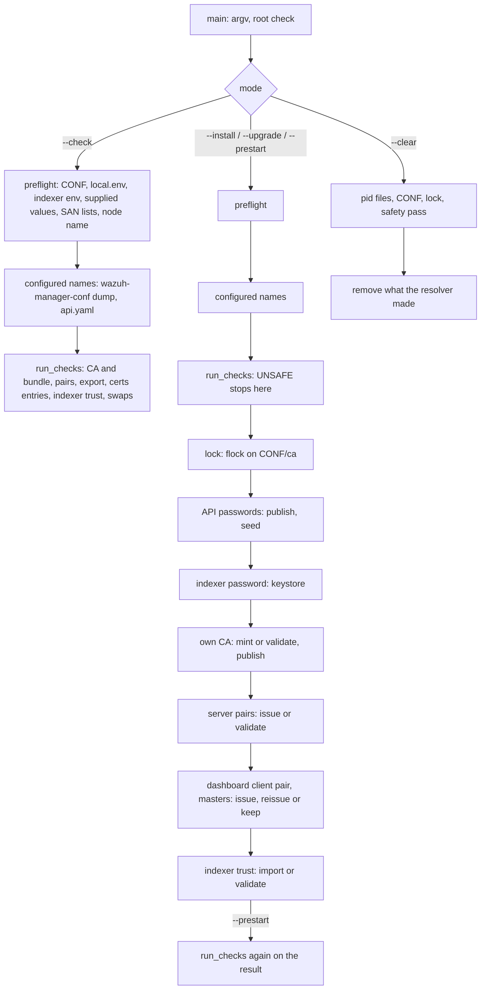

# Credential resolver

`wazuh-manager-resolve-credentials.py` is installed as `bin/wazuh-manager-resolve-credentials`. It sets up the
manager's passwords and trust material at installation, and checks and completes them before every start:

- the two Server API passwords, seeded into `rbac.db` and published for the dashboard;
- the indexer password, stored in the keystore;
- the manager's CA and its two server pairs (agent listener, Server API);
- the indexer's CA and the client pair the indexer issues for this manager.

It is one self-contained Python file run as root by the manager's bundled interpreter in isolated mode
(`#!/var/wazuh-manager/framework/python/bin/python3 -I`), with the standard library, `cryptography` and, to read
the Server API's `api.yaml`, PyYAML.

It is **not** a daemon and runs no host tool: the only programs it starts are Wazuh's own, by absolute path. It
does not touch `/etc/wazuh`. It never repairs an owner or a mode, never re-issues a certificate that is already
in place, and never replaces material an operator staged.

The operator contract (files, keys, modes, messages, procedures) is
[docs/ref/getting-started/credentials.md](../../../docs/ref/getting-started/credentials.md). This README is the
developer side.

## Requirements

| ID | Requirement | Status |
|----|-------------|--------|
| RF-1 | Five modes: `--install`, `--upgrade` (both exit 0 whatever they report), `--prestart` and `--check` (exit 1 on any problem), `--clear`; one is required (D-23); every mode exits 2 for usage errors (no mode included), a non-root caller, a lock another run held for more than `LOCK_TIMEOUT` (60 s; the writing modes only), an internal error. A certificate the resolver cannot parse, or a node name too long for a common name, is `INVALID`, never an internal error | kept |
| RF-2 | Values are looked up in the process environment, then `<CONF>/local.env`, then (indexer password only) `/etc/wazuh-indexer/export/credentials.env` | kept |
| RF-3 | Server API passwords: supplied values are validated and never replaced by generated ones; on a master with no `rbac.db`, publish to `<CONF>/export/credentials.env` first, then seed through `rbac_control.py`; a worker seeds nothing | kept |
| RF-4 | Indexer password stored in the keystore when absent; never generated, never published | kept |
| RF-5 | Own CA in `<CONF>/ca/`: minted at `--install` only when nothing exists, never beside existing pairs or a bundle; staged CAs (with or without key) used as they are; published in `export/ca.pem` by every writing mode when the copy there is absent or differs; `certs/root-ca.pem` written only when absent | kept |
| RF-6 | Server pairs issued at `--install` only, each with its own SAN list (explicit, or discovered: every global address of every interface, read over netlink); otherwise validated, never repaired; a staged `apid` pair may chain through intermediate CAs carried after the leaf, a `remoted` leaf through those kept in `certs/root-ca.pem` | kept |
| RF-10 | The pairs and the bundle are checked under the names the daemons are configured with (`remote.https.certificate/key/ca_certificate`, `auth.ssl_manager_cert/key`, `api.yaml` `https.cert/key`, `indexer.ssl.*`), which must be directly in `<CONF>/certs`; only the default names are issued or imported, other configured files are staged; a turned-off listener's pair (`auth.disabled`, `https.enabled: false`) is not checked; the indexer pair chains to any listed CA file, an empty CA list leaves it to the leaf checks, and its certificate and key are set together or not at all | kept |
| RF-11 | On a master, every writing mode publishes `export/dashboard-client.pem` / `-key.pem` (`0644` / `0600`, `CN=wazuh-dashboard`, `clientAuth` only, issued by the manager's CA, a key of its own) when absent and the CA has its key; the resolver's own pair is reissued when it no longer chains to the CA or expired; an operator's pair is checked with warnings only and never written; `--clear` removes only the resolver's; nothing about it refuses a start | kept |
| RF-7 | Indexer trust imported from the indexer's export with a marker written first, re-imported when the source changes; staged files (no marker) validated, never replaced; the CA and the pair taken together or not at all (an export that would leave the pair in place without its issuer changes nothing); the client pair needs `clientAuth` and may chain through intermediate CAs carried after the leaf; material only the clock refuses (expired, not valid yet) is a `WARNING` that does not refuse the start, and is imported from the export only into a gap | kept |
| RF-8 | `--check` is read-only (no lock, no write, no subprocess but the configuration reader `wazuh-manager-conf --skip-file-checks dump`) and reports `UNSAFE`/`INVALID`, and `MISSING` only for what `--prestart` could not complete either (the CA, the bundle, the server pairs, indexer files with nothing to import; not the indexer password, which lives in the keystore it does not read); it refuses whatever `--prestart` would refuse, so a restart is refused before anything is stopped; `--prestart` runs the same tests first; warnings (exit 0) are copied to `wazuh-manager.log` by `wazuh-manager-control` | kept |
| RF-9 | `--clear` refuses while a daemon runs; it always removes the server pairs and the agents' bundle (`certs/root-ca.pem`), staged or issued, and removes the CA, indexer files and dashboard pair only when the resolver minted or imported them (their marker says so); a staged CA, staged indexer files and `local.env` are kept | kept |
| RNF-1 | No secret on argv, in output or in the environment of a subprocess; secrets travel on stdin | kept |
| RNF-2 | Every entry under `<CONF>`, the indexer export and the home is reached through its parent's descriptor without following links; a writing run that finds anything unsafe writes nothing; secrets read (`local.env`, the indexer's `credentials.env` and `manager-client-key.pem`) are root's with no group or other bit | kept |
| RNF-3 | One writing run at a time (lock on `<CONF>/ca`) | kept |
| RNF-4 | Runs on the bundled interpreter with `cryptography` and PyYAML as pinned by `framework/requirements.txt`; no other dependency | kept |

## Design decisions

| ID | Decision | Why |
|----|----------|-----|
| D-1 | `<CONF>` is the fixed `/etc/wazuh-manager`; `-H` moves the home only | the same constant the C, C++ and Python code use; no variable may redirect where root writes |
| D-2 | Called from `wazuh-manager-control`, not from the unit's `ExecStartPre` | the control script already orders `--check` after the configuration file's own validation (`validate --skip-file-checks`, so the TLS names it reads come from a file the validator accepts), before the full validation that checks the files exist, and before the stop of a restart |
| D-3 | Seeds through `framework/python/bin/python3 -I framework/scripts/rbac_control.py`, not `bin/rbac_control` | the wrapper (`framework/wrappers/generic_wrapper.sh`) runs `dirname`, `basename`, `pwd` and `tr` from `PATH`; the resolver must run no host tool |
| D-4 | Accepts a group-writable `<CONF>` (its owner and group are checked) and opens nothing in it by name twice | `authd`, `remoted` and the Server API write there; every entry is checked on its own descriptor |
| D-5 | `ca/` and `export/` (both `root:root 0700`) are told apart by content, and the test is repeated on the descriptors a writing run uses | their specs are identical, so only what they hold reveals a swap, and a rename between a test by name and the write must not redirect it |
| D-6 | A stale `export/ca.pem` is published again by every writing mode, and `--check` lets the start go on | it is what staging a CA again by hand leaves, not an attack; refusing it left the manager down until someone ran `--install` by hand |
| D-7 | Never mint a CA beside existing pairs or a bundle | a second CA would leave the kept pairs without a trusted issuer |
| D-8 | Import markers are written before the files | an interrupted import is then recognisable and finished, never mistaken for staged files |
| D-9 | The client pair must carry `extendedKeyUsage` `clientAuth` | an EKU-less leaf is refused; the indexer issues the pair with it |
| D-10 | A pair is accepted only when every CA on its path to an anchor is valid now, `CA:TRUE` and allowed to sign | rotation CAs may stay in the bundle after they expire; the path is built through a usable one |
| D-11 | `--clear` reads only pid file **names** in `var/run` | nothing in that service-writable directory is opened; a planted pid file can only block |
| D-12 | A rejected `local.env` (unsafe or malformed) stops generation and seeding for that run | a password the operator meant to set must never be replaced by a generated one that then gets seeded |
| D-13 | `OPENSSL_armcap=0` is set before anything imports OpenSSL | some arm64 hypervisors advertise SVE they do not implement; other entry points get it from `generic_wrapper.sh` |
| D-14 | Paths are built by `x509.verification`'s client verifier with relaxed extension policies (CA: `basicConstraints` required; leaf: anything), then the resolver checks the leaf, and on every CA of the path, the anchor included, `keyCertSign` and an `extendedKeyUsage` that allows the leaf's purpose (OpenSSL's rule: `anyExtendedKeyUsage` alone does not; agents, the dashboard and remoted's own check use OpenSSL). A self-signed certificate in the leaf's file is never offered as an intermediate. Intermediates come only from the pair's own file, after the leaf, and never for remoted, whose leaf must chain to `certs/root-ca.pem` alone (an intermediate kept there is an anchor); anchors stay `ca/root-ca.pem` (apid), `certs/root-ca.pem` (remoted), `indexer-ca.pem` (connector) | the WebPKI defaults would demand an `authorityKeyIdentifier` and a `subjectAltName` that other tooling's certificates may lack, and a server verifier needs an expected name; the relaxed verifier checks neither `keyCertSign` nor the leaf, hence the resolver's own checks. remoted's `GET /cacerts` hands agents the bundle only when the leaf chains to it with no other certificate (partial chain), and the resolver makes the same judgement. No host tool (`openssl verify`) is run |
| D-15 | The indexer trust is selected without writing, the resulting pair is validated against the resulting CA, and only a passing combination is written; `--check` runs the same selection and reports its refusals | writing the CA first let an export with a bad pair, or a CA that did not issue the staged pair, break a working connector, and a restart ran `--check` before the stop but the import after it |
| D-16 | `certs/` is exactly `0750` and `<CONF>` must leave its group `rwx` | a mode that locks the daemons out passed every other test and only failed later, in a daemon that could not open its certificate |
| D-17 | A configured TLS file is followed only directly inside `<CONF>/certs`; a path elsewhere, or with a `.`/`..` component, is `INVALID` and never opened. Relative paths resolve as their consumer resolves them (the home for `wazuh-manager.conf`, `<CONF>/certs` for `api.yaml`) | both configuration files are writable by the service account, which could otherwise make root open any file; `certs/` is root's and its files are already checked |
| D-18 | The configuration is read with `wazuh-manager-conf --skip-file-checks dump` in every mode, `--check` included, and `api.yaml` with `yaml.safe_load`; one that cannot be read is `INVALID` and the default names are checked | the schema's defaults and path rules live in one place; `--check` must judge the same files as `--prestart` |
| D-19 | Only the indexer material's validity window is a warning: a CA or client pair that passes with every validity window left out (signatures, issuer, CA constraints and purpose all hold; a CA renewed in place after the pair it issued expired included) does not refuse the start; it is kept in place and imported only into a gap, never over a pair valid now; a new CA is judged with its pair as a set, and a rotation to a set the clock refuses waits while the set in place is valid. Everything else, the server pairs included, still refuses the whole start | an expired client pair or a clock behind at boot stopped every daemon although only the indexer connection was affected, and the connector already refuses unusable material at the handshake and retries; a server pair is what the agents and the dashboard verify, so it stays a refusal |
| D-20 | The dashboard pair's owner is decided by `export/.dashboard-client.issued`, which records each file's SHA-256 (the new one and, during a rewrite, the previous one) and is written before the files; a present file matching neither makes the pair the operator's | only the resolver's own pair may be reissued or removed; a pair replaced by hand keeps the old marker and must not be overwritten, and an interrupted reissue (each file is replaced atomically) must be finished, not taken for a manual replacement |
| D-21 | Each judgement --check and the writing modes share is one function (the CA and bundle, the server pairs, the indexer trust, the published passwords, `export/ca.pem`, the dashboard pair, the node role read from the one configuration dump); --check reports its diagnosis, the writing modes act on it, and `--prestart` then runs the read-only checks again on what it wrote | a rule fixed in one path and not in the other let `--check` and the start disagree: a restart refused before the stop, or a start going on with material the check would refuse |
| D-22 | A supplied `WAZUH_MANAGER_NODE_NAME` is judged in every mode, `--check` included, as the passwords and the SAN lists are: a valid DNS name of at most 64 characters, else `INVALID` with the texts of the issuing steps (so a run that reaches them prints each line once). The CA's tighter 50-character limit still applies only when a CA is minted, and an unset variable (the host name stands in) is judged only when something is issued | the key table promises `INVALID` for a bad name, and `--check` accepted one that the next issuing run would refuse |
| D-23 | A mode is required: a call naming none prints the usage and exits 2, where it used to run `--prestart` | `--prestart` writes the keystore, which must not be opened while `wazuh-manager-modulesd` (its `keystore_server`) runs; only `wazuh-manager-control` checks that before calling it, so a bare hand-run call must not be a writing one |

## Architecture



Every step re-checks what it reads, and the problems are reported through one `Report`, which prints each line
once. `--install` and `--upgrade` exit 0 whatever they report (2 only for the RF-1 exceptions: usage, non-root,
the lock held for more than 60 s, an internal error); the start is where the verdict counts.

## Layout

| Path | Responsibility |
|------|----------------|
| `wazuh-manager-resolve-credentials.py` | the program. Sections, in order: constants · `Paths` (every location, injectable for tests) · `Report` · safe file-system layer (`open_top`, `open_dir`, `read_file`, `write_file`, `ensure_dir`) · `.env` grammar and lookup · Wazuh subprocesses · passwords · Server API passwords · indexer password · configured TLS files · own CA · dashboard client pair · server pairs and SANs · indexer trust · whole-tree checks · lock · modes · `--clear` · `main` |
| `tests/conftest.py` | the sandbox: a private `root:root` tree with stub `wazuh-manager-conf` (role probe and `dump` with the schema's defaults), `wazuh-manager-keystore` and `rbac_control.py`, an indexer export, an `api.yaml`, a key pool |
| `tests/test_*.py` | the suite (below) |

Installed by `InstallServer()` in `src/init/inst-functions.sh` (line 1 rewritten for a non-default home), shipped
by both packages, run by `postinst`/`%post`, `install.sh` and `src/init/wazuh-server.sh`.

## Consumer contract

| Consumer | Reads | Contract |
|----------|-------|----------|
| the dashboard on the same host | `<CONF>/export/credentials.env`, `export/ca.pem`, later `export/dashboard-client.pem` / `-key.pem` | `credentials.env`: `NAME=value` lines `WAZUH_MANAGER_API_PASSWORD`, `WAZUH_MANAGER_WUI_PASSWORD`, `root:root 0600`, in a `root:root 0700` directory; `ca.pem` is the manager's CA; the client pair (masters; `0644` certificate, `0600` key, RF-11) is not used yet |
| remoted, authd, apid | `certs/remoted.pem`, `apid.pem`, `root-ca.pem`, or the names configured in `wazuh-manager.conf` and `api.yaml` (directly in `certs/`) | `root:wazuh-manager 0640`; the leaf, then its intermediates and optionally the root (what `--install` writes: leaf + CA); each daemon sends the whole file |
| indexer connector, clusterd | `certs/indexer-ca.pem`, `indexer-connector.pem`, `indexer-connector-key.pem`; keystore `indexer` family | `root:wazuh-manager 0640` |
| `wazuh-manager-control` | exit status and stderr of `--check` / `--prestart` | non-zero refuses the start; for `--check` the message follows the relayed lines, first match wins: `UNSAFE` → unsafe, `INVALID` → invalid (error 22), `MISSING` → unresolved (error 21), none of them → cannot check (error 22); `--prestart` → unresolved (error 21). Both steps are skipped when the program is missing or not executable |
| DEB `postinst`, RPM `%post` | exit status and stderr of `--install` / `--upgrade`, and whether `export/credentials.env` exists afterwards | stderr is captured and relayed after stdout. Whenever the run resolved as an install (a fresh install, and on DEB a reinstall from the config-files state) the saved-password hint is printed only when the file exists, followed by the start hint; on every configure a non-zero exit or any `MISSING`, `INVALID` or `UNSAFE` line prints that the resolution is incomplete, then one next step: when a server pair is `MISSING` with the reason `no CA key to issue it`, stage `ca/root-ca.key` (or the pairs) and then `--install`; otherwise `--install` when the CA, the bundle or a server pair is missing, an entry is `INVALID`/`UNSAFE` or the exit was non-zero; else start the manager. The problem-line grammar, and that one reason text, are therefore read by two consumers |
| the indexer (producer) | — | `/etc/wazuh-indexer/export/{credentials.env,ca.pem,manager-client.pem,manager-client-key.pem}`, root-owned, not group- or world-writable |

## Tests

Run as root (they refuse otherwise, so a case that could not run fails rather than skips):

```bash
python -m pip install -c framework/requirements.txt cryptography PyYAML "pytest==7.3.1"
sudo env "PATH=$PATH" python -m pytest -p no:cacheprovider -q src/init/credentials/tests
```

Keep `PATH`: a plain `sudo python3` runs root's system interpreter, which may lack the pinned `cryptography`
and fail at import.

CI: `.github/workflows/5_testunit_credentials.yml`, on the interpreter version in `framework/.python-version` with
`cryptography` and `PyYAML` at the versions `framework/requirements.txt` pins (installed with it as constraints), plus a `py_compile` of the program and an `sh -n` of `src/init/wazuh-server.sh`. The
installed behaviour is covered by `tests/integration/test_manager_control/test_unsafe_credentials_file.py` in the
manager integration workflow.

| File | Pins |
|------|------|
| `test_cli.py` | arguments, modes, exit codes, output streams, `-q`, `-H` |
| `test_env.py` | the `.env` grammar and the lookup order |
| `test_runner.py` | subprocesses: absolute programs, fixed environment, secrets on stdin only |
| `test_safety.py` | the file-system primitives, the specification of `<CONF>` and `certs/`, and the secret inputs (no group or other bit) |
| `test_threats.py` | the service account against the resolver: planted, swapped, linked and hidden entries |
| `test_lock.py` | one writing run at a time |
| `test_passwords.py` | password rules, publish-then-seed, worker role, indexer password and keystore, a malformed publication judged by the seed |
| `test_framework_parity.py` | the resolver's rule, generator and `CONF_DIR` against the framework's (read from `framework/` as source) |
| `test_ca.py` | the CA states, minting only when nothing exists, the bundle kept byte for byte, an unparsable CA certificate |
| `test_pairs.py` | server pair profile, keep / half / missing, issuer validity, chains through intermediate CAs, CA purpose, the common-name length of the node name, unparsable certificates in the pairs and the bundle |
| `test_sans.py` | explicit SAN lists; discovery on a stubbed address dump; the netlink reply parser on crafted messages; the real kernel's dump, on the host and in a scratch network namespace |
| `test_indexer_trust.py` | the import rule, markers, `clientAuth`, interrupted imports and their recovery, connector chains through intermediate CAs, the CA and pair imported together or not at all, unparsable indexer CA and connector certificates, validity windows as warnings (in place, first import, never over a valid pair, structural defects still refused), the client pair described (DN, SANs) |
| `test_check.py` | `--check` is read-only and reports only the `MISSING` `--prestart` cannot complete; the whole-tree checks; `--prestart` checks first; a stale `export/ca.pem` published again; a supplied node name judged on every run |
| `test_control_script.py` | `wazuh-manager-control` around the resolver, in a scratch home with stub daemons: one JSON document with `-j` (`start`, `info -v/-r/-t`), resolver lines logged in the daemons' format, `reload` running `remoted -t`, the role read without file checks, and every action run directly (never through `systemctl`), a `start` relaunching a daemon that died |
| `test_dashboard_pair.py` | the dashboard client pair: profile and modes, issued in every writing mode on a master only, no CA key, reissue on CA change and expiry, interrupted writes, operator pairs (kept, defects as warnings, `--clear`), unsafe entries, the `ca/`–`export/` swap |
| `test_configured_paths.py` | pairs and bundle under configured names, names outside `certs/` refused unread, turned-off listeners, reading `wazuh-manager.conf` and `api.yaml`, the indexer's CA list and client pair under configured names (union of CAs, empty list, no pair, certificate and key together, `--clear`) |
| `test_clear.py` | `--clear`: liveness, what goes and what stays, no link followed, nothing removed when unsafe |

## Operational notes

- `--check` is safe while the manager runs; `--prestart`, `--install` and `--upgrade` open the keystore and must
  not run while `wazuh-manager-modulesd` holds it (the control script orders this).
- The lock is an `flock` on `<CONF>/ca`; a second writing run waits up to 60 seconds, then exits 2.
- Output: progress on stdout prefixed `resolve-credentials:`, one problem per line on stderr; no line carries a
  secret.

## Developer FAQ

- **Why not `ExecStartPre=` in the unit?** `wazuh-manager-control` must run `--check` between the two
  validations of the configuration (after the file's own, before the one that checks the files it names) and,
  on a restart, before stopping anything; the unit cannot express that order (D-2).
- **Why not `bin/rbac_control seed`?** The wrapper runs host tools (`dirname`, `basename`, `pwd`, `tr`); the
  resolver runs the same Python script directly (D-3).
- **Why are some checks repeated after the lock?** `<CONF>` is writable by the service group, so `ca/` and
  `export/` can be renamed between a check by name and the write; the write descriptors are checked again (D-5).
- **Why does `--clear` not read pid files?** Their directory is writable by the service account; the pid is taken
  from the name (D-11).
- **Why is `WAZUH_MANAGER_CERT_SANS` only warned about?** It named the indexer pair the manager used to issue; it
  is ignored, not refused, so an old `local.env` does not stop a start.
- **Why netlink for the SAN addresses?** `SIOCGIFADDR` gives one IPv4 address per interface and `/proc` lists no
  IPv4 addresses at all; one `RTM_GETADDR` dump over `NETLINK_ROUTE` gives every address of both families with its
  scope and flags — the request `ip -o addr show` makes, without running it — so discovery names what the shell
  resolver named, secondary addresses included.
