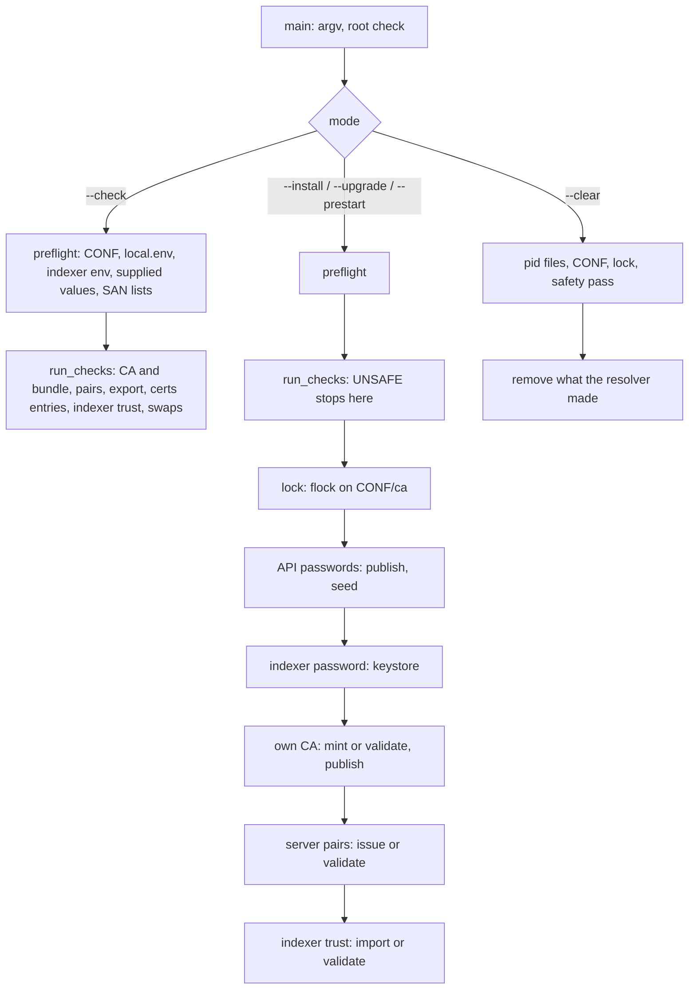

# Credential resolver

`wazuh-manager-resolve-credentials.py` is installed as `bin/wazuh-manager-resolve-credentials`. It sets up the
manager's passwords and trust material at installation, and checks and completes them before every start:

- the two Server API passwords, seeded into `rbac.db` and published for the dashboard;
- the indexer password, stored in the keystore;
- the manager's CA and its two server pairs (agent listener, Server API);
- the indexer's CA and the client pair the indexer issues for this manager.

It is one self-contained Python file run as root by the manager's bundled interpreter in isolated mode
(`#!/var/wazuh-manager/framework/python/bin/python3 -I`), with the standard library and `cryptography` only.

It is **not** a daemon and runs no host tool: the only programs it starts are Wazuh's own, by absolute path. It
does not touch `/etc/wazuh`. It never repairs an owner or a mode, never re-issues a certificate that is already
in place, and never replaces material an operator staged.

The operator contract (files, keys, modes, messages, procedures) is
[docs/ref/getting-started/credentials.md](../../../docs/ref/getting-started/credentials.md). This README is the
developer side.

## Requirements

| ID | Requirement | Status |
|----|-------------|--------|
| RF-1 | Five modes: `--install`, `--upgrade` (both exit 0 whatever happens), `--prestart` (default) and `--check` (exit 1 on any problem), `--clear`; exit 2 for usage errors, a non-root caller, a held lock, an internal error | kept |
| RF-2 | Values are looked up in the process environment, then `<CONF>/local.env`, then (indexer password only) `/etc/wazuh-indexer/export/credentials.env` | kept |
| RF-3 | Server API passwords: supplied values are validated and never replaced by generated ones; on a master with no `rbac.db`, publish to `<CONF>/export/credentials.env` first, then seed through `rbac_control.py`; a worker seeds nothing | kept |
| RF-4 | Indexer password stored in the keystore when absent; never generated, never published | kept |
| RF-5 | Own CA in `<CONF>/ca/`: minted at `--install` only when nothing exists, never beside existing pairs or a bundle; staged CAs (with or without key) used as they are; published in `export/ca.pem`; `certs/root-ca.pem` written only when absent | kept |
| RF-6 | Server pairs issued at `--install` only, each with its own SAN list (explicit or discovered from the default-route interfaces); otherwise validated, never repaired | kept |
| RF-7 | Indexer trust imported from the indexer's export with a marker written first, re-imported when the source changes; staged files (no marker) validated, never replaced; the client pair needs `clientAuth` | kept |
| RF-8 | `--check` is read-only (no lock, no subprocess, no write) and reports `UNSAFE`/`INVALID`, never `MISSING`; `--prestart` runs the same tests first | kept |
| RF-9 | `--clear` refuses while a daemon runs, removes what the resolver made, keeps what it was given | kept |
| RNF-1 | No secret on argv, in output or in the environment of a subprocess; secrets travel on stdin | kept |
| RNF-2 | Every entry under `<CONF>`, the indexer export and the home is reached through its parent's descriptor without following links; a writing run that finds anything unsafe writes nothing | kept |
| RNF-3 | One writing run at a time (lock on `<CONF>/ca`) | kept |
| RNF-4 | Runs on the bundled interpreter with `cryptography` as pinned by `framework/requirements.txt`; no other dependency | kept |

## Design decisions

| ID | Decision | Why |
|----|----------|-----|
| D-1 | `<CONF>` is the fixed `/etc/wazuh-manager`; `-H` moves the home only | the same constant the C, C++ and Python code use; no variable may redirect where root writes |
| D-2 | Called from `wazuh-manager-control`, not from the unit's `ExecStartPre` | the control script already orders `--check` before the configuration validation and before the stop of a restart |
| D-3 | Seeds through `framework/python/bin/python3 -I framework/scripts/rbac_control.py`, not `bin/rbac_control` | the wrapper runs `dirname`, `basename` and `sed`; the resolver must run no host tool |
| D-4 | Accepts a group-writable `<CONF>` (its owner and group are checked) and opens nothing in it by name twice | `authd`, `remoted` and the Server API write there; every entry is checked on its own descriptor |
| D-5 | `ca/` and `export/` (both `root:root 0700`) are told apart by content, and the test is repeated on the descriptors a writing run uses | their specs are identical, so only what they hold reveals a swap, and a rename between a test by name and the write must not redirect it |
| D-6 | A stale `export/ca.pem` is `INVALID` with the remedy, not `UNSAFE` | it is what staging a CA again by hand leaves, not an attack |
| D-7 | Never mint a CA beside existing pairs or a bundle | a second CA would leave the kept pairs without a trusted issuer |
| D-8 | Import markers are written before the files | an interrupted import is then recognisable and finished, never mistaken for staged files |
| D-9 | The client pair must carry `extendedKeyUsage` `clientAuth` | an EKU-less leaf is refused; the indexer issues the pair with it |
| D-10 | A server pair is accepted only when an issuer that is valid now signs it | rotation CAs may stay in the bundle after they expire |
| D-11 | `--clear` reads only pid file **names** in `var/run` | nothing in that service-writable directory is opened; a planted pid file can only block |
| D-12 | A rejected `local.env` (unsafe or malformed) stops generation and seeding for that run | a password the operator meant to set must never be replaced by a generated one that then gets seeded |
| D-13 | `OPENSSL_armcap=0` is set before anything imports OpenSSL | some arm64 hypervisors advertise SVE they do not implement; other entry points get it from `generic_wrapper.sh` |

## Architecture



Every step re-checks what it reads, and the problems are reported through one `Report`, which prints each line
once. `--install` and `--upgrade` always exit 0; the start is where the verdict counts.

## Layout

| Path | Responsibility |
|------|----------------|
| `wazuh-manager-resolve-credentials.py` | the program. Sections, in order: constants · `Paths` (every location, injectable for tests) · `Report` · safe file-system layer (`open_top`, `open_dir`, `read_file`, `write_file`, `ensure_dir`) · `.env` grammar and lookup · Wazuh subprocesses · passwords · Server API passwords · indexer password · own CA · server pairs and SANs · indexer trust · whole-tree checks · lock · modes · `--clear` · `main` |
| `tests/conftest.py` | the sandbox: a private `root:root` tree with stub `wazuh-manager-conf`, `wazuh-manager-keystore` and `rbac_control.py`, an indexer export, a key pool |
| `tests/test_*.py` | the suite (below) |

Installed by `InstallServer()` in `src/init/inst-functions.sh` (line 1 rewritten for a non-default home), shipped
by both packages, run by `postinst`/`%post`, `install.sh` and `src/init/wazuh-server.sh`.

## Consumer contract

| Consumer | Reads | Contract |
|----------|-------|----------|
| the dashboard on the same host | `<CONF>/export/credentials.env`, `export/ca.pem` | `NAME=value` lines `WAZUH_MANAGER_API_PASSWORD`, `WAZUH_MANAGER_WUI_PASSWORD`; `root:root 0600` in a `root:root 0700` directory; `ca.pem` is the manager's CA |
| remoted, authd, apid | `certs/remoted.pem`, `apid.pem`, `root-ca.pem` | `root:wazuh-manager 0640`; leaf followed by the CA |
| indexer connector, clusterd | `certs/indexer-ca.pem`, `indexer-connector.pem`, `indexer-connector-key.pem`; keystore `indexer` family | `root:wazuh-manager 0640` |
| `wazuh-manager-control` | exit status and stderr of `--check` / `--prestart` | non-zero refuses the start; for `--check` the message follows the relayed lines: `UNSAFE` → unsafe, `INVALID` → invalid, neither → cannot check (error 22); `--prestart` → unresolved (error 21) |
| the indexer (producer) | — | `/etc/wazuh-indexer/export/{credentials.env,ca.pem,manager-client.pem,manager-client-key.pem}`, root-owned, not group- or world-writable |

## Tests

Run as root (they refuse otherwise, so a case that could not run fails rather than skips):

```bash
sudo python3 -m pytest -q src/init/credentials/tests
```

CI: `.github/workflows/5_testunit_credentials.yml`, on the interpreter version in `framework/.python-version` with
`cryptography==50.0.1`, plus a `py_compile` of the program and an `sh -n` of `src/init/wazuh-server.sh`. The
installed behaviour is covered by `tests/integration/test_manager_control/test_unsafe_credentials_file.py` in the
manager integration workflow.

| File | Pins |
|------|------|
| `test_cli.py` | arguments, modes, exit codes, output streams, `-q`, `-H` |
| `test_env.py` | the `.env` grammar and the lookup order |
| `test_runner.py` | subprocesses: absolute programs, fixed environment, secrets on stdin only |
| `test_safety.py` | the file-system primitives and the specification of `<CONF>` |
| `test_threats.py` | the service account against the resolver: planted, swapped, linked and hidden entries |
| `test_lock.py` | one writing run at a time |
| `test_passwords.py` | password rules, publish-then-seed, worker role, indexer password and keystore |
| `test_framework_parity.py` | the resolver's rule and generator against the Server API's (read from `framework/` as source) |
| `test_ca.py` | the CA states, minting only when nothing exists, the bundle kept byte for byte |
| `test_pairs.py` | server pair profile, keep / half / missing, issuer validity |
| `test_sans.py` | explicit SAN lists and discovery from `/proc` fixtures |
| `test_indexer_trust.py` | the import rule, markers, `clientAuth`, interrupted imports and their recovery |
| `test_check.py` | `--check` is read-only and never `MISSING`; the whole-tree checks; `--prestart` checks first |
| `test_clear.py` | `--clear`: liveness, what goes and what stays, no link followed, nothing removed when unsafe |

## Operational notes

- `--check` is safe while the manager runs; `--prestart`, `--install` and `--upgrade` open the keystore and must
  not run while `wazuh-manager-modulesd` holds it (the control script orders this).
- The lock is an `flock` on `<CONF>/ca`; a second writing run waits up to 60 seconds, then exits 2.
- Output: progress on stdout prefixed `resolve-credentials:`, one problem per line on stderr; no line carries a
  secret.

## Developer FAQ

- **Why not `ExecStartPre=` in the unit?** `wazuh-manager-control` must run `--check` before validating the
  configuration and, on a restart, before stopping anything; the unit cannot express that order (D-2).
- **Why not `bin/rbac_control seed`?** The wrapper runs host tools; the resolver runs the same Python script
  directly (D-3).
- **Why are some checks repeated after the lock?** `<CONF>` is writable by the service group, so `ca/` and
  `export/` can be renamed between a check by name and the write; the write descriptors are checked again (D-5).
- **Why does `--clear` not read pid files?** Their directory is writable by the service account; the pid is taken
  from the name (D-11).
- **Why is `WAZUH_MANAGER_CERT_SANS` only warned about?** It named the indexer pair the manager used to issue; it
  is ignored, not refused, so an old `local.env` does not stop a start.
