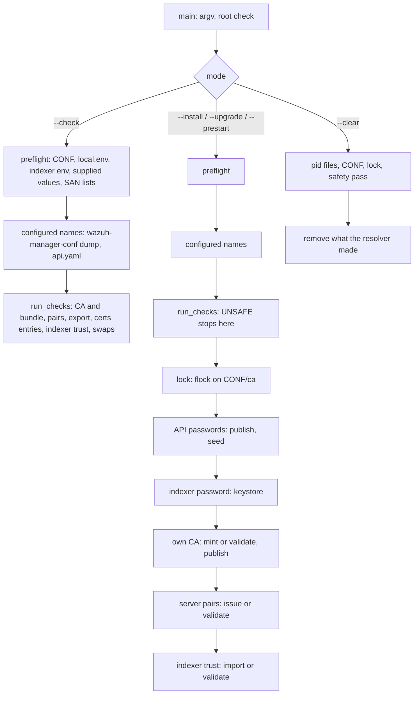

# Credential resolver

`wazuh-manager-resolve-credentials.py` is installed as `bin/wazuh-manager-resolve-credentials`. It sets up the
manager's passwords and trust material at installation, and checks and completes them before every start:

- the two Server API passwords, seeded into `rbac.db` and published for the dashboard;
- the indexer password, stored in the keystore;
- the manager's CA and its two server pairs (agent listener, Server API);
- the indexer's CA and the client pair the indexer issues for this manager.

It is one self-contained Python file run as root by the manager's bundled interpreter in isolated mode
(`#!/var/wazuh-manager/framework/python/bin/python3 -I`), with the standard library, `cryptography` and, to read
the Server API's `api.yaml`, PyYAML.

It is **not** a daemon and runs no host tool: the only programs it starts are Wazuh's own, by absolute path. It
does not touch `/etc/wazuh`. It never repairs an owner or a mode, never re-issues a certificate that is already
in place, and never replaces material an operator staged.

The operator contract (files, keys, modes, messages, procedures) is
[docs/ref/getting-started/credentials.md](../../../docs/ref/getting-started/credentials.md). This README is the
developer side.

## Requirements

| ID | Requirement | Status |
|----|-------------|--------|
| RF-1 | Five modes: `--install`, `--upgrade` (both exit 0 whatever happens), `--prestart` (default) and `--check` (exit 1 on any problem), `--clear`; exit 2 for usage errors, a non-root caller, a held lock, an internal error. A certificate the resolver cannot parse, or a node name too long for a common name, is `INVALID`, never an internal error | kept |
| RF-2 | Values are looked up in the process environment, then `<CONF>/local.env`, then (indexer password only) `/etc/wazuh-indexer/export/credentials.env` | kept |
| RF-3 | Server API passwords: supplied values are validated and never replaced by generated ones; on a master with no `rbac.db`, publish to `<CONF>/export/credentials.env` first, then seed through `rbac_control.py`; a worker seeds nothing | kept |
| RF-4 | Indexer password stored in the keystore when absent; never generated, never published | kept |
| RF-5 | Own CA in `<CONF>/ca/`: minted at `--install` only when nothing exists, never beside existing pairs or a bundle; staged CAs (with or without key) used as they are; published in `export/ca.pem` by every writing mode when the copy there is absent or differs; `certs/root-ca.pem` written only when absent | kept |
| RF-6 | Server pairs issued at `--install` only, each with its own SAN list (explicit or discovered from the default-route interfaces); otherwise validated, never repaired; a staged `apid` pair may chain through intermediate CAs carried after the leaf, a `remoted` leaf through those kept in `certs/root-ca.pem` | kept |
| RF-10 | The pairs and the bundle are checked under the names the daemons are configured with (`remote.https.certificate/key/ca_certificate`, `auth.ssl_manager_cert/key`, `api.yaml` `https.cert/key`), which must be directly in `<CONF>/certs`; only the default names are issued; a turned-off listener's pair (`auth.disabled`, `https.enabled: false`) is not checked | kept |
| RF-7 | Indexer trust imported from the indexer's export with a marker written first, re-imported when the source changes; staged files (no marker) validated, never replaced; the CA and the pair taken together or not at all (an export that would leave the pair in place without its issuer changes nothing); the client pair needs `clientAuth` and may chain through intermediate CAs carried after the leaf | kept |
| RF-8 | `--check` is read-only (no lock, no write, no subprocess but the configuration reader `wazuh-manager-conf --skip-file-checks dump`) and reports `UNSAFE`/`INVALID`, never `MISSING`; it refuses whatever `--prestart` would refuse, so a restart is refused before anything is stopped; `--prestart` runs the same tests first | kept |
| RF-9 | `--clear` refuses while a daemon runs, removes what the resolver made, keeps what it was given | kept |
| RNF-1 | No secret on argv, in output or in the environment of a subprocess; secrets travel on stdin | kept |
| RNF-2 | Every entry under `<CONF>`, the indexer export and the home is reached through its parent's descriptor without following links; a writing run that finds anything unsafe writes nothing | kept |
| RNF-3 | One writing run at a time (lock on `<CONF>/ca`) | kept |
| RNF-4 | Runs on the bundled interpreter with `cryptography` and PyYAML as pinned by `framework/requirements.txt`; no other dependency | kept |

## Design decisions

| ID | Decision | Why |
|----|----------|-----|
| D-1 | `<CONF>` is the fixed `/etc/wazuh-manager`; `-H` moves the home only | the same constant the C, C++ and Python code use; no variable may redirect where root writes |
| D-2 | Called from `wazuh-manager-control`, not from the unit's `ExecStartPre` | the control script already orders `--check` before the configuration validation and before the stop of a restart |
| D-3 | Seeds through `framework/python/bin/python3 -I framework/scripts/rbac_control.py`, not `bin/rbac_control` | the wrapper runs `dirname`, `basename` and `sed`; the resolver must run no host tool |
| D-4 | Accepts a group-writable `<CONF>` (its owner and group are checked) and opens nothing in it by name twice | `authd`, `remoted` and the Server API write there; every entry is checked on its own descriptor |
| D-5 | `ca/` and `export/` (both `root:root 0700`) are told apart by content, and the test is repeated on the descriptors a writing run uses | their specs are identical, so only what they hold reveals a swap, and a rename between a test by name and the write must not redirect it |
| D-6 | A stale `export/ca.pem` is published again by every writing mode, and `--check` lets the start go on | it is what staging a CA again by hand leaves, not an attack; refusing it left the manager down until someone ran `--install` by hand |
| D-7 | Never mint a CA beside existing pairs or a bundle | a second CA would leave the kept pairs without a trusted issuer |
| D-8 | Import markers are written before the files | an interrupted import is then recognisable and finished, never mistaken for staged files |
| D-9 | The client pair must carry `extendedKeyUsage` `clientAuth` | an EKU-less leaf is refused; the indexer issues the pair with it |
| D-10 | A pair is accepted only when every CA on its path to an anchor is valid now, `CA:TRUE` and allowed to sign | rotation CAs may stay in the bundle after they expire; the path is built through a usable one |
| D-11 | `--clear` reads only pid file **names** in `var/run` | nothing in that service-writable directory is opened; a planted pid file can only block |
| D-12 | A rejected `local.env` (unsafe or malformed) stops generation and seeding for that run | a password the operator meant to set must never be replaced by a generated one that then gets seeded |
| D-13 | `OPENSSL_armcap=0` is set before anything imports OpenSSL | some arm64 hypervisors advertise SVE they do not implement; other entry points get it from `generic_wrapper.sh` |
| D-14 | Paths are built by `x509.verification`'s client verifier with relaxed extension policies (CA: `basicConstraints` required; leaf: anything), then the resolver checks the leaf, and on every CA of the path, the anchor included, `keyCertSign` and an `extendedKeyUsage` that allows the leaf's purpose (OpenSSL's rule: `anyExtendedKeyUsage` alone does not; agents, the dashboard and remoted's own check use OpenSSL). A self-signed certificate in the leaf's file is never offered as an intermediate. Intermediates come only from the pair's own file, after the leaf, and never for remoted, whose leaf must chain to `certs/root-ca.pem` alone (an intermediate kept there is an anchor); anchors stay `ca/root-ca.pem` (apid), `certs/root-ca.pem` (remoted), `indexer-ca.pem` (connector) | the WebPKI defaults would demand an `authorityKeyIdentifier` and a `subjectAltName` that other tooling's certificates may lack, and a server verifier needs an expected name; the relaxed verifier checks neither `keyCertSign` nor the leaf, hence the resolver's own checks. remoted's `GET /cacerts` hands agents the bundle only when the leaf chains to it with no other certificate (partial chain), and the resolver makes the same judgement. No host tool (`openssl verify`) is run |
| D-15 | The indexer trust is selected without writing, the resulting pair is validated against the resulting CA, and only a passing combination is written; `--check` runs the same selection and reports its refusals | writing the CA first let an export with a bad pair, or a CA that did not issue the staged pair, break a working connector, and a restart ran `--check` before the stop but the import after it |
| D-16 | `certs/` is exactly `0750` and `<CONF>` must leave its group `rwx` | a mode that locks the daemons out passed every other test and only failed later, in a daemon that could not open its certificate |
| D-17 | A configured TLS file is followed only directly inside `<CONF>/certs`; a path elsewhere, or with a `.`/`..` component, is `INVALID` and never opened. Relative paths resolve as their consumer resolves them (the home for `wazuh-manager.conf`, `<CONF>/certs` for `api.yaml`) | both configuration files are writable by the service account, which could otherwise make root open any file; `certs/` is root's and its files are already checked |
| D-18 | The configuration is read with `wazuh-manager-conf --skip-file-checks dump` in every mode, `--check` included, and `api.yaml` with `yaml.safe_load`; one that cannot be read is `INVALID` and the default names are checked | the schema's defaults and path rules live in one place; `--check` must judge the same files as `--prestart` |

## Architecture



Every step re-checks what it reads, and the problems are reported through one `Report`, which prints each line
once. `--install` and `--upgrade` always exit 0; the start is where the verdict counts.

## Layout

| Path | Responsibility |
|------|----------------|
| `wazuh-manager-resolve-credentials.py` | the program. Sections, in order: constants · `Paths` (every location, injectable for tests) · `Report` · safe file-system layer (`open_top`, `open_dir`, `read_file`, `write_file`, `ensure_dir`) · `.env` grammar and lookup · Wazuh subprocesses · passwords · Server API passwords · indexer password · configured TLS files · own CA · server pairs and SANs · indexer trust · whole-tree checks · lock · modes · `--clear` · `main` |
| `tests/conftest.py` | the sandbox: a private `root:root` tree with stub `wazuh-manager-conf` (role probe and `dump` with the schema's defaults), `wazuh-manager-keystore` and `rbac_control.py`, an indexer export, an `api.yaml`, a key pool |
| `tests/test_*.py` | the suite (below) |

Installed by `InstallServer()` in `src/init/inst-functions.sh` (line 1 rewritten for a non-default home), shipped
by both packages, run by `postinst`/`%post`, `install.sh` and `src/init/wazuh-server.sh`.

## Consumer contract

| Consumer | Reads | Contract |
|----------|-------|----------|
| the dashboard on the same host | `<CONF>/export/credentials.env`, `export/ca.pem` | `NAME=value` lines `WAZUH_MANAGER_API_PASSWORD`, `WAZUH_MANAGER_WUI_PASSWORD`; `root:root 0600` in a `root:root 0700` directory; `ca.pem` is the manager's CA |
| remoted, authd, apid | `certs/remoted.pem`, `apid.pem`, `root-ca.pem`, or the names configured in `wazuh-manager.conf` and `api.yaml` (directly in `certs/`) | `root:wazuh-manager 0640`; the leaf, then its intermediates and optionally the root (what `--install` writes: leaf + CA); each daemon sends the whole file |
| indexer connector, clusterd | `certs/indexer-ca.pem`, `indexer-connector.pem`, `indexer-connector-key.pem`; keystore `indexer` family | `root:wazuh-manager 0640` |
| `wazuh-manager-control` | exit status and stderr of `--check` / `--prestart` | non-zero refuses the start; for `--check` the message follows the relayed lines: `UNSAFE` → unsafe, `INVALID` → invalid, neither → cannot check (error 22); `--prestart` → unresolved (error 21) |
| the indexer (producer) | — | `/etc/wazuh-indexer/export/{credentials.env,ca.pem,manager-client.pem,manager-client-key.pem}`, root-owned, not group- or world-writable |

## Tests

Run as root (they refuse otherwise, so a case that could not run fails rather than skips):

```bash
sudo python3 -m pytest -q src/init/credentials/tests
```

CI: `.github/workflows/5_testunit_credentials.yml`, on the interpreter version in `framework/.python-version` with
`cryptography==50.0.1` and `PyYAML==6.0.3`, plus a `py_compile` of the program and an `sh -n` of `src/init/wazuh-server.sh`. The
installed behaviour is covered by `tests/integration/test_manager_control/test_unsafe_credentials_file.py` in the
manager integration workflow.

| File | Pins |
|------|------|
| `test_cli.py` | arguments, modes, exit codes, output streams, `-q`, `-H` |
| `test_env.py` | the `.env` grammar and the lookup order |
| `test_runner.py` | subprocesses: absolute programs, fixed environment, secrets on stdin only |
| `test_safety.py` | the file-system primitives and the specification of `<CONF>` and `certs/` |
| `test_threats.py` | the service account against the resolver: planted, swapped, linked and hidden entries |
| `test_lock.py` | one writing run at a time |
| `test_passwords.py` | password rules, publish-then-seed, worker role, indexer password and keystore |
| `test_framework_parity.py` | the resolver's rule and generator against the Server API's (read from `framework/` as source) |
| `test_ca.py` | the CA states, minting only when nothing exists, the bundle kept byte for byte, an unparsable CA certificate |
| `test_pairs.py` | server pair profile, keep / half / missing, issuer validity, chains through intermediate CAs, CA purpose, the common-name length of the node name, unparsable certificates in the pairs and the bundle |
| `test_sans.py` | explicit SAN lists and discovery from `/proc` fixtures |
| `test_indexer_trust.py` | the import rule, markers, `clientAuth`, interrupted imports and their recovery, connector chains through intermediate CAs, the CA and pair imported together or not at all, unparsable indexer CA and connector certificates |
| `test_check.py` | `--check` is read-only and never `MISSING`; the whole-tree checks; `--prestart` checks first; a stale `export/ca.pem` published again |
| `test_configured_paths.py` | pairs and bundle under configured names, names outside `certs/` refused unread, turned-off listeners, reading `wazuh-manager.conf` and `api.yaml` |
| `test_clear.py` | `--clear`: liveness, what goes and what stays, no link followed, nothing removed when unsafe |

## Operational notes

- `--check` is safe while the manager runs; `--prestart`, `--install` and `--upgrade` open the keystore and must
  not run while `wazuh-manager-modulesd` holds it (the control script orders this).
- The lock is an `flock` on `<CONF>/ca`; a second writing run waits up to 60 seconds, then exits 2.
- Output: progress on stdout prefixed `resolve-credentials:`, one problem per line on stderr; no line carries a
  secret.

## Developer FAQ

- **Why not `ExecStartPre=` in the unit?** `wazuh-manager-control` must run `--check` before validating the
  configuration and, on a restart, before stopping anything; the unit cannot express that order (D-2).
- **Why not `bin/rbac_control seed`?** The wrapper runs host tools; the resolver runs the same Python script
  directly (D-3).
- **Why are some checks repeated after the lock?** `<CONF>` is writable by the service group, so `ca/` and
  `export/` can be renamed between a check by name and the write; the write descriptors are checked again (D-5).
- **Why does `--clear` not read pid files?** Their directory is writable by the service account; the pid is taken
  from the name (D-11).
- **Why is `WAZUH_MANAGER_CERT_SANS` only warned about?** It named the indexer pair the manager used to issue; it
  is ignored, not refused, so an old `local.env` does not stop a start.
