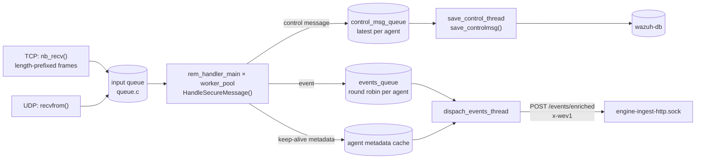

# remoted (C daemon)

`wazuh-manager-remoted` is the manager's agent gateway. This directory holds its C side: the process
(options, configuration, privilege drop, PID file), the local request socket, the shared-files
publisher, and the whole **legacy channel** that serves 4.x agents over AES-encrypted TCP/UDP on
port 1514. The HTTPS agent API on port 1517 — what every 5.x agent uses — is the C++ module in
[`remoted_module/`](remoted_module/README.md), which this daemon **links** and starts in its own
thread. Manager only: [`src/CMakeLists.txt`](../CMakeLists.txt) adds this directory in its
`if(NOT IS_AGENT)` branch.

Three documentation layers cover remoted, each with its own job:

- **This README** — the C daemon: [layout](#layout), [start-up](#start-up),
  [threads](#threads), [the legacy pipeline](#the-legacy-pipeline), how the
  [C and C++ halves fit together](#the-c-and-c-halves), [invariants](#invariants),
  [design decisions](#design-decisions-d1d17) and [tests](#tests).
- **[`remoted_module/README.md`](remoted_module/README.md)** — the HTTPS agent API: the HTTP(S)
  server, JWT authentication, every endpoint, enrollment, back-pressure, the admin socket, metrics;
  its [Integration in remoted](remoted_module/README.md#integration-in-remoted) section is the
  module-side view of the boundary described here.
- **[`docs/ref/modules/remoted/`](../../docs/ref/modules/remoted/README.md)** — the operator
  contract: the [architecture](../../docs/ref/modules/remoted/architecture.md) of both channels,
  every option in [configuration](../../docs/ref/modules/remoted/configuration.md) (the
  `<remote>` section and the `remoted.*` internal options), the command line and the local request
  socket's commands (both in the [overview](../../docs/ref/modules/remoted/README.md)), the
  [event protocol](../../docs/ref/modules/remoted/event-protocol.md) towards the engine and the
  [stateless metadata](../../docs/ref/modules/remoted/stateless-metadata.md) enrichment. Operator
  facts live there; this file links them.

## Requirements

What the C daemon has to do, and where each requirement is answered.

### Functional (RF)

| # | Requirement | Where it is answered |
|---|---|---|
| RF-1 | Load the `remote` and `global` sections of the effective configuration, the `auth` policy `POST /enroll` applies, and every `remoted.*` internal option, refusing an out-of-range value at load | `RemotedConfig()` (`src/config.c`) through `w_mconf_load()`/`w_mconf_section()` and `Read_Remote_JSON()`/`Read_Global_JSON()` in [`src/config/`](../config/README.md); the `auth` section through `Read_Authd_JSON()` in `remoted_enrollment_config()` (`src/secure.c`) |
| RF-2 | `-t`: validate the file with file checks on, every internal option the C++ module owns, and the TLS material the listener would load; exit non-zero on the first error | `main()` (`src/main.c`): `w_mconf_validate()` then `w_remoted_validate_module_config()` (`src/secure.c`), which calls `remoted_module_validate_tls()` |
| RF-3 | Refuse to start, before the PID file exists, when a TLS file of the HTTPS listener is unreadable by the service user, with exactly one deterministic message | `w_remoted_preflight_tls_files()` / `w_remoted_check_tls_files()` (`src/secure.c`), messages `REMOTED_TLS_FILES_*` (`include/remoted.h`) — D2 |
| RF-4 | Start the HTTPS agent API with a typed configuration on every start, whatever the legacy setting | `HandleSecure()` → `remoted_module_start(mtLoggingFunctionsWrapper, &rm_config)`, `atexit(remoted_module_stop)` — D1, D3 |
| RF-5 | Serve `queue/sockets/remote.sock` on every start: `getstats`, `getconfig` (`remote`, `internal`, `global`), `assigngroup`, and the forwarding of a request to a 4.x agent | `remcom_main()` (`src/remcom.c`), `req_sender()`/`req_dispatch()` (`src/request.c`) — D9 |
| RF-6 | Keep each group's shared files and `merged.mg` current on disk (the HTTPS `/download` route reads them), except on a worker node or with `-m`/`remoted.merge_shared=0` | `update_shared_files()` / `c_files()` (`src/manager.c`); `main()` clears `merge_shared` on a worker |
| RF-7 | Bind the legacy TCP and/or UDP listener only when `remote.legacy` is enabled, and start the legacy subsystems only then | `HandleRemote()` (`src/remoted.c`, `logr.proto`), `start_legacy_subsystems()` (`src/secure.c`, `logr.legacy_enabled`) — D6 |
| RF-8 | Authenticate a legacy frame by decrypting it with the key of the agent it names (or of the agent registered for its source address), and refuse a stale frame or a second live session for one key | `HandleSecureMessage()`, `rem_resolve_session_conflict()` (`src/secure.c`); `ReadSecMSG()` in `src/shared/os_crypto/shared/msgs.c` |
| RF-9 | Process 4.x control messages (keep-alive, startup, shutdown, request answers) into wazuh-db, coalescing a backlog to the latest message per agent | `validate_control_msg()` / `save_controlmsg()` (`src/manager.c`), the indexed `control_msg_queue` and `save_control_thread()` (`src/secure.c`) |
| RF-10 | Forward 4.x events to the engine, batched per agent and prefixed with the agent's metadata, over `POST /events/enriched` | `dispach_events_thread()` (`src/secure.c`), metadata cache `src/agent_metadata_db.c` — framing in [event protocol](../../docs/ref/modules/remoted/event-protocol.md) |
| RF-11 | Discard the 4.x message types 5.x no longer processes (`5:` dbsync, `s:` chunked inventory sync) before they reach the engine; keep honouring the `u:upgrade_module:` acknowledgment | `HandleSecureMessage()`, `discard_legacy_agent_message()` (`src/secure.c`) |
| RF-12 | Deliver pending `remote_upgrade` tasks to connected 4.x agents over the legacy channel, with the manager CA pushed before the `upgrade` command | `legacy_upgrade_task_delivery()` (`src/legacy_task_delivery.c`) — D12, D13 |
| RF-13 | At start, mark disconnected only the agents silent for longer than `global.agents_disconnection_time` | `HandleSecure()`, `wdb_disconnect_agents()` — D7 |
| RF-14 | Reload `client.keys` for the legacy keystore every `remoted.keyupdate_interval` seconds | `rem_keyupdate_main()` / `check_keyupdate()` (`src/sendmsg.c`) |

### Non-functional (RNF)

| # | Requirement | Where it is answered |
|---|---|---|
| RNF-1 | A remoted that is about to exit must never look running to `wazuh-manager-control status` | the preflight runs before `CreatePID()` — D2 |
| RNF-2 | An agent that does not read must not hold a worker thread | control ACKs go through `send_msg_nowait()` and the connection is closed on a full queue (`send_control_ack()`) — D10 |
| RNF-3 | Peers without a registered key must not exhaust the descriptors registered agents need | `remoted.unauthenticated_max` cap in `handle_new_tcp_connection()`, `remoted.unauthenticated_timeout` sweep in `reap_unauthenticated_connections()`, warning `rem_check_unauthenticated_cap()` |
| RNF-4 | Rejections any peer can trigger at line rate must not flood the log, and one noisy cause must not hide another | per-reason throttle `rem_log_rejected_frame()` (`src/secure.c`) — D8 |
| RNF-5 | Memory used by the legacy queues is bounded in bytes as well as in items | `rem_set_input_queue_max_bytes()` (`src/queue.c`), `batch_queue_set_bytes_limit()`; `RemotedConfig()` refuses a byte cap below 1024 |
| RNF-6 | An offline engine must not stall the receive path | the dispatcher drains and drops one agent turn at a time with a 0.5–30 s back-off (`dispach_events_thread()`) |
| RNF-7 | The C daemon stays C: no C++ source enters its glob, and the only C↔C++ contact is one header | [`CMakeLists.txt`](CMakeLists.txt) — D1 |
| RNF-8 | Unit-testable without the C++ module or a live manager | `remoted_lib` excludes `main.c`; `WAZUH_UNIT_TESTING` exports `STATIC` functions; the module's entry points are `__wrap_`ped ([Tests](#tests)) |

## Layout

| Path | Contents |
|---|---|
| `src/main.c` | `main()`: options, home (`w_homedir()`: `WAZUH_MANAGER_FORCE_HOME`, then `WAZUH_MANAGER_HOME`, then auto-detected; `-D` overrides all three), `chdir`, `RemotedConfig()`, node role, `-t`, daemonize, group drop, `HandleRemote()` |
| `src/remoted.c` | the globals `keys`, `logr`, `node_name`, `cluster_name`; `HandleRemote()`: raise `RLIMIT_NOFILE`, bind the legacy sockets, load the OpenSSL configuration as root, drop to the user, TLS preflight, PID file, `HandleSecure()` |
| `src/secure.c` | `HandleSecure()` and the event loop; building the module configuration (`w_remoted_build_module_config()` and the `remoted_module_*_config()` readers of the `remoted.*` options the module owns); the TLS preflight; the legacy subsystems, the frame handler `HandleSecureMessage()`, the control-message thread and the event dispatcher |
| `src/config.c` | `RemotedConfig()`, every legacy `remoted.*` internal option and the agent module limits (`fim.*`, `syscollector.*`, `sca.*`); the three `getconfig` answers |
| `src/manager.c` | groups and multigroups: the shared-files scan, `merged.mg`, pushing it to 4.x agents (`wait_for_msgs()`), control-message validation and persistence, group assignment (`assign_group_to_agent()`, through the master on a worker) |
| `src/remcom.c` | `remote.sock`: the JSON commands, or a non-JSON request handed to `req_sender()` |
| `src/request.c` | the request table: forward a request to a 4.x agent and wait for its answer (`req_dispatch()`, one thread per request, bounded by `remoted.request_pool`); `req_send_and_wait()` for in-process callers |
| `src/legacy_task_delivery.c`, `.h` | the 4.x `remote_upgrade` poller and its CA push; the file's opening comment is its design document |
| `src/agent_metadata_db.c`, `.h` | the in-memory keep-alive metadata cache (`OSHash` + rwlock) the dispatcher prefixes batches with, and its cleanup thread |
| `src/agent_version_check.c` | `agent_meta_check_version()`, alone in its translation unit (D14) |
| `src/netbuffer.c` | per-socket TCP receive/send buffers: length-prefixed framing, authenticated/unauthenticated tracking |
| `src/netcounter.c` | per-descriptor message-counter fence (`rem_setCounter()`/`rem_getCounter()`) |
| `src/queue.c` | the input queue between the event loop and the workers, with its byte cap |
| `src/sendmsg.c` | the keystore rwlock (`key_lock_*()`), key reload, `send_msg()` / `send_msg_nowait()` |
| `src/state.c`, `.h` | the legacy channel's counters (`rem_inc_*()`) and the `getstats` answer |
| `src/bulk.c`, `.h` | growable byte buffer for the dispatcher's request bodies |
| `include/remoted.h` | everything the units share: the structures, prototypes, globals and the `REMOTED_TLS_FILES_*` messages |
| `remoted_module/` | the C++ HTTPS agent API, its own CMake project, README and tests |

Two headers here are compiled into **agent** test builds as well:
`src/unit_tests/wrappers/wazuh/remoted/` includes `include/remoted.h` and `src/agent_metadata_db.h`,
and `src/shared/CMakeLists.txt` compiles those wrappers into `libwazuh_test.a` for every target — so
the agent legs of the legacy unit-test workflows fire on either file.

### Build

[`CMakeLists.txt`](CMakeLists.txt) builds:

- `add_subdirectory(remoted_module)` first — the C++ module, a shared library whose sources never
  enter this project's glob;
- `remoted_lib`, a static library of every `src/*.c` **except `main.c`**, linked against
  `wazuhext`, `config`, `wazuh_modulesd_lib` (statically: a compile error in any modulesd shim breaks
  remoted), `wazuh` ([`src/shared`](../shared/README.md)) and `remoted_module`. With `UNIT_TEST` it
  gets `WAZUH_UNIT_TESTING`, which turns `STATIC` functions into exported ones;
- `wazuh-manager-remoted` from `main.c` alone — only when `UNIT_TEST` is off, so a test tree has no
  daemon. Linked as CXX (the module is C++), output to `src/build/bin`, jemalloc and the runtime
  RUNPATH applied.

`ARGV0` is `wazuh-manager-remoted` (the log tag); the `#define ARGV0 "wazuh-remoted"` in
`include/remoted.h` is only an `#ifndef` fallback. `USER`/`GROUPGLOBAL` are `wazuh-manager` unless
`TARGET` is an agent.

## Start-up

1. `main()` resolves the home — `w_homedir()` (`WAZUH_MANAGER_FORCE_HOME`, then `WAZUH_MANAGER_HOME`,
   then the executable's path; see [`src/shared`](../shared/README.md)), overridden by `-D` — resolves a relative `-c` **before** the `chdir()` to that home, and loads the
   configuration. Every path the daemon and the module open afterwards is relative to the home or
   absolute (D5).
2. `w_is_worker()` sets `logr.worker_node`; a worker never builds `merged.mg`.
3. `-t` stops here (RF-2).
4. Daemonize, drop the group, `HandleRemote()`: raise the soft descriptor limit to
   `remoted.rlimit_nofile`, bind the legacy listener (when enabled), load the OpenSSL configuration
   while still root (D4), drop to the user, run the TLS preflight (D2), write the PID file.
5. `HandleSecure()`: shared-files scan and thread, `remote.sock`, the start-up disconnection pass
   (D7), start the C++ module with the preflight's configuration plus the `/control` block and the
   cluster name (D3), then the legacy subsystems (D6), then the event loop.

The event loop runs even with the legacy listener off: `logr.proto` is `0`, no socket is added and
`wnotify_wait()` idles.

## Threads

| Thread | Count | When |
|---|---|---|
| Main: event loop (`HandleSecure()`) — accept, read, write the legacy sockets; once a second, reap unauthenticated connections | 1 | always (idle without legacy) |
| `update_shared_files` — rescans groups every `remoted.shared_reload` seconds | 1 | always |
| `remcom_main` — `remote.sock` | 1 | always |
| `req_dispatch` — one forwarded request | ≤ `remoted.request_pool` | per request; non-JSON requests are refused without legacy |
| C++ module threads | — | always; see [`remoted_module/`](remoted_module/README.md) |
| `rem_handler_main` — decrypt and classify frames (`HandleSecureMessage()`) | `remoted.worker_pool` | legacy |
| `save_control_thread` — control messages into wazuh-db | 1 | legacy |
| `dispach_events_thread` — batches to the engine | 1 | legacy |
| `wait_for_msgs` — push `merged.mg` to 4.x agents | `remoted.sender_pool` | legacy |
| `agent_meta_cleanup_thread` — expire the metadata cache every 5 s | 1 | legacy |
| `legacy_upgrade_task_delivery` | 1 | legacy |
| `rem_keyupdate_main` — reload `client.keys` | 1 | legacy |
| `close_fp_main` — close idle `rids` files every `remote.legacy.rids_closing_time` | 1 | legacy |
| `current_timestamp` — `current_ts`, refreshed every second, the clock of the overtake logic and of the rejection throttle | 1 | legacy |

`main()` refuses `remoted.verify_msg_id=1` with `remoted.worker_pool` above 1: message-id
verification cannot be guaranteed across several workers.

### Locks

- The keystore is guarded by one rwlock (`key_lock_read/write/unlock()` in `src/sendmsg.c`); each
  `keyentry` also has its own mutex (`rem_resolve_session_conflict()`).
- **The key lock is ordered before the netbuffer mutex**: `send_msg()` holds it around
  `nb_queue()`. That is why `reap_unauthenticated_connections()` collects the sockets under the
  netbuffer mutex and closes them only after releasing it — `_close_sock()` takes the key lock.
- `send_msg()` / `send_msg_nowait()` must be called **without** the key lock held (comment in
  `include/remoted.h`); `validate_control_msg()` returns `send_ack` so the caller sends the ACK once
  it holds no lock.
- `_close_sock()` stamps the descriptor's counter fence before closing (`nb_close_socket()`), so a
  queued message from a closed connection cannot be taken for one of a later connection that reuses
  the descriptor number.

## The legacy pipeline

The operator view, with its data flow, is
[Architecture — Legacy pipeline](../../docs/ref/modules/remoted/architecture.md); the
implementation path is:

- A frame starts `!<id>!` (the agent id it claims) or carries no id, in which case the agent is
  looked up by source address. Until it decrypts, the id is only a claim: rejection lines name the
  source address, not an agent.
- A frame that decrypts but is not ahead of the agent's stored counters is refused without touching
  the session. A frame from a second connection takes the session over only once the current one has
  been quiet longer than `remote.legacy.connection_overtake_time`; otherwise it is refused, and the
  "key already in use" warning is held back until the conflict outlives that window.
- The control queue is an indexed queue keyed by agent id with upsert semantics: a newer
  keep-alive replaces a queued one (`rem_inc_ctrl_queue_replaced()`).
- The dispatcher posts one agent turn per request. When the engine socket cannot be opened, or a
  post fails, it drops that turn and backs off (0.5 s doubling, capped at 30 s), draining and
  dropping until a client opens again; a failed post logs `analysisd offline? POST failed (rc=<n>,
  http=<status>, curl=<code>). Dropping events until recovery.` Each event dropped this way is counted
  (`rem_inc_recv_events_failed()`) and reported at WARNING at most once per 90 s
  (`drop_consumer()`: `Dropped <n> event(s) in the last <s> s: unable to connect with analysisd.`); an
  event refused by the full queue on the way in is counted the same way, with its own warning at most
  once per 90 s (`maybe_log_events_queue_drop()`). Both go through `rem_log_events_dropped()`, one
  window per cause; the first line of each says `so far` instead of the period.

## The C and C++ halves

| | C (this directory) | C++ ([`remoted_module/`](remoted_module/README.md)) |
|---|---|---|
| Serves | legacy 1514, `remote.sock`, shared files on disk | HTTPS 1517 (every 5.x agent), `remote-admin-http.sock` |
| Keystore | `keys` (`OS_ReadKeys()`), reloaded by `rem_keyupdate_main` | its own `client.keys` reader, refreshed every `keyupdate_interval` (`rm_config.keystore_refresh_interval`) |
| Configuration | reads the document and the internal options | receives `remoted_module_config_t`, filled by `src/secure.c` |
| Logging | `debug_op` | through the `mtLoggingFunctionsWrapper` callback passed to `remoted_module_start()` |

The boundary is the C ABI in
[`remoted_module/include/remoted_module.h`](remoted_module/include/remoted_module.h):
`remoted_module_start()`/`remoted_module_stop()`, `remoted_module_init_tls_library()` (D4),
`remoted_module_validate_tls()` (RF-2), and `remoted_module_tls_ca_matches_leaf()` /
`remoted_module_tls_leaf_signer_pem()`, which the legacy poller uses to decide whether and which CA
to push (D13). Default TLS paths (`REMOTED_MODULE_DEFAULT_CA_PATH`,
`REMOTED_MODULE_DEFAULT_CA_CERTIFICATE_PATH`) come from that header, so the preflight probes the same
files the module loads.

**Enums mirrored by construction.** `src/config/include/remote-config.h` (the C reader) and
`remoted_module.h` each define the verification mode, the dual-stack mode and the rate-limit
"unset" sentinel; `w_remoted_build_module_config()` copies them across without translation. The
`_Static_assert`s at the top of `src/secure.c` — the only unit that includes both headers — fail the
build if either side is reordered. A new enum value or field copied this way needs its own
assertion there.

## Invariants

1. **The preflight runs after the user drop and before `CreatePID()`** (D2). Moving it before the
   drop would pass files the service user cannot read; moving it after the PID file would let
   `status` report a remoted that is exiting.
2. **The module never starts unchecked.** `HandleSecure()` runs the preflight itself if it was
   skipped (D3).
3. **`get_pending_tasks` marks everything it returns `delivered`**, for every task type, so the
   legacy poller checks the agent version strictly before calling it for that agent (D12).
4. **Without legacy, nothing touches the legacy keystore.** `remote.sock` answers a non-JSON request
   with `err Legacy delivery disabled` instead of reaching `req_sender()` (D9).
5. **Counter options are read on the `-t` path** (`_s_recv_flush`, `_s_comp_print`,
   `_s_verify_counter` in `RemotedConfig()`), so an out-of-range value fails the check instead of
   stopping remoted after a reported successful start (D11).

### Duplicates kept by hand

| Here | Must match | Detected by |
|---|---|---|
| `legacy_task_push_result_t` and the static prototypes of `src/legacy_task_delivery.c` | their redeclaration in `src/unit_tests/remoted/test_legacy_task_delivery.c`, with `LEGACY_TASK_MAX_PUSH_ATTEMPTS`, `LEGACY_TASK_ACK_LIST_MAX_SIZE`, `LEGACY_TASK_ACK_RETRY_COOLDOWN_SEC` | nothing |
| `REMOTED_TLS_FILES_*` texts (`include/remoted.h`) | `src/unit_tests/remoted/test_secure.c`; the missing-key text also an integration test (comment in the header) | those tests |
| `REMOTED_HTTPS_RATE_LIMIT_MAX` and the string buffers in `src/config/include/remote-config.h` | the schema's maxima | nothing |
| the socket paths remoted uses (`REMOTE_LOCAL_SOCK`, `ANLSYS_ENRICH_SOCK`, `WM_TASK_MODULE_SOCK` in `src/shared/include/defs.h`) | `REMOTED_SOCKET` and friends in `framework/wazuh/core/common.py` | nothing |

## Design decisions (D1–D17)

| # | Decision | Rationale (where it is recorded) |
|---|---|---|
| D1 | **The HTTPS module is linked, not `dlopen`ed, and remoted's C sources include only `remoted_module.h`** | Keeps the C daemon C: the module's sources never enter this project's glob ([`CMakeLists.txt`](CMakeLists.txt) comment; [`remoted_module/README.md`](remoted_module/README.md)) |
| D2 | **The TLS files are probed as the service user, after the drop and before the PID file**, and exactly one message is logged | The files are opened after privileges are dropped, and a remoted that is going to exit must never look running to `wazuh-manager-control status`. A readable published CA is required because, unreadable, `/cacerts` answered `404` and agents could not enroll with nothing saying why (`include/remoted.h`, `HandleRemote()`, commit history of the preflight) |
| D3 | **The module configuration is built once, by the preflight, and reused by `HandleSecure()`** | Building it twice logged the builder's warnings twice at every start; and a fallback build would have started the module without the TLS check (comments above `preflight_module_config` and in `HandleSecure()`) |
| D4 | **The OpenSSL configuration is loaded while still root** (`remoted_module_init_tls_library()`) | OpenSSL reads `OPENSSL_CONF` once, at first use, which comes after the drop; a file the service account cannot read would then be skipped silently (`src/remoted.c`) |
| D5 | **No chroot: the working directory is the home, and every path is relative to it or absolute** | The chroot only moved the root to where the working directory already was; dropping it lets remoted run like authd, analysisd and modulesd and is a prerequisite for confinement by the systemd unit (commit history; comment in `main()`) |
| D6 | **The legacy subsystems start only with `remote.legacy` enabled; the shared-files thread and `remote.sock` always do** | `/download` on the HTTPS API reads `merged.mg` and the group files whatever the legacy flag (comments in `HandleSecure()` and `start_legacy_subsystems()`) |
| D7 | **At start, only agents silent longer than `agents_disconnection_time` are disconnected**, in the local database | Resetting every agent reported the whole fleet disconnected after a master restart, and indexed it so in the first metrics snapshot, until each agent's next keep-alive reached the master (comment in `HandleSecure()`) |
| D8 | **One throttle per rejection reason; lines name the source address until the frame decrypts** | Any peer can produce these at line rate; a noisy cause must not hide another, and an unauthenticated agent id is a claim anyone can make (comment above `rem_reject_reason_t`) |
| D9 | **`remote.sock` refuses agent forwarding when legacy is off** | `req_sender()`/`req_dispatch()` only ever forward over the legacy AES channel (`send_msg()`) (comment in `remcom_main()`) |
| D10 | **Control ACKs never wait for buffer space** | The agent sets their pace with its own messages; a worker waiting on an agent that does not read would delay every other agent's messages (`send_control_ack()`) |
| D11 | **The message-counter options are read in `RemotedConfig()`**, on the `-t` path, although `OS_StartCounter()` owns them | Otherwise an out-of-range value passed the check and stopped remoted after the start was reported successful (comment in `src/config.c`) |
| D12 | **The legacy poller checks the version before reading tasks; a no-response goes to an in-memory retry list; outcomes are not reported back** | Reading marks tasks delivered; a no-response costs a full `response_timeout` per attempt and would stall the sweep; reporting outcomes was traded for simplicity, with the logs as the only record of a failure (opening comment of `src/legacy_task_delivery.c`) |
| D13 | **The CA push never fails the upgrade and is not retried with the WPK** | An agent off the air is worse than one without an anchor; a CA hiccup must not re-stream the whole WPK (`legacy_task_deliver_ca()`) |
| D14 | **`agent_meta_check_version()` lives in its own translation unit** | GNU ld's `--wrap` only redirects references resolved at link time, so the split is what lets the legacy-delivery and remcom tests mock its two primitives (`src/agent_version_check.c`) |
| D15 | **The key lock is ordered before the netbuffer mutex** | `send_msg()` holds the key lock around `nb_queue()` (comment in `reap_unauthenticated_connections()`) |
| D16 | **Enums shared with the module are mirrored and pinned by `_Static_assert`** | The parser and the module share no header; a silent reorder would misconfigure TLS client verification or `IPV6_V6ONLY` with no build failure (top of `src/secure.c`) |
| D17 | **A relative `-c` is resolved before the `chdir()`** | Otherwise the same relative path would name another file under the home (comment in `main()`) |

## Tests

| Suite | What | Runs in |
|---|---|---|
| `src/unit_tests/remoted/` (cmocka): `test_secure`, `test_manager`, `test_save_ctrlmsg_thread`, `test_netbuffer`, `test_bulk`, `test_sendmsg`, `test_remote-config`, `test_remote-state`, `test_remcom`, `test_request`, `test_queue`, `test_legacy_task_delivery` | the units above, against `remoted_lib` with `--wrap` mocks ([`src/unit_tests/remoted/CMakeLists.txt`](../unit_tests/remoted/CMakeLists.txt)); `remoted_module_*` are wrapped for every test in `src/unit_tests/wrappers/wazuh/remoted/remoted_module_wrappers.c`, since any binary linking `remoted_lib` pulls them in | the manager leg of [`5_testunit_linux-win.yml`](../../.github/workflows/5_testunit_linux-win.yml) (registered from `src/unit_tests/server.cmake`); `TEST=1` build, ctest, coverage reported but not gated |
| Static analysis | the whole manager tree | [`5_codeanalysis_scanbuild.yml`](../../.github/workflows/5_codeanalysis_scanbuild.yml) |
| C++ module | GoogleTest, see [`remoted_module/README.md`](remoted_module/README.md#tests) | [`5_testcomponent_remoted_module.yml`](../../.github/workflows/5_testcomponent_remoted_module.yml) |
| Whole manager | `remoted-tier-0-1` and `remoted-tier-2` of [`test_modules_manager.json`](../../.github/test_modules_manager.json), against the installed `.deb` | [`5_builderpackage_manager-multiples.yml`](../../.github/workflows/5_builderpackage_manager-multiples.yml), selected by `src/remoted/**` and `src/shared/**` |

`main.c` is outside `remoted_lib` and has no unit coverage; `HandleSecure()` and the thread bodies
are reached only through the integration suites. How to run each lane locally is in the
`wazuh-testing` skill.
