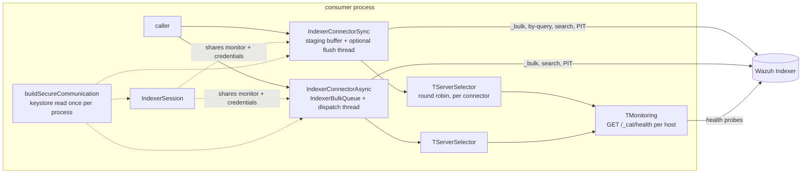

# indexer_connector — the manager's client library for the Wazuh Indexer

`libindexer_connector.so` is the only C++ path from a manager process to the Wazuh Indexer
(OpenSearch): `_bulk` writes, delete- and update-by-query, searches and points in time (PIT), over
libcurl (`urlrequest`), with one health monitor per host list, round-robin host selection and the
retry policy each write path can afford. It is not a daemon and has no configuration section of its
own: each consumer builds the connector's JSON from the `indexer` section of `wazuh-manager.conf`
plus its own internal options.

Three documentation layers cover it, each with its own job:

- **This README** — the developer's map: what the library guarantees and where that is pinned
  ([requirements](#requirements)), why it is built this way ([design decisions](#design-decisions-d1d25)),
  the consumer contract and the test map.
- **[`docs/ref/modules/indexer_connector/`](../../../docs/ref/modules/indexer_connector/README.md)**
  — the operator and integrator contract: flush and retry tables per status code, delete-by-query
  semantics, PIT refusals, indices, log lines, and the
  [configuration reference](../../../docs/ref/modules/indexer_connector/configuration.md) (the
  `indexer` section, keystore credentials, certificates). Facts stated there are not restated here.
- **[`testtool/README.md`](testtool/README.md)** — `indexer_connector_tool`, the developer CLI
  (`push-events`, `export-policy`, `generate-full-policy`) that the integration suite also drives.

Consumers, each linking the shared library into its own process:

| Consumer | Process | Classes used | Built in |
|---|---|---|---|
| Engine `wiconnector` | `wazuh-manager-analysisd` | `IndexerConnectorAsync` (no session), behind its own `IIndexerConnectorAsync` | `src/engine/source/wiconnector/src/windexerconnector.cpp` |
| inventory_sync_server | `wazuh-manager-modulesd` | `IndexerSession` + `IndexerConnectorSync` + `IndexerConnectorAsync`, behind adapters | `src/wazuh_modules/inventory_sync_server/src/indexer/` |
| vulnerability_scanner | `wazuh-manager-modulesd` | `IndexerSession` + one `IndexerConnectorSync` per scan slot | `src/wazuh_modules/vulnerability_scanner/src/vulnerabilityScannerFacade.cpp` |
| content_manager (indexer downloader) | `wazuh-manager-modulesd` | `IndexerConnectorSync` built per download, no session | `src/shared_modules/content_manager/src/components/IndexerDownloader.hpp` |

The Python framework has its own indexer client and does not use this library. task_manager links
`urlrequest` but not this library (its CMakeLists says so).

## Requirements

### Functional

| # | Requirement | Where |
|---|---|---|
| RF-1 | **Two connectors and a session.** `IndexerConnectorSync` stages writes in a byte-bounded buffer the caller (or a timer) flushes, and serves searches, PIT and by-query operations; `IndexerConnectorAsync` queues writes in an in-memory FIFO drained by one dispatch thread, and serves PIT and searches; `IndexerSession` owns one health monitor and one credential read that several connectors of one process share | `include/indexerConnector.hpp` |
| RF-2 | **Construction validates synchronously and throws `IndexerConnectorException`**: missing/empty `hosts` (checked first), a single CA file that does not exist (with several, a missing one throws `std::runtime_error` from `Utils::CertHelper::mergeCaRootCertificates()` instead), empty keystore credentials, `monitoring_interval_seconds` < 1, `max_retry_delay_seconds` below the base delay, a negative `request_timeout_seconds` (and, sync only, a negative retry budget). An unreachable host does not throw: it stays unavailable until the monitor sees it | `src/indexerConnectorSyncImpl.hpp`, `src/indexerSession.cpp`; component `SessionConstructsAgainstAnUnreachableHost`, `SessionRejectsANonexistentCaFile` |
| RF-3 | **TLS and credentials are resolved by one function**, `buildSecureCommunication()`: one CA is used as is, several are merged into `tmp/root-ca-merged.pem`; the username and password come from the keystore's `indexer` column family, read **once per process** (function-local statics) and never replaced by a built-in pair | `src/indexerTransport.cpp` |
| RF-4 | **Health monitoring**: `GET /_cat/health` per host (5 s timeout) every `monitoring_interval_seconds` (default 10), one synchronous round at construction. `green`/`yellow` is Available, a `429` is Throttled (stays in rotation), anything else is Down; the `PERMANENT` breaker warning needs 3 consecutive probes | `src/monitoring.hpp`; `monitoring_test.cpp` |
| RF-5 | **Host selection**: round robin preferring Available over Throttled, throwing `No available server. …` only when every host is Down. `isAvailable()` and `hasAvailableServer()` never move the cursor; one request consumes one selection | `src/serverSelector.hpp`; `serverSelector_test.cpp`, sync `BulkOnlyFlushConsumesExactlyOneHostSelection` |
| RF-6 | **Data-stream writes are idempotent only with an id.** `indexDataStream(index, id, data)` puts the JSON-escaped `_id` in the `create` action **at enqueue**; the queue stores the serialized action, so every resend repeats it. An id longer than 512 bytes throws and queues nothing; an empty id queues the two-argument action. The two-argument overload stays non-idempotent | `src/indexerConnectorAsyncImpl.hpp` (`MAX_DOC_ID_BYTES`); `BulkIndexDataStreamIdLengthLimit`, `DataStreamIdSurvivesRetry`, `DataStreamIdSurvivesSplitAndMix`, component `AsyncDataStreamResendIsDeduplicated` |
| RF-7 | **An applied `create` is not an error**: a per-item `409` with `version_conflict_engine_exception` on `create` inside a 2xx `_bulk` counts in `getDeduplicatedEvents()`, is never resent nor counted as dropped, and logs one WARNING per streak. Any other 409 is a per-item error | `isAppliedCreateConflict()`; `AppliedConflictsCountedAndWarnedOnce`, `AppliedConflictWarnIsEdgeTriggered`, `OtherConflictsAreNotDeduplicated` |
| RF-8 | **Async per-item requeue**: items an HTTP 200 `_bulk` rejected with `cluster_block_exception` or a per-item `429` go back to the **front** of the queue in their original order, the next send is backed off, `getRequeuedEvents()` counts each requeue; a response whose items cannot be matched to the batch requeues nothing and leaves the backoff as it is | `IndexerBulkQueue::requeueFront()`; `MixedRejectionsRequeueOnlyBlockedAndThrottledItemsInOrder`, `UnparseableOrItemlessResponseRequeuesNothing` |
| RF-9 | **Async status policy**: no response or `429` retried without limit; `503` retried up to 10 consecutive answers to the head batch, then discarded; `500`, `502`, `504` and others discarded; every discarded batch adds to `getDroppedEvents()` with a rate-limited summary every 30 s; `413` halves the bulk threshold (a batch that cannot shrink below 4096 bytes is dropped, logged once, not counted) | `src/indexerConnectorAsyncImpl.hpp` (`MaxUnavailableRetries`, `MINIMAL_BULK_BYTES`); `ServiceUnavailableIsDiscardedAfterRetryLimit`, `HandleBadGatewayIsNotRetried`, `GatewayTimeoutIsNotRetried`, `DiscardSummaryCountsEachCause` |
| RF-10 | **Async queue**: FIFO, so a `deleteById()` is applied after a pending `index()` of the same document; byte-bounded by `max_queue_bytes` (0 = unlimited), overflow dropped and counted; in memory only, so pending events are lost at stop | `src/indexerBulkQueue.hpp`; `BulkDeleteIsAppliedAfterAnIndexOfTheSameDocument`, `QueueSizeLimitEnforcedWithSlowProcessing`, `indexerBulkQueue_test.cpp` |
| RF-11 | **Sync status policy**: `429`, transport failures and `502`/`503`/`504` retried within a budget of `max_retry_attempts` (default 5) and `max_retry_duration_seconds` (default 15) drawn from **one** deadline per operation; the chunks of a `413` split share their flush's budget; exhaustion throws `Category::RetryExhausted`; `500` and other statuses drop the batch and throw | `isRetryableServerError()`, `IndexerRetryBudget` in `src/exponentialBackoff.hpp`; `IndexerConnectorSyncServerUnavailableTest`, `SplitChunksShareTheFlushRetryAttempts`, `SplitChunksShareTheFlushRetryDeadline`, `RetryDeadlineFailsTheFlushPromptly` |
| RF-12 | **Sync responses are validated fail-closed**: a 200 `_bulk` is checked item by item (`validateBulkResponse()`); a delete answered `404 not_found` counts as done; a versioned `bulkIndex()` is a scripted `update` carrying `retry_on_conflict` (5) whose no-op is `ctx.op = 'none'`, and a 409 that survives it fails the flush; a missing `errors` field, missing `items` or unparseable body fails | `src/indexerConnectorSyncImpl.hpp`; `BulkResponseValidation*`, `ScriptedUpdateActionCarriesRetryOnConflict`, `BulkResponseUpdateItemVersionConflictIsAFailure` |
| RF-13 | **By-query operations confirm what they claim**: delete-by-query (`conflicts: "proceed"`) and `executeUpdateByQuery()` fail on shard `failures` or an unparseable body, retry `version_conflicts` on their own allowance (3 attempts, 3 s base) inside the shared wall bound, and fail with `Category::ConflictsExhausted` when it runs out; staged queries are dropped when a flush fails | `retryAfterVersionConflict()`; `IndexerConnectorSyncDeleteByQueryOutcomeTest`, `IndexerConnectorSyncConflictRetryTest`, `AnUpdateByQueryThatExhaustsItsConflictAllowanceFailsAsContention`, `DeleteByQueryError409ThrowsAndDropsTheStagedQuery` |
| RF-14 | **PIT and search reads refuse partial answers**: PIT creation sends `allow_partial_pit_creation=false` (refusal `503`), PIT searches send `allow_partial_search_results=false` (refusal `500`), and the async search on an index or alias does too; failures keep the indexer's status in `statusCode()`; only `429` is retried inside (sync, within the budget). The sync `executeSearchQuery()` and `executeSearchQueryWithPagination()` are not covered | both Impl headers; `CreatePointInTimeRequestsNoPartialResults`, `SearchWithPitRequestsNoPartialResults`, `SearchByIndexRequestsNoPartialResults`, `SearchWithPitFlagRefusalKeepsStatus` |
| RF-15 | **`flush_interval_seconds = 0` starts no sync flush thread**: every flush is the caller's, and a failed flush reaches the caller | sync `ZeroFlushIntervalStartsNoBackgroundThread`, `TimerFlushFailureIsReportedToTheOwningCaller`, `NonZeroFlushIntervalStartsTheBackgroundThread` |
| RF-16 | **`registerNotify()` callbacks run only after a confirmed write** (a validated bulk, a 413 split whose every chunk validated, a staged delete-by-query alone, a confirmed update-by-query), outside the internal mutex; a failed bulk keeps them, a failed update-by-query discards them | `include/indexerConnector.hpp`; `RegisterNotifyCallbacksNotCalledOnError`, `DeleteByQueryWithBulkDataTriggersNotifyOnce` |
| RF-17 | **Index names are allowlisted** (`[a-zA-Z0-9._*-]`, non-empty) before they reach a URL: on the sync connector everywhere (bulk actions included), on the async connector in `createPointInTime()` and `search(index, …)`; a refused name throws `IndexerConnectorException` (`statusCode()` 0) before any request. The async bulk actions (`index`/`delete`/`create`) check only for an empty name | `isSafeIndexName()` in `src/safeIndexName.hpp`, one definition for both; sync `IsSafeIndexName_Allowlist`, `BulkIndex_RejectsIndexWithSlash` and siblings; async `CreatePointInTimeRejectsUnsafeIndexName`, `SearchRejectsUnsafeIndexName`, `PitAndSearchAcceptAllowlistedIndexNames` |
| RF-18 | **Observability for callers**: async `getQueueSize()`, `getDroppedEvents()`, `getRequeuedEvents()`, `getDeduplicatedEvents()`; sync `takeBulkRequestStats()` (requests, bytes, conflict waits — reset on take); `IndexerConnectorException::category()` and `statusCode()` | `include/indexerConnector.hpp`; `BulkRequestStatsCountEveryAttemptAndResetOnTake`, `FlushFailuresCarryTheirCause` |

### Non-functional

| # | Requirement |
|---|---|
| RNF-1 | **Manager-only, SHARED.** Registered in the `if(NOT IS_AGENT)` branch of `src/CMakeLists.txt`, built as `add_library(indexer_connector SHARED …)` with `BUILD_RPATH "$ORIGIN/../lib"`, installed by `InstallServer` in `src/init/inst-functions.sh` as `lib/libindexer_connector.so` (root:wazuh-manager 0750, the row in `.github/actions/check_files/manager_base.csv`) |
| RNF-2 | **Language levels.** The library compiles as C++20 (`CMAKE_CXX_STANDARD 20`), but the engine (C++17) includes `include/indexerConnector.hpp`: the public header must stay C++17-clean |
| RNF-3 | **Opaque public surface.** `IndexerSession` and both connectors are PImpl facades; `nlohmann::json` is the only third-party type in the public header. libcurl, simdjson and the keystore stay behind `src/` (`target_link_libraries(… PRIVATE …)`). RocksDB is not linked directly: the library has no RocksDB code, and the static `keystore` archive brings its own `rocksdb` link (the unit target relies on the same) |
| RNF-4 | **Logging.** `LoggingContext` = (caller name, log function); each connector tags its lines `<caller>(indexer-connector)` (`indexer-connector` when the name is empty). The log sink is per DSO and `Log::assignLogFunction()` only sets an unset one, so in a process the first connector that supplies a function decides it |
| RNF-5 | **Credentials are cached for the process lifetime**: rotating the indexer username/password takes a restart of every consumer process (`wazuh-manager-modulesd`, `wazuh-manager-analysisd`) |
| RNF-6 | **Every request is bounded**: `request_timeout_seconds` (default 60, 0 disables) on data requests, 5 s on health probes |
| RNF-7 | **Dual licence.** `GPL-2.0-only OR AGPL-3.0-or-later` (`COPYING`); in the dual scope of `.github/scripts/spdx_scope.py`, so every source file carries the SPDX line (this `.md` does not need one) |

## Design decisions (D1–D25)

Numbered and append-only: a changed decision gets a new number that supersedes the old one.

| # | Decision | Why (evidence) |
|---|---|---|
| D1 | **One credential/TLS function in its own translation unit** (`src/indexerTransport.cpp`), shared by both connectors and `IndexerSession` | The block was duplicated byte for byte between the two Impl headers, so "both variants validate identically" was kept by hand; in one TU it is structural, and the credential mutex and cache become unique process-wide, so `queue/keystore` is opened once per process instead of once per connector class (`src/indexerTransport.hpp`). The unit test target compiles that file in for the same reason (`tests/unit/CMakeLists.txt`) |
| D2 | **No built-in credential fallback**: empty keystore credentials throw | Substituting a credential every installation shares turned a missing key into an authentication attempt with a known password, and its warning scrolled past unread; the resolver refuses to start the manager without the key, so reaching the connector empty means the keystore was emptied behind a running manager (comment in `src/indexerTransport.cpp`) |
| D3 | **`hosts` is validated before anything else** | Cheapest and most common failure; checking it first keeps a hosts-less configuration from opening `queue/keystore` (RocksDB) on its way to throwing. The only visible change: with both a missing CA and no hosts, the hosts error is reported (constructor comments in both Impl headers, `src/indexerSession.cpp`) |
| D4 | **`IndexerSession`: one monitor, one keystore read, one CA merge per process**, adopted by connectors through the session-taking constructors; the session is not retained (the monitor is reference-counted) | Without it every connector runs its own synchronous `GET /_cat/health` round (5 s timeout per host) in its constructor, so a process holding a sync and an async connector pays twice (`include/indexerConnector.hpp`). Pinned by component `TwoConnectorsSharingASessionCostOneHealthCheckRound`, `AConnectorKeepsWorkingAfterItsSessionIsDestroyed` |
| D5 | **A connector's `hosts` must equal its session's**, checked at construction (`makeSharedSelector()`) | The monitor's server map is fixed at construction and `TMonitoring::isAvailable()` throws `std::out_of_range` for an unknown host; the check turns a configuration mistake into a clear exception instead of a failure on the first request, and lives in one place so both facades cannot drift (`src/indexerSession.hpp`) |
| D6 | **The round-robin cursor stays private to each selector** even when the monitor is shared | Sharing it would widen the value-based wrap-around detection in `getNext()`, which can miss its own starting index when several threads advance one cursor (`src/serverSelector.hpp`) |
| D7 | **`IndexerSessionData` is not in the public header** | `TMonitoring` is templated on `HTTPRequest`; exposing it would pull libcurl into every consumer TU (`src/indexerSession.hpp`) |
| D8 | **Availability probes never move the cursor; a host is consumed only by the request sent to it** | Every probe (the inventory sync `/stats` and `/config` handlers call `isAvailable()`) would otherwise skip a healthy host for the next real request and bias the distribution (`src/serverSelector.hpp`) |
| D9 | **A `429` on the health probe keeps the host in rotation (Throttled); Available hosts are preferred** | A 429 is an answer: the node is alive but shedding load, and requests sent to it back off on their own 429s; only a host that did not answer usefully is Down (`src/monitoring.hpp`, `getNext()` in `src/serverSelector.hpp`) |
| D10 | **The heap-sizing WARNING needs 3 consecutive `PERMANENT` breaker probes** | OpenSearch labels a parent-breaker trip `PERMANENT` whenever fielddata outweighs the transient breakers, and its forced GC runs at most every 5 s, so one probe can trip on garbage the next collection frees (seen during a rolling restart); only a breaker that survives several forced collections says the live heap is too small (`PERMANENT_BREAKER_WARNING_PROBES`) |
| D11 | **Sync retries `502`/`503`/`504` like a `429`; `500` is never retried** | Resending is idempotent because every production sync caller passes an `_id`; a 500 may be deterministic and would only burn the budget (`isRetryableServerError()` comment and the commit that introduced it) |
| D12 | **Async retries `503` (up to 10) but discards `502`/`504`/`500`** | A 503 is a refusal before processing, so retrying is safe but not forever; 502/504 may mean the bulk was processed and the answer lost, and resending a data-stream action without an `_id` would duplicate documents; 500 may be deterministic and would block the queue head. Once the engine sent an `_id`, the 502/504 policy was kept unchanged by decision (code comments in `src/indexerConnectorAsyncImpl.hpp`, operator reference) |
| D13 | **The data-stream `_id` is minted by the caller and serialized at enqueue; a 409 on `create` counts as applied** | The queue stores the serialized action, so every resend (timeout, transport failure, 503, 413 split, per-item requeue) carries the same `_id` and the indexer answers an already applied one with 409 instead of indexing it twice; the change added the overload without altering the two-argument one (header comment on `indexDataStream()`, its commit). The engine's `generateDocId()` is the only caller of the three-argument overload |
| D14 | **Per-item rejections are classified on the dispatch thread and nothing may escape the success callback** | Classified late on the logger thread, cluster-blocked and 429 items were discarded uncounted after the batch had left the queue; an exception in the success callback is reported as a transport failure, so the whole batch, already written documents included, would be resent (comment in the dispatch callback, the requeue commit) |
| D15 | **The requeue decision is recorded before any log line** | A failing log line (allocation failure) used to make the handler report the batch as unclassified although its items were already requeued, and a second failing line escaped the callback and resent the whole batch (the follow-up commit; comment "Not even this log line may escape") |
| D16 | **A `_bulk` answer whose head says `"errors":false` skips item parsing and the logger** | Parking a full copy of payload and response in the logger queue was the main RSS driver under sustained load (comment above `bulkResponseHasErrors()`'s call site) |
| D17 | **An async batch that cannot shrink under `413` is dropped, not thrown** | Throwing would make the queue requeue and retry the same batch forever, since it can never fit (comment at the 413 branch) |
| D18 | **Sync retries are bounded by attempts and one wall clock per operation** | Without a budget a persistent 429 or an unreachable indexer blocks the flushing worker, and the inventory sync shard behind it, forever; sized to fail before the caller's response window (remoted's downstream response timeout, 20 s by default). Separate windows per index and for the conflict allowance let a flush outlive that window, after which the agent re-sends the session that causes the conflict (`DEFAULT_MAX_RETRY_ATTEMPTS` comment, `budgetLeft()`, the one-wall-clock commit) |
| D19 | **`request_timeout_seconds` bounds every data request** | Unreachable hosts are the monitor's job; this bound is the only thing that catches a host that accepted the connection and never answers, which otherwise blocks the caller inside `curl_easy_perform` forever (`m_requestTimeoutMs` comment) |
| D20 | **The first backoff is drawn above the base delay** (`[base, 1.5 × base]`) | Never faster than configured, yet connectors that failed in the same instant do not retry in lockstep (`IndexerExponentialBackoff::nextDelay()`) |
| D21 | **A by-query version conflict is retried on its own allowance: 3 attempts, 3 s base** | A delete-by-query searches refreshed segments only, so a clean right after a bulk of the same documents conflicts on writes acknowledged but not refreshed; treating that as failure made the session answer 500 and the agent re-POST into the same race. The condition clears itself, so the idempotent query is re-run. The base is 3 s because `wazuh-states-sca` refreshes every 5 s and the second delay is drawn from `[base, 2 × base]`: measured against a real indexer, a 2 s base converged 6/10, 3 s 10/10 (`CONFLICT_RETRY_ATTEMPTS` comment and the two commits that set it) |
| D22 | **A bulk delete answered `404 not_found` counts as done** | The delete's goal is met, and counting it as a failure failed every inventory sync session of the flush whenever another item set `errors:true`, making agents resend the same delete; the async connector already ignored the same item. A delete on a missing index still fails (the commit that changed `validateBulkResponse()`) |
| D23 | **Versioned upserts skip a stale document with `ctx.op = 'none'` and carry `retry_on_conflict`; a 409 that survives fails the flush** | `'noop'` is skipped too but makes OpenSearch log a WARN per document, flooding the indexer log during resyncs (`_update_by_query` keeps `'noop'`, the only value that API accepts); `retry_on_conflict` re-applies a write refused by a concurrent group or metadata update (comments above the update builder in `src/indexerConnectorSyncImpl.hpp`, the two commits) |
| D24 | **PIT creation and searches ask the indexer to refuse a partial answer** | While a node is stopping OpenSearch answers 200 without that node's shards; a PIT created that way keeps the gap for every later search, which then reports a complete answer, while callers take the read as the whole answer (the engine's content space, the vulnerability feed's cursor). Refusals carry the indexer's status so a 404 still means missing (the commit that added the flags, operator reference) |
| D25 | **The library is dual-licensed** | It is linked both by the AGPLv3 engine and by GPLv2-only code; authored by Wazuh, it takes `GPL-2.0-only OR AGPL-3.0-or-later` so each consumer uses the licence that matches it (the dual-licensing commit, `COPYING`) |

## Architecture



The facades (`src/indexerConnectorSync.cpp`, `src/indexerConnectorAsync.cpp`) instantiate the
templates `IndexerConnectorSyncImpl<TServerSelector<HTTPRequest>, HTTPRequest>` and
`IndexerConnectorAsyncImpl<…>`; the template parameters (sizes, delays, `MaxUnavailableRetries`,
`ConflictRetryDelayMs`) let the unit tests instantiate the same code with a mock HTTP request and a
mock selector (`tests/unit/CMakeLists.txt` compiles the templates in directly); `ConflictRetryDelayMs`
was made a parameter so those tests do not pay the 3 s conflict wait. In the sync connector the retry sleep waits on its own mutex
(`m_retryMutex`), because `processBulk()` holds `m_mutex` while running and reusing it would
self-deadlock. The async connector writes per-item error diagnostics through a bounded logger queue
(`logger_queue_size` default 8, `logger_threads` default 1): when it is full only log lines are lost.

## Layout

| File | Responsibility |
|---|---|
| `include/indexerConnector.hpp` | The whole public contract: `IndexerSession`, `IndexerConnectorSync`, `IndexerConnectorAsync`, `PointInTime`, `IndexerBulkRequestStats`, `IndexerConnectorException` (`Category`, `statusCode()`). Read this first |
| `src/indexerConnectorSyncImpl.hpp` | Sync template: staging, flush thread, `413` split, response validation, retry budget, by-query and conflict retry, search/PIT |
| `src/indexerConnectorAsyncImpl.hpp` | Async template: action serialization (`_id` escaping, 512-byte limit), dispatch callback (classification, requeue, dedup, discard windows), PIT/search |
| `src/safeIndexName.hpp` | `isSafeIndexName()`, the index-name allowlist both templates apply |
| `src/indexerBulkQueue.hpp` | Byte-bounded FIFO with batch dispatch, `requeueFront()`, shared backoff, overflow accounting |
| `src/exponentialBackoff.hpp` | `IndexerExponentialBackoff` (jittered) and `IndexerRetryBudget` (attempts + deadline) |
| `src/serverSelector.hpp`, `src/monitoring.hpp` | Host selection and the health monitor (`HostState`: Available / Throttled / Down) |
| `src/indexerTransport.{hpp,cpp}` | `buildSecureCommunication()`: CA merge, client pair, keystore credentials |
| `src/indexerSession.{hpp,cpp}` | `IndexerSession::Impl`, `IndexerSessionData`, `makeSharedSelector()` |
| `src/indexerConnector{Sync,Async}.cpp` | PImpl facades over the templates |
| `testtool/` | `indexer_connector_tool` (not installed) — [its README](testtool/README.md) |
| `qa/` | Integration suite against a real OpenSearch |

## Consumer contract

What a caller must obey; the operator-visible consequences are in the
[operator reference](../../../docs/ref/modules/indexer_connector/README.md).

- **Writing to a data stream: pass a per-write `_id`** through `indexDataStream(index, id, data)`,
  generated once per document by the caller, at most 512 bytes and valid UTF-8 (escaped but not
  validated: an invalid one makes the indexer reject the whole bulk). Dedup is per backing index, so a
  resend across a rollover still duplicates. inventory_sync_server's `IIndexerConnectorAsync`
  (`src/wazuh_modules/inventory_sync_server/src/indexer/IIndexerConnectorAsync.hpp`) exposes only the
  two-argument overload: a data-stream writer added there duplicates on resend.
- **Sync writes without an `_id` are not idempotent** on resend (502/504 or transport failure).
- **Retry whole reads yourself.** A PIT or search refusal (`503`/`500`) and any non-429 failure reach
  the caller; repeat the whole read.
- **A failed sync flush means re-stage.** Every `Category` is a failed operation; the buffer and the
  staged by-query requests are gone. Use `flush_interval_seconds = 0` when the caller must answer for
  each flush (inventory sync does).
- **Update-by-query must be cheap to re-run**: gate it by version or make the script go
  `ctx.op = 'noop'` when the document already matches, since conflicts and retries re-run it.
- **Delete-by-query only sees refreshed documents**; `refresh()` needs `indices:admin/refresh`.
- **Connectors sharing a session must use the session's `hosts`**; `monitoring_interval_seconds`,
  `ssl.*` and credentials come from the session.
- **Call `registerNotify()` under `scopeLock()`** and `invokePendingCallbacks()` after releasing it.
- **Async stop discards the queue**: nothing in memory survives the process.
- **Restart to rotate credentials** (RNF-5).

## Tests

| Suite | Target / ctest label | Files | Pins |
|---|---|---|---|
| Unit | `indexer_connector_utest` | `tests/unit/*.cpp` (+ `src/indexerTransport.cpp`), mocks in `tests/unit/mocks/` | Both Impl templates against `MockHTTPRequest`/`MockServerSelector`: every status path, the budget, splits, response validation, requeue/dedup/discard windows, PIT flags, index allowlist, concurrency oracles (`ConcurrentStagersAndFlushersDeliverEveryDocumentExactlyOnce` and siblings); the queue, backoff, monitor, selector and session alone |
| Component | `indexer_connector_ctests` | `tests/component/` | The real shared library against `FakeIndexer` (cpp-httplib) on local ports: health and selection, bulk/delete/by-query round trips, data-stream dedup on resend, session sharing cost and lifetime |
| Integration | pytest | `qa/test_efficacy_log.py` | `indexer_connector_tool` against `opensearchproject/opensearch:2.11.1` in Docker: every event indexed (sync and async), `413` split until everything lands, a rejected document fails the flush, an outage loses nothing, repeated flushes do not resend |

The ctest label is the test directory's `project()` name (`set_tests_properties(… LABELS
${PROJECT_NAME})`). From `src/`, in a tree configured with `UNIT_TEST=ON`:

```bash
cmake --build build -j --target indexer_connector_utest indexer_connector_ctests
ctest --test-dir build -L indexer_connector_utest
ctest --test-dir build -L indexer_connector_ctests
```

The unit and component suites seed credentials into `queue/keystore` relative to the working
directory; two session cases in `sharedIndexerSession_test.cpp` `GTEST_SKIP` when that fails.

CI:

- `.github/workflows/5_testunit_indexerconnector.yml` — `indexer_connector_utest` with coverage
  (lines gated at the default floor, functions not gated) and an ASAN job; no `allowed_skips`, so the
  skips above stay invisible.
- `.github/workflows/5_testcomponent_indexer-connector.yml` — `indexer_connector_ctests`, legs
  `valgrind` (an unsanitized build; no valgrind runs) and `asan`, `allowed_skips: "0"`.
- `.github/workflows/5_testintegration_indexer-connector.yml` — builds `indexer_connector_tool`, runs
  the `qa/` suite, and fails on any skipped case.

The reproduction details of each lane (and why the OpenSearch port 9200 must be free) are in the
`wazuh-testing` skill.
