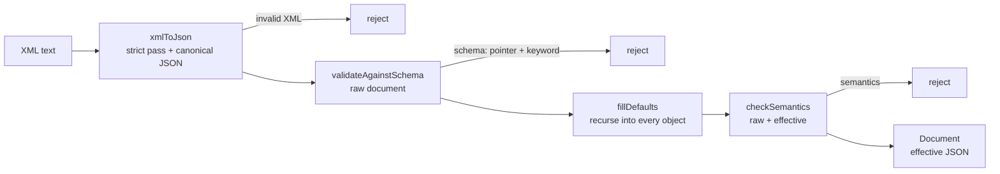

# manager_config — loader of the manager configuration (`/etc/wazuh-manager/wazuh-manager.conf`)

Manager-only C++17 static library that turns `/etc/wazuh-manager/wazuh-manager.conf` (strict XML) into the **effective
configuration** (parsed XML, validated against the embedded JSON Schema, defaults filled, cross-field
semantics checked) and exposes it as canonical JSON to the C daemons (`manager_config_c.h`) and as a C++
class (`manager_config.hpp`). It replaces the pseudo-XML `ReadConfig`/`os_xml` path and the "bypass"
readers of the manager (`<logging>`, `<cluster>`, `<indexer>`). `agent.conf` and the agent stay on
`os_xml`.

Consumers: `bin/wazuh-manager-conf` (also run by the installer to validate the generated file); the C
daemons remoted, authd, wazuh-db and modulesd through libconfig's `w_mconf_*()`
(`src/config/src/mconf-config.c`: one load per process without file checks, `-t` validates with them,
`getconfig` returns the effective sections); the cluster getters and the logging format inside libwazuh
through the `w_mconf_hook_*` provider; the engine (`wazuh-manager-analysisd`) through the C++ API —
`src/engine/source/base/src/managerConfig.cpp` links the `manager_config` target, loads the document
once and reads its sections directly (for example the logging format, `managerConfig::logFormat()`);
`bin/wazuh-manager-certs` through the C++ API (`src/shared_modules/manager_certs/CMakeLists.txt`);
`wazuh-server.sh` (`validate` before any daemon `-t`, `get cluster.node_type`, `get auth.disabled`); the
credential resolver (`src/init/credentials/wazuh-manager-resolve-credentials.py`, which runs the CLI's
`dump` for the configured TLS paths); and the Python framework (`wazuh.core.manager_conf` consumes
`dump`/`validate` of the CLI — there is no second implementation of the language).

## Requirements

| # | Requirement | Where |
|---|---|---|
| RF-1 | Strict XML: exactly one `<wazuh_config>` root; entities decoded; raw `&`, `--` inside comments, legacy `<! !>` comments and a second root are rejected with the offending line | `src/xmlToJson.cpp` |
| RF-2 | Canonical JSON with the schema's types: `yes`/`no` → boolean, digits → integer where allowed, repeated or comma-separated values → arrays, the attribute forms of the dialect (`<backup database="…">`, `<disconnected_time enabled="…">`) → nested objects, enums matched in any case and normalized to the schema's spelling | `src/xmlToJson.cpp` |
| RF-3 | Validation against the embedded draft-04 schema; each error is reported with its JSON pointer and keyword — the first by the loader, every one, in the order of the file, by `validateAll()` (`wazuh-manager-conf validate`) | `src/schemaValidate.cpp`, `src/manager_config.cpp` |
| RF-4 | Defaults declared in the schema are filled into the effective document (a missing section = its defaults) | `src/defaults.cpp` |
| RF-5 | Uniform, fatal cross-field rules: certificate/key pairing, no `.`/`..` prefix segments, distinct listener ports, existence of the HTTPS/authd certificate files (relative to the manager home; nothing recreates them at start — the credential resolver issues them once at installation, or the operator provisions them, e.g. with wazuh-certs-tool — so the `file not found` verdict carries that hint; the existence of `indexer.ssl.*` is not checked here: the credential resolver owns those files — imported from the indexer's export or staged by the operator — and refuses the start itself, before any daemon runs, when they are missing), and the location of `indexer.ssl.*` (directly in `/etc/wazuh-manager/certs`, the resolver's rule) | `src/semantics.cpp` |
| RF-6 | `sectionJson()` / `documentJson()` canonical JSON (cJSON-parseable); C API without exceptions or C++ types across the boundary | `src/manager_config.cpp`, `src/manager_config_c.cpp` |
| RNF-1 | C++17, STATIC, manager only, pugixml + rapidjson PRIVATE | `CMakeLists.txt` |
| RNF-2 | Schema embedded at build time (`generated/embeddedSchema.hpp`) | `CMakeLists.txt` |
| RNF-3 | Input limits: 1 MiB, depth 16; no DTD/external entities (pugixml has no DTD processing at all) | `src/xmlToJson.hpp` |

## Design decisions

- **Schema as the single source of truth** (`schema/wazuh-manager.schema.json`): types, ranges, enums, defaults and
  descriptions of the 69 leaf options (the count `managerConfig_test.cpp`'s leaf guard pins) — byte-identical to the
  YAML PoC's schema, so the 5.1 XML→YAML conversion is a backend swap. Draft-04 because it is what rapidjson's
  validator implements and what the Python framework uses (`jsonschema.Draft4Validator`). Definitions (`duration`,
  `size`, `port`…) are reused through `allOf: [{$ref}]`.
- **Schema-driven typing** over the pugixml DOM: the target type of every element decides the conversion, so
  `<disabled>no</disabled>` is the boolean `false`, `<port>1514</port>` is an integer, `<protocol>tcp,udp</protocol>`
  and `<hosts><host>…</host></hosts>` are arrays, and `true`/`false` fail with `type` ("booleans are yes/no" — the hint is added only when the option expects a boolean).
  Text is otherwise kept verbatim — whitespace included — so the schema names what is wrong.
- **Strictness pass over the raw text** before conversion: pugixml tolerates an unescaped `&` that is not a valid
  reference and `--` inside comments; both are rejected with their line, like every malformed-XML error
  (`invalid XML: … (line N)`, computed from pugixml's byte offset).
- **Validate the raw document, then fill defaults, then check semantics.** The effective document may therefore contain
  values the schema would reject on input for an optional section a consumer treats as non-fatal when absent (e.g.
  `remote.legacy` disabled and unconfigured): the schema's own root `required` (`cluster`, `indexer`)
  covers the sections that are never optional in practice, so a `validate` failure at PUT time replaces a startup
  crash for those; there is no more general re-validation of the effective document.
- **Defaults algorithm**: for every property of an object schema missing in the document, insert its
  `default` when declared (property or resolved `$ref`), else an empty object when it is an object schema; recurse into
  object properties. Options without `default` (`remote.legacy.local_ip`, `remote.https.verification_mode`,
  `auth.legacy_enrollment`, `task-manager.wpk_repository`) stay absent: absence is
  meaningful ("module default / inferred"); the required `cluster.key` and `indexer.hosts` have none either. A
  default the consuming module applies anyway is declared in the schema (`remote.https.ciphers`, `max_body_size`,
  `dual_stack` carry remoted_module's built-in values), so the effective document shows what is in force.
- **Ports**: a listener that binds nothing does not reserve its port: the legacy one unless
  `remote.legacy.enabled`, and `auth.port` unless authd binds it — `auth.disabled: no`, `auth.remote_enrollment: yes`
  and `auth.legacy_enrollment` (when unset, `remote.legacy.enabled`), the same condition authd applies.
  `remote.https.port` and `cluster.port` always do.
- **Files**: `LoadOptions::checkFiles` (default on) resolves relative paths against `LoadOptions::home` and uses absolute
  ones as they are. The certificate/key defaults are absolute (`/etc/wazuh-manager/certs/...`, the fixed configuration
  directory, which a custom home never moves), so unit tests turn the checks off or name the files explicitly under a
  temporary home; an operator-written relative path still means "relative to the manager home". Only `remote.https.{certificate,key,ca,ca_certificate}` and
  `auth.{ssl_agent_ca,ssl_manager_cert,ssl_manager_key}` are checked, and an empty value is skipped.
- **`indexer.ssl.*` is checked for its location, never for its existence.** The credential resolver may import the
  indexer CA and the connector pair from a co-located indexer's export at `--prestart`, which runs after the
  file-checked validation of a start, so requiring the files would refuse a fresh co-located start. Where they lie is
  the configuration's alone, and the resolver refuses any path outside `/etc/wazuh-manager/certs` before it looks for
  the file (error 22) — a 4.x `/etc/filebeat/certs/...` passed `validate` and then stopped the start. With file
  checks on, each listed CA, `certificate` and `key` must therefore pass the resolver's `certs_name()` rule: resolved
  against the home (so a relative path is refused), no empty, `.` or `..` component, and directly in
  `Utils::MANAGER_CONF_DIR/certs`. It is a file check because it is about this host's layout, and because the
  resolver reads the document through `dump --skip-file-checks`. The two copies of the rule are kept identical by
  hand.
- **`cluster.key` is required and has no default**: a well-known default key would be a shared secret; the installer
  always generates one. `cluster` and `indexer` are the only `required` properties at the document root:
  every manager runs as a cluster node, and `wazuh-manager-analysisd` cannot start with zero indexer hosts,
  so a document that omits either section, or one whose `<cluster>` omits `<key>`, fails with `required` at
  `validate` time instead of leaving the effective document with a gap that only breaks a daemon on restart.
- **The schema refuses what remoted's reader refuses**, so `validate` (and an API `PUT`) is the whole verdict on
  those options instead of a `wazuh-manager-remoted -t` at the next restart: `#/definitions/ip` (`remote.legacy.local_ip`,
  `remote.https.bind_addr`) is a pattern for exactly the addresses `OS_IsValidIP()` returns `1` for (one IPv4
  dotted quad, optionally `::ffff:`-prefixed, or one full or compressed IPv6 address; no CIDR, netmask, `any` or host
  name — the `!` negation it also tolerates is refused, since it means nothing for a bind address), and the
  `remote.https` strings carry the `maxLength` of `remote-config.h` (255 for `bind_addr`, `global_prefix` and
  `ciphers`, 511 for the four paths). The pattern uses plain groups only: rapidjson's internal regex engine has no
  `(?:…)`, and its `^`/`$` anchor the whole pattern, so the alternation is wrapped in one group to read the same in
  Python. `cluster.bind_addr` is not an `ip`: clusterd binds it through asyncio, which also accepts a host name, so it
  is a `#/definitions/host` (a host name of dot-separated labels — letters, digits, `-` and `_`, which container names
  carry — or an `ip`); every `indexer.hosts` entry is a `#/definitions/url` (`http://` or `https://`, a host name,
  IPv4 address or bracketed IPv6 address, an optional `:port` and path), so `https://` alone is refused.
- **Durations and sizes stop where the readers would**: `w_parse_time()`, `w_parse_size()` and
  `Utils::parseStrToTime()` overflow on long digit strings (or throw, for `std::stol`), and the consumers keep the
  result in an `int` (`rids_closing_time` refuses more than `INT_MAX`, the task manager casts
  `agents_disconnection_time`). The `duration*` patterns therefore cap the digits per unit (9 in seconds, 7 in
  minutes, 5 in hours, 4 in days, 3 in weeks; at most 999999999 seconds) and the integer form carries the same
  `maximum`; `size` caps them so the byte count stays below 10^15, and refuses zero in any unit (`0K`), which
  remoted's reader refuses. Leading zeros stay free. An integer too long for `strtoll()` stays text in
  `xmlToJson`, so the pattern — not `maximum` — refuses it; `parity.py` mirrors that limit.
- **`remote.legacy.local_ip` has no default**: the installer omits it for an IPv6 listener so that remoted applies its own
  default.
- **An empty file is invalid** (XML needs a root); the minimal valid document is
  `<wazuh_config><cluster><key>...32 alphanumeric...</key></cluster><indexer><hosts><host>scheme://host:port</host>
  </hosts></indexer></wazuh_config>` — every other option keeps its schema default.
- **`validate` reports every problem in one run; the loader stops at the first**. A 4.x
  configuration carried into `wazuh-manager.conf` breaks dozens of rules, and fixing them one run at a time
  turned the migration into a loop. `validateAll()` therefore collects in three passes over one document:
  `xmlToJson` records element-level problems (a duplicate, stray text, a wrong list item, nesting too deep)
  and leaves that element out instead of stopping; the schema runs with rapidjson's
  `kValidateContinueOnErrorFlag` over what remains (each entry worded by the same `describe()` as the
  fail-fast error, and pointed at the offending key or item where rapidjson names its container); the
  cross-field rules then run on that document too — they read only values of the type the schema expects —
  skipping a pointer already reported. Only a document-level XML error (malformed text, the root) is alone,
  since nothing after it can be read. Errors are sorted by the position of their value in the document (a
  `required` one after the problems inside its object). Duplicates and stray text are reported only where the
  schema defines the members: an unknown element is rejected once, by `additionalProperties`, and what it
  holds or how often it repeats would bury that line (a default 4.14 manager configuration lists 23 problems
  instead of 62). `Document::parse()` and `validateFile()` keep the fail-fast validator: the daemons' `-t`,
  `dump` and `get` need one verdict. Both fail on exactly the same documents, and on every invalid vector
  the first error of `validateAll()` is, word for word, the one they report (pinned by the GTest).

## Architecture

`Document::parse()` (`src/manager_config.cpp`) runs the pipeline in one direction, stopping at the
first error (`validateAll()` runs the same stages but collects every error — see Design decisions):



Semantics rules read from the **raw** document where a schema default would otherwise mask the
operator's intent (certificate/key pairing — see Design decisions), and from the **effective** one
everywhere else (port collisions, file existence). The effective document is never re-validated
against the schema after `fillDefaults`: a `required` property with no default (`cluster`, `indexer`,
`cluster.key`, `indexer.hosts`) is what makes an absent section fail at the `validateAgainstSchema`
step instead of silently defaulting into a broken effective document.

## Layout

```
manager_config/
├── CMakeLists.txt                 # STATIC lib, schema embedding, tests under UNIT_TEST
├── schema/wazuh-manager.schema.json
├── include/manager_config/{manager_config.hpp, manager_config_c.h}
├── src/{xmlToJson,schemaValidate,defaults,semantics,manager_config,manager_config_c}.cpp
├── src/embeddedSchema.hpp.in       # configure_file() -> <build>/generated/embeddedSchema.hpp
├── cli/manager-conf.cpp            # bin/wazuh-manager-conf
└── tests/
    ├── unit/managerConfig_test.cpp   # target manager_config_utest
    ├── cli/manager_conf_cli_test.sh  # test manager_config_cli, over bin/wazuh-manager-conf
    ├── vectors/{valid,invalid}/*.conf + expected/*.json   # shared with parity.py
    └── parity.py                     # jsonschema Draft4 must agree with the library on every vector
```

## Consumer contract

- **Two APIs, one implementation**: C++ (`manager_config.hpp`, `Document::load`/`Document::parse`, and
  `validateAll`/`validateFileAll` for the whole list of problems) for the engine and `bin/wazuh-manager-conf`; a C ABI (`manager_config_c.h`, `mconf_load`/`mconf_load_ex`/
  `mconf_validate`) for the C daemons through libconfig's `w_mconf_*()` wrappers
  (`src/config/src/mconf-config.c`). Both call the same `Document::parse()` pipeline — there is no
  second validator to keep in sync.
- **Link**: `target_link_libraries(<your_target> PRIVATE manager_config)`. STATIC + PIC (RNF-1/RNF-2);
  the schema is embedded in **your** binary at build time (`generated/embeddedSchema.hpp`) — a schema
  change (e.g. a new `required` entry) only takes effect for a consumer after it is rebuilt and
  reinstalled, not merely after `bin/wazuh-manager-conf` is.
- **File checks**: `LoadOptions::checkFiles` / `mconf_load_ex`'s `check_files` (default on) resolve
  certificate/key paths against `home` and fail if they don't exist. Daemon start-up loads with
  `check_files == 0` (P44) — file existence is `-t`'s and `wazuh-manager-conf validate`'s job, not the
  plain loader's, so a daemon can come up with an as-yet-uncreated certificate and let `-t` catch it.
- **`mconf_t` is immutable** after `mconf_load_ex()` returns: concurrent `mconf_section_json()` /
  `mconf_document_json()` calls on one handle need no external locking. Do not add mutation on the C++
  side without re-checking every caller that relies on this (modulesd reads sections from arbitrary
  threads at arbitrary times).
- **Errors**: C++ callers get `Error{pointer, message}` (`what()` renders `"<pointer>: <message>"`, or
  just the message when `pointer` is empty); C callers get -1 and a filled `err` buffer. Render the
  pointer to the operator as-is — it is the schema location of the offending option, not a bug.
- **Ownership**: `mconf_section_json()`/`mconf_document_json()` return a `malloc`'d C string the caller
  `free()`s; `mconf_free()` releases the handle.

## Tests

```bash
cmake -S $WAZUH_REPO/src -B $WAZUH_REPO/src/build -DUNIT_TEST=ON
cmake --build $WAZUH_REPO/src/build -j --target manager_config_utest wazuh-manager-conf
ctest --test-dir $WAZUH_REPO/src/build -L manager_config --output-on-failure
```

`-L manager_config` is the module-wide ctest label and runs the three registered tests:
`manager_config_utest` (GTest over the library), `manager_config_cli` (the end-to-end script over
`bin/wazuh-manager-conf` — hence the second build target above, which is not a dependency of the test
binary) and `manager_config_parity` (registered when `find_program` finds a `python3` in `$TMP_PY_VENV/bin` — `/bin`
when the variable is unset — and nowhere else; it imports `jsonschema`, so a venv without it fails the
test rather than skipping it).
`-L manager_config_utest` selects the GTest alone. To run a suite by hand:

```bash
$WAZUH_REPO/src/build/shared_modules/manager_config/tests/unit/manager_config_utest
$TMP_PY_VENV/bin/python3 tests/parity.py schema/wazuh-manager.schema.json tests/vectors
```

CI runs all three on every PR touching `src/shared_modules/manager_config/**` (except this README),
`error_messages.h`, the installer files the CLI suite executes (`gen_wazuh.sh`, `shared.sh`,
`inst-functions.sh`, `template-select.sh` and the seven generic templates `WriteManager()` reads — it
validates the configuration the installer generates) or the configure and build inputs, via
`.github/workflows/5_testunit_managerconfig.yml` (its `paths:` list is the exact set): one job with the
installer text-handling suite and the three suites plus a
coverage report (uploaded, not gated) and an ASAN/UBSAN job that runs the GTest only — the CLI suite
asserts exact exit codes and an empty stderr, which a sanitizer's reports would break.

`parity.py` carries its own strict ElementTree-based XML→dict loader with the same schema-driven typing:
it is the reference for the Python framework and the seed of the 5.0→5.1 conversion tool.

## Errors

| Situation | Message |
|---|---|
| file missing, unreadable or larger than 1 MiB | plain message, empty JSON pointer (`configuration file not found: <path>` only when the path does not exist; `configuration file cannot be read: <path>: <system error>` for any other access error, a directory included; `… larger than 1048576 bytes: …`). The CLI checks the file itself first and reports a missing one as `(1239): Configuration file not found: '<path>'.` and any other access error as `(1244): Invalid configuration at '/': configuration file cannot be read: <path>: <reason>.`; the C daemons render the loader's message under `(1244)` |
| malformed XML, raw `&`, `--` in a comment, second root, wrong root | `invalid XML: … (line N)` / specific message with the line, empty JSON pointer |
| schema / semantics | JSON pointer + violated keyword (`/remote/https/port: does not satisfy 'maximum' … [schema …]`; the schema root shows as `[schema /]`). `bin/wazuh-manager-conf` renders it as `(1244): Invalid configuration at '<pointer>': <reason>.` (`'/'` for an empty pointer) — `validate` one such line per problem, `get`/`dump` the first only; the C daemons put the file path in the subject and `Error::what()` (`<pointer>: <reason>`) in the reason |

## License

Dual-licensed under `GPL-2.0-only OR AGPL-3.0-or-later`: the C daemons use it under GPLv2 and the engine under AGPLv3. See [COPYING](COPYING).
